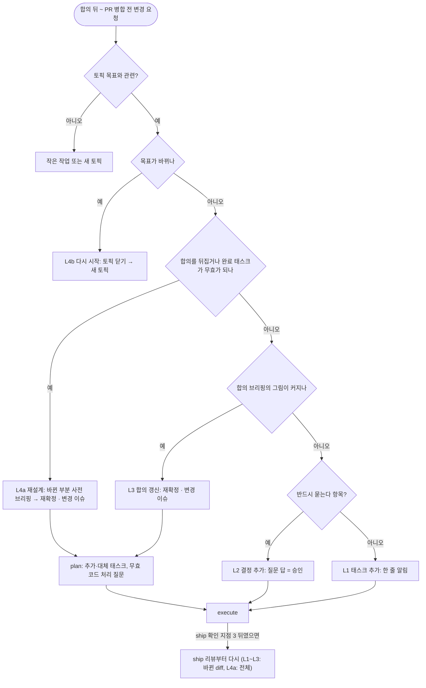

# 진행 중 변경 요청

합의 브리핑 확정 뒤부터 PR 병합 전까지(병합하지 않으면 브랜치를 정리하기 전까지) 개발자가 요구를 추가하거나 바꿀 때
읽는다. ship의 마지막 질문처럼 토픽을 아카이브한 뒤라도 이 기간 안이면 해당한다. 합의 전이면 discuss의 질의로
처리하고, 실험 모드는 [실험 모드](SKILL.md#실험-모드) 3을 따른다.

토픽 목표와 무관한 요청은 이 토픽에 넣지 않고 작은 작업이나 새 토픽으로 처리한다. PR 병합 뒤에 들어온 요청은
토픽을 다시 열지 않는다. 작은 작업이나 새 토픽으로 처리하고 아카이브를 근거로 참조한다.

## 수준 판별

위에서부터 확인해 처음 해당하는 수준으로 정한다. 판별 근거와 함께 수준을 알리고, 두 수준 사이에서 애매하면
높은 쪽을 제안해 개발자가 정한다. 개발자가 수준을 지정하면 그것을 따른다.

| 순서 | 질문 | 해당하면 |
|---|---|---|
| 1 | 토픽 목표가 바뀌는가 | L4b 다시 시작 |
| 2 | 합의한 결정·요구사항(R-n)·장애 시나리오(FS-n)를 뒤집거나, 완료한 태스크를 무효로 만드는가 | L4a 재설계 |
| 3 | 합의 브리핑의 그림이 커지는가: risk.md 호출 조건에 새로 해당, 새 장애 시나리오, 구조 결정(새 패키지·모듈, 데이터 구조, 레이어 배치), 외부 계약·데이터 보존 변경, 서로 엮인 결정 2개 이상, 개발자의 재확정 요청 | L3 합의 갱신 |
| 4 | discuss의 [반드시 묻는다](../workflow-discuss/SKILL.md#질문하는-방법) 항목에 해당하는가 | L2 결정 추가 |
| - | 모두 아님 | L1 태스크 추가 |

2번과 3번의 차이는 기존 합의를 뒤집는지(이미 한 작업이 무효가 되는지), 기존 합의 위에 보태는지다.

## 수준별 처리

개발자의 변경 요청은 수준과 관계없이 BRIEF의 "변경 요청"에 C-n으로 기록한다. 새로 생긴 요구사항·결정·태스크에는
C-n을 붙인다.

| 수준 | 개발자 확인 | 문서 | 진행 중인 태스크 | 이슈 |
|---|---|---|---|---|
| L1 태스크 추가 | 묻지 않고 한 줄로 알린다 | DESIGN에 태스크 추가 | 계속한다 | 기존 이슈 |
| L2 결정 추가 | discuss의 질문 방법으로 묻는다. 답이 승인이다 | 요구사항 R-n, DESIGN 결정·태스크 추가 | 결정에 의존하지 않는 태스크는 계속한다 | 기존 이슈 |
| L3 합의 갱신 | 합의 브리핑 재확정 (확인 지점 2) | 합의 브리핑의 바뀐 부분 표시, DESIGN 갱신. 핵심 경로면 risk-reviewer 사전 점검 | 영향받는 태스크만 멈춘다 | 변경 이슈 추가 |
| L4a 재설계 | 바뀐 부분의 사전 브리핑 재승인 → 합의 브리핑 재확정 | 대체된 결정과 무효 태스크 표시, 바뀐 부분만 DESIGN 재작성 | 모두 멈춘다 | 변경 이슈 추가 |
| L4b 다시 시작 | [토픽 닫기](SKILL.md#토픽-닫기-완료하지-않고-끝낼-때) 절차 | 토픽 닫기 기록 후 새 토픽 | 토픽 닫기 3 (브랜치 코드 처리를 묻는다) | 새 토픽의 이슈 |

- L2를 처리하다 답이 3번 질문에 해당하게 되면 L3로 올린다.
- L3·L4a는 재확정 후 STATE를 plan으로 돌려 추가·대체 태스크를 쓰고 execute로 이어간다. 재확정은 바뀐 범위의
  계획과 구현을 승인한 것으로 본다. L4a에서 무효가 된 태스크의 코드를 되돌릴지는 plan에서 태스크별로 정리해
  개발자에게 묻는다.
- 재승인·재확정: BRIEF를 새로 쓰지 않고 바뀐 부분에 C-n을 표시한다. L4a는 사전 브리핑 상태를 "재승인 대기 (C-n)"로
  바꿔 먼저 승인받는다. L3·L4a 모두 합의 브리핑 상태를 "재확정 대기 (C-n)"로 바꿔 확정받는다. DESIGN에서 대체된 결정은
  지우지 않고 대체됐다고 표시한다.
- STATE에 토픽 항목이 있으면, 변경을 구현하는 동안 단계는 execute(L3·L4a는 plan부터)로 두고 끝나면 ship으로 되돌린다.
  개발자의 답이나 재확정을 기다리는 동안(L2~L4a)은 "막힘"에 C-n과 기다리는 결정을 적는다.

## ship 중에 들어온 경우

- 리뷰 검토가 진행 중이면 끝날 때까지 작업 트리를 고치지 않는다. 수준 판별과 질문만 먼저 한다.
- 확인 지점 3(리뷰 결과의 수정 여부)에 답하기 전에 들어온 변경은 리뷰 결과와 함께 처리한다. 리뷰 지적 수정과 변경을
  함께 구현하고, ship 리뷰 6단계의 1회 재검토에 두 diff를 함께 넣는다. 수정할 지적이 없으면 변경 diff만 검토한다.
  재검토를 따로 두 번 하지 않는다.
- 확인 지점 3 뒤에 들어온 변경은 구현한 뒤 ship을 리뷰부터 다시 한다. L1~L3은 직전 리뷰 이후 바뀐 diff만, L4a는 전체 diff를 검토한다.
- 재검토든 다시 하는 리뷰든 검토자는 [review의 검토 배정](../review/SKILL.md#검토-배정)을 바뀐 diff 기준으로 적용해 정한다.
  로직이 아닌 변경(로그, 문구, 설정)은 메인이 직접 검토한다.
- 그 뒤 전체 검증, 문서 동기화, 완료 요약 갱신을 다시 한다.

아카이브 뒤(ship 4단계 이후, PR 병합 전)에 들어온 경우:

- L1·L2는 같은 브랜치에서 처리한다. STATE에 다시 올리지 않고 아카이브 폴더의 BRIEF·DESIGN을 그대로 갱신한다.
- L3·L4a·L4b는 토픽 폴더를 `docs/topics/`로 되돌리고(`git mv`), archive README의 줄을 지우고, STATE에 다시 올린 뒤
  위 절차로 진행한다.
- PR이 이미 있으면 본문과 연결 이슈를 최종 내용으로 고친다.

## 변경 이슈 (L3·L4a)

재확정을 받은 뒤 변경 이슈를 하나 더 만든다. 기존 이슈 본문은 고쳐 쓰지 않는다. 본문은 기존 이슈 링크, 변경 이유,
추가·바뀐 요구사항, 완료·검증 기준이다. 같은 작업 브랜치에서 진행하고, PR 하나에서 두 이슈를 함께 닫는다.
STATE의 "추적"에 두 이슈를 모두 적는다.

이 토픽이 이슈 없이 진행 중이면(개발자가 생략을 지시함) 변경 이슈도 만들지 않는다. 원격 저장소나 권한 문제로
실패하면 [workflow의 이슈와 브랜치](SKILL.md#이슈와-브랜치) 4를 따라 본문을 DESIGN의 "진행 기록"에 남긴다.
