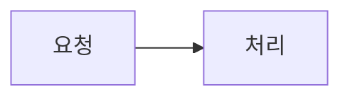

# <TOPIC> — <한 줄 설명>

> 개발자가 읽고 승인하는 문서다. 섹션마다 한 화면 안에 들어오게 쓰되, 넘치는 상세는 빼지 말고 DESIGN으로 옮겨 링크한다.
> 상세 근거는 [DESIGN](DESIGN.md)에 있다. 작성 기준은 [문서 작성 기준](../../../.agents/conventions/writing.md)이다.

## 사전 브리핑

**상태**: 승인 대기 | 승인됨 (YYYY-MM-DD) | 재승인 대기 (C-n) | 재승인됨 (YYYY-MM-DD, C-n)
**제안 규모**: 중간 | 큼 | 실험

### 목표

<!-- 이 토픽이 끝났을 때 달라져 있어야 하는 것 한두 줄. 이슈 본문의 "목표"가 된다. -->

**판정**: <!-- 무엇을 실행해 보면 목표를 이뤘다고 볼 수 있는가. ship 전체 검증에서 실제로 실행한다. -->

### 요구사항

<!-- 관찰 가능한 문장으로. 예: "R1. 수량이 0 이하면 400과 오류 코드 INVALID_QUANTITY를 돌려준다" -->

- R1.

### 지금 동작 (as-is)

<!-- 이번 문제와 관련된 경로만, 노드 10개 안팎. 확인하지 못한 부분은 "미확인"으로 표시한다.
     새 기능이라 바꿀 동작이 없으면, 새 기능이 붙을 지점(진입점, 기존 모듈·레이어)을 그린다. -->

### 문제

<!-- 무엇이 왜 문제인지 3줄 안팎 -->

### 제안 방향

<!-- 한두 문장. 아직 확정이 아니다.
     실험이면 측정 목표, 판정 기준(언제 끝내는가), 매 회차 고정 조건, 첫 가설을 적는다. -->

### 결정이 필요한 질문

<!-- 한 번에 1~3개, 결과를 크게 바꾸는 것부터. 답을 받으면 "답"을 채우고, 새로 생긴 질문은 아래에 이어 붙인다.
     답 상태: 미결 / <답> (YYYY-MM-DD) / 위임: <에이전트가 정함> / 보류: <미룬 이유> -->

1. <질문> — 무엇이 달라지는가: <영향>
   - A: <효과와 제약>
   - B: <효과와 제약>
   - 추천: <선택과 이유>
   - **답**: 미결

### 이번 범위가 아닌 것

-

## 합의 브리핑

**상태**: 확정 대기 | 확정됨 (YYYY-MM-DD) | 재확정 대기 (C-n) | 재확정됨 (YYYY-MM-DD, C-n)

### 바뀐 뒤 동작 (to-be)

<!-- as-is와 같은 범위로 그리고 바뀐 부분을 표시한다. -->

### 확정된 결정

| 결정 | 이유 | 근거 |
|---|---|---|
| | | 개발자 답변 / 위임 / 제안 |

### 완료 기준과 검증 방법

<!-- 요구사항별 완료 조건과 그것을 확인할 테스트·측정. 이슈 본문의 "완료·검증 기준"이 된다. -->

- R1:

### 남은 위험

-

### 미결 사항

<!-- 비어 있어야 확정을 요청한다. 개발자가 미룬 것은 "보류"로 이유와 함께 적는다. -->

없음

## 변경 요청

<!-- 합의 브리핑 확정 뒤에 들어온 변경. 수준 기준과 처리는 workflow의 "진행 중 변경 요청"이다. 없으면 "없음".
     위에 추가하는 요구사항·결정에는 (C-n)을 붙이고, 재확정한 합의 브리핑의 바뀐 부분에도 표시한다.
     L1은 요청·수준·처리를 한 줄로 쓴다. L2 이상의 질문은 "결정이 필요한 질문"과 같은 형식으로 쓴다. -->

### C1 — <요청 한 줄> (YYYY-MM-DD)

- 수준: L1 태스크 추가 | L2 결정 추가 | L3 합의 갱신 | L4a 재설계 — <판별 근거>
- 처리: <추가·바뀐 R-n, 결정, 태스크. L4a면 무효가 된 태스크와 코드 처리>
- 승인: 알림만 | 답변 (YYYY-MM-DD) | 재확정 (YYYY-MM-DD)
- 이슈: 기존 이슈 | 변경 이슈 #<번호>

## 완료 요약

<!-- ship에서 채운다. 완료하지 않고 닫으면 결과를 "닫음"으로 쓰고 이유와 진행 지점을 적는다.
     이 섹션만 읽어도 무엇이 바뀌었는지 알 수 있게 쓴다. 내부 ID는 내용과 함께 적는다. -->

**결과**: 완료 | 닫음 — <한 줄>

### 무엇이 바뀌었나

<!-- 바뀐 동작을 표로, 핵심 로직은 플로우차트로. 문제 → 처리 → 확인 위치를 한자리에서 닫는다. -->

### 주요 결정

| 결정 | 이유 | 버린 대안 |
|---|---|---|

### 검증

| 명령 | 실행 | 통과 | 실패 |
|---|---|---|---|

| 요구사항·장애 시나리오 | 확인한 경로(정상·실패·중복·동시성) | 테스트 |
|---|---|---|

실행하지 못한 검사와 사유:

### 리뷰 처리

critical n · major n · minor n (수정 n, 보류 n)

| 지적 | 등급 | 처리 |
|---|---|---|

### 남은 일

-

**추적**: 이슈 (변경 이슈 포함) · 브랜치 · PR
