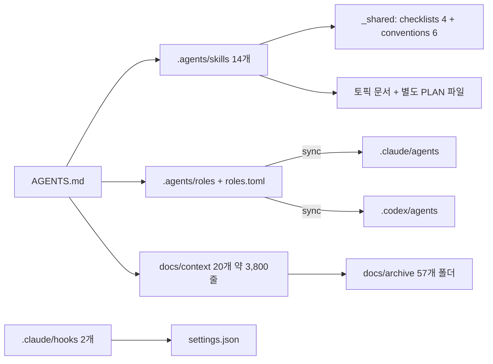
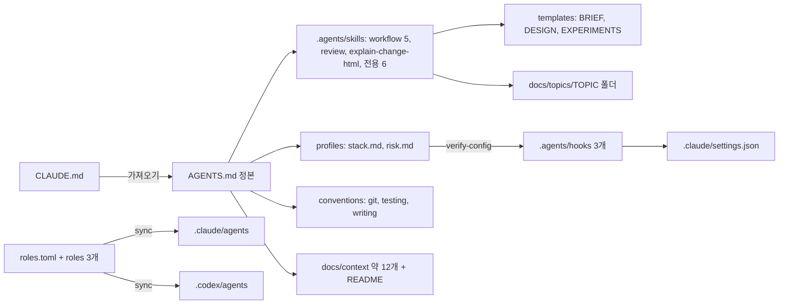

# AGENT-STRUCTURE-OVERHAUL — 에이전트 지침을 agent-backend-kit 구조로 바꾸고 프로젝트 문서를 현재 코드 기준으로 정리

> 개발자가 읽고 승인하는 문서다. 상세 근거는 DESIGN에 둔다(사전 브리핑 승인 뒤 작성).
> 형식은 agent-backend-kit의 BRIEF 템플릿을 따른다. 이번 토픽이 그 구조를 들여오는 작업이라 미리 적용했다.

## 사전 브리핑

**상태**: 승인됨 (2026-11-06). 판정은 초안 그대로 확정. 승인 뒤 질문 5·6 추가
**제안 규모**: 큼 (지침·스킬·hook·검사 스크립트와 문서 약 30개를 여러 세션에 걸쳐 바꾼다)

### 목표

에이전트 지침, 스킬, 역할, hook을 agent-backend-kit 구조로 바꾼다. 프로젝트마다 다른 값은 `stack.md`와 `risk.md` 두 프로필에만 둔다.
`docs/context`, `docs/smoke`, `docs/quality`는 현재 코드와 맞지 않는 서술과 쌓인 변경 이력을 걷어 내고, 필요한 문서만 남긴다.

**판정** (초안, 고쳐 주세요):

1. 새 구조에 맞춘 문서 검사(`check-agent-docs.py --strict`)와 역할 동기화 검사(`sync-agent-configs.py --check`)가 통과한다.
2. hook 테스트 스크립트가 통과한다. 실제 세션에서 `payment-service`의 Java 파일 하나를 고치면 편집 린트가 돌고,
   턴이 끝날 때 기준 브랜치 이후 바뀐 모듈의 단위 테스트만 실행되는 것을 `.git/agent-verify/trace.log`로 확인한다(이 브랜치에서는 payment·pg·product. 2026-11-06 리뷰 뒤 정정).
3. 새 세션에서 작은 수정 요청은 workflow 문서 없이 처리되고, 토픽 요청은 discuss의 요구사항 질의부터 시작한다.
   Claude Code에서 확인하고, Codex는 실행할 수 있으면 같은 요청으로 한 번 확인한다.
4. context·smoke·quality 문서에 나오는 파일 경로, 클래스, 설정 키가 실제로 존재한다(자동 대조, 불일치 0건).
   문서 머리의 "최종 갱신 · 이전: …" 이력 줄이 남아 있지 않다.

### 요구사항

- R1. `AGENTS.md`가 유일한 정본이다. kit과 같은 절(작업 원칙, 작업 규모, 승인 범위, 서브에이전트, 구현과 검증, 검증 hook, 흔한 실수, 참고 문서)로 쓰고, `CLAUDE.md`는 `@AGENTS.md`만 가져온다.
- R2. 스택 버전·검증 명령·hook 설정은 `.agents/profiles/stack.md`에, 결제 불변식과 핵심 경로는 `.agents/profiles/risk.md`에 둔다. 멀티모듈 6개 서비스를 hook 설정(`MODULES`, `ROOT_FILES`)에 반영한다.
- R3. workflow는 kit 방식으로 바꾼다. 토픽 폴더에 BRIEF·DESIGN(실험은 EXPERIMENTS)을 두고, 개발자 확인 지점은 세 곳이며, 합의 뒤 변경은 L1~L4로 처리한다. 별도 PLAN 파일과 `_shared/checklists` 4종은 없앤다.
- R4. 서브에이전트는 implementer, reviewer와 결제 위험 검토 역할 셋이다. 위험 검토 역할의 기준은 `risk.md`다. `roles.toml` → `sync-agent-configs.py`로 `.claude/agents`와 `.codex/agents`를 함께 만드는 구조는 유지한다.
- R5. hook은 kit의 `.agents/hooks/`(편집 린트, 종료 검증, 일시정지, 판정 기록)로 바꾸고 `.claude/hooks/`는 없앤다. 종료 검증은 바뀐 모듈의 단위 테스트만 돌린다.
- R6. 남기는 전용 스킬: payment-live-drill, wiki-access, portfolio-access, writing, doc-review, context-update. review는 kit 버전으로, explain-diff-html은 kit의 explain-change-html로 바꾼다. issue-commit-pr은 `conventions/git.md`로 합친다.
- R7. `STATE.md`는 토픽마다 제목과 다섯 줄만 쓴다. "별건" 메모는 `docs/TODOS.md`로 옮기고, `docs/context/TODOS.md`는 거기에 합친다.
- R8. context 문서는 코드와 다른 서술을 고치고, 겹치는 문서를 합치고, 에이전트 운영 문서(`CODEX.md`, `CLAUDE-5-PROMPTING.md`)는 context 밖으로 뺀다. 첫 질문의 답에 따라 구성을 정한다.
- R9. smoke·quality 가이드의 명령, 경로, 지표 이름을 현재 스크립트·설정과 대조해 고친다.
- R11. 컨테이너(Testcontainers)를 띄우는 테스트는 모두 `integration` 태그를 달아 `integrationTest`에서만 돈다. `./gradlew test`는 Docker 없이 통과한다 (질문 7 답변으로 추가).
- R10. archive 폴더 안의 기록은 바꾸지 않는다. `docs/archive/README.md` 목차만 실제 폴더와 맞추고, 옛 형식(COMPLETION-BRIEFING)과 새 형식(BRIEF)을 둘 다 읽을 수 있게 안내한다.

### 지금 구조 (as-is)

확인한 현재 상태:

- context 문서 11개 머리에 "최종 갱신 · 이전: …" 변경 이력이 한 줄로 길게 쌓여 있다. `CONCERNS.md` 머리줄은 이전 갱신 다섯 번을 담고 있다.
- `ARCHITECTURE.md`와 `CONCERNS.md`가 "Phase 4" 같은 이미 지난 일정 이름을 기준으로 처방을 적고 있다.
- `docs/archive/README.md` 목차에만 있는 폴더가 4개, 실제로는 있는데 목차에 없는 폴더가 3개다.
- 구조와 모듈이 `ARCHITECTURE.md`와 `STRUCTURE.md`로, 알려진 위험이 `PITFALLS.md`와 `CONCERNS.md`로 나뉘어 있다.
- 지침 규칙이 `AGENTS.md`, `roles/README.md`, `_shared/conventions`, `_shared/checklists`, `docs/context/CODEX.md`에 흩어져 있다. 그래서 같은 규칙이 여러 곳에 생기지 않는지 따로 검사하는 기능(`check-agent-docs.py`의 중복 규칙 검사)까지 두고 있다.

### 문제

규칙과 지식이 놓인 곳이 많아서, 무엇을 읽어야 하는지와 어느 문서가 맞는지를 매번 따져야 한다.
문서는 토픽이 끝날 때마다 이력을 덧붙이는 식으로 갱신돼서, 지금 사실과 과거 결정이 한 문장에 섞여 있다.

### 제안 방향

kit의 파일을 기준으로 옮기고, 이 프로젝트에만 필요한 것(Codex 동기화, 멀티모듈 hook 설정, 결제 불변식, 전용 스킬)만 덧붙인다.
작업은 두 단계로 나눈다. 1단계에서 지침 구조를 옮기고, 2단계에서 새 지침으로 문서를 정리한다. 2단계가 1단계에서 만든 규칙(context README, writing 기준)을 실제로 써 보는 검증이 된다.

### 결정이 필요한 질문

1. context 문서를 어디까지 합칠까 — 무엇이 달라지는가: 2단계의 분량과, 이후 에이전트가 읽을 문서 수
   - A. 겹치는 것만 합친다(20개 → 약 12개). 구성은 아래 표
   - B. 파일 구성은 그대로 두고 내용만 정정한다. 빠르지만 "어느 문서를 읽어야 하나" 문제는 남는다
   - C. kit처럼 최소(5~6개)로 줄인다. 결제 흐름 상세가 한두 문서에 몰려 문서 하나가 1,000줄을 넘는다
   - 추천: A. 겹침은 없애면서 결제 흐름처럼 실제로 나눠 읽는 문서는 남긴다
   - **답**: A (2026-11-06)

   | 지금 | A안 |
   |---|---|
   | ARCHITECTURE + STRUCTURE | ARCHITECTURE 하나 (모듈, 레이어, 포트, 디렉토리) |
   | PAYMENT-FLOW, CONFIRM-FLOW | 둘 다 유지, 겹치는 설명 제거 |
   | PITFALLS + CONCERNS | PITFALLS 하나. 해결 안 된 우려는 `docs/TODOS.md`로 |
   | CONVENTIONS(목차) + conventions/ 5개 | 목차는 context README로 옮기고 주제별 문서는 유지 |
   | TESTING + conventions/testing | TESTING 하나. 예외 케이스 관점은 `.agents/conventions/testing.md` |
   | STACK + stack/flyway-operations | 버전·명령은 `stack.md`로, 인프라·Flyway 운영 설명만 context에 |
   | INTEGRATIONS | 유지 |
   | PAYMENT-FLOW-GUIDE (사람용) | context 밖 `docs/guides/`로 이동 |
   | TODOS | `docs/TODOS.md`로 이동, 끝난 항목 삭제 |
   | CODEX, CLAUDE-5-PROMPTING | context에서 빼서 `.agents/` 아래 참고 문서로 |

2. 결제 위험 검토 역할의 이름 — 무엇이 달라지는가: 역할 파일, 호출 문구, 메모리의 모델 배정 기록
   - A. kit처럼 `risk-reviewer`로 바꾸고, 지금 domain-expert 본문에 있는 결제 기준을 `risk.md`의 불변식·핵심 경로로 옮긴다. 모델(fable)은 그대로 둔다
   - B. 이름은 `domain-expert`로 두고 기준만 `risk.md`로 옮긴다
   - 참고: 지금 domain-expert의 Claude 모델은 `fable`(Codex는 `gpt-6-astra`)이다
   - 추천: A. kit과 이름이 같아야 이후 kit 개선분을 그대로 가져올 수 있다
   - **답**: A, `risk-reviewer`로 바꾼다. Claude 모델은 비용 때문에 `fable`에서 `opus`로 내린다(kit과 같다). Codex 모델은 바꾸지 않는다 (2026-11-06)

3. `#162` 브랜치의 진행 중 토픽(처리량 측정, 요청 추적) 처리
   - **답**: `#162` 위에서 개편 브랜치를 시작한다 (2026-11-06). 두 토픽은 이 브랜치에서 새 형식(토픽 폴더, 다섯 줄 STATE)으로 옮긴다.
     `#162`가 `AGENTS.md`, workflow 스킬, `CODEX.md`를 이미 고쳐 두어서, main 기준으로 개편하면 나중에 이 파일들에서 충돌이 크게 난다.
     대신 `#162`를 먼저 main에 병합해야 이 브랜치의 PR에 처리량 커밋이 섞이지 않는다.

4. 사람이 읽는 글의 작성 기준을 어떻게 합칠까 — 무엇이 달라지는가: BRIEF·PR·이슈 본문과 README·위키·포스팅이 같은 기준을 쓰는지
   - 지금: `_shared/conventions/writing*.md` 4개(약 410줄). 문체, AI체·번역체 제거, 용어·식별자, 표·Mermaid 규칙을 예시와 함께 자세히 다룬다. writing·doc-review 스킬이 이것을 쓴다
   - kit: `conventions/writing.md` 1개(65줄). 결론 먼저, 표·그림 우선, 번역체·비유 금지, 숫자 기준은 상한이 아님, 기존 문서 수정 원칙. BRIEF·HTML·PR·이슈 본문에 쓴다
   - A. kit 파일을 뼈대로 한 파일에 합친다. 지금 문서의 목소리(AI체 제거)·용어·Mermaid 규칙 중 kit에 없는 것만 예시 표로 줄여 넣는다. 에이전트 브리핑과 위키·포스팅이 같은 기준을 쓴다
   - B. 두 벌을 둔다. kit `writing.md`는 브리핑·PR용, 지금 4개 파일은 writing·doc-review 스킬의 위키·포스팅용으로 남긴다. 기존 규칙은 잃지 않지만 같은 규칙이 두 곳에 생긴다
   - 추천: A. 규칙이 한 곳에 있어야 하나만 고치면 되고, 지금 문서의 핵심 규칙은 kit에 없는 부분만 옮기면 된다
   - **답**: 두 단계로 나눈다 (2026-11-06). 위키·포스팅은 평소 브리핑보다 강하게 제약한다.
     개발자가 준 [문체 교정 지침 원문](input-style-guide.md)을 위키·포스팅 기준의 바탕으로 쓴다.
     - 공통 기준: kit의 `.agents/conventions/writing.md`. BRIEF, HTML 보고서, PR·이슈 본문, 길어진 보고에 쓴다
     - 위키·포스팅 기준: `.agents/skills/writing/` 아래 한 파일. 원문 1~7절을 그대로 쓰고, 지금 `writing*.md` 4개에서 원문에 없는 규칙만 덧붙인다.
       덧붙일 후보는 메타 도입어 금지, 균일한 병렬 나열 금지, 번역투 조사, 용어·식별자 4단계 규칙, 동의어 통일, 약어 풀어쓰기, Mermaid 금지 문자다. writing 스킬은 작성에, doc-review 스킬은 원문 7절 표를 검수 목록으로 쓴다
     - 겹침 처리: 공통 기준의 문장 원칙은 위키·포스팅 기준의 요약판이라고 공통 기준에 적고 링크한다. 지금 `writing*.md` 4개는 옮긴 뒤 지운다

5. 진행 중인 처리량 토픽이 쓰는 문서를 이번에 얼마나 고칠까 — 무엇이 달라지는가: 처리량 측정(T2.4 — 100/s 시험 직전 중단)을 재개할 때 따라갈 문서
   - 처리량 토픽의 계획·인계 문서가 `docs/quality/RUNBOOK.md`의 실행 명령을 따른다. RUNBOOK은 `#162`에서 최근 두 번 고쳐졌다
   - 두 토픽(처리량, 요청 추적)의 문서도 새 형식의 토픽 폴더(`docs/topics/<TOPIC>/`)로 옮겨야 한다
   - A. RUNBOOK의 실행 명령과 측정 조건은 바꾸지 않고, 문체·끊긴 링크·이력 줄만 고친다. 두 토픽은 폴더로 옮기고 링크만 고친다. 내용을 BRIEF·DESIGN 형식으로 다시 쓰지 않는다
   - B. RUNBOOK도 다른 문서처럼 코드와 대조해 명령까지 고치고, 두 토픽 문서도 새 형식으로 다시 쓴다. 측정 재개 때 이전 명령과 달라질 수 있다
   - 추천: A. 측정 회차끼리 같은 조건을 유지해야 하는데, 명령이 바뀌면 지난 측정과 비교할 수 없게 된다
   - **답**: B (2026-11-06). RUNBOOK 명령까지 코드와 대조해 고치고 두 토픽 문서도 새 형식으로 다시 쓴다.
     명령이나 측정 조건이 이전과 달라져 이후 측정 결과에 영향을 줄 수 있으면, 바뀐 항목과 영향을 따로 보고한다

6. 이 토픽의 이슈와 커밋 — 무엇이 달라지는가: GitHub 이슈 생성 여부와 커밋 시점
   - kit 규칙은 합의 브리핑 확정 뒤 이슈를 만들고, 태스크가 끝날 때마다 커밋한다. 지금 지침은 둘 다 요청할 때만 한다
   - A. 이번 토픽부터 kit 규칙을 따른다. 이슈를 만들고 태스크마다 커밋한다
   - B. 이슈는 만들지 않고 커밋만 태스크마다 한다
   - C. 둘 다 요청할 때만 한다
   - 추천: A. 개편 뒤 쓸 규칙을 이번 토픽에서 먼저 써 보는 셈이고, 태스크 단위 커밋이 있어야 문제가 생긴 단계만 되돌릴 수 있다
   - **답**: A (2026-11-06). 합의 브리핑 확정 뒤 이슈를 만들고 태스크마다 커밋한다

7. Docker가 꺼져 있을 때 종료 검증 hook — 무엇이 달라지는가: Docker 없이 작업하는 세션에서 턴이 막히는지
   - `payment-service`의 단위 테스트(`test`)에 Testcontainers로 Redis·MySQL을 띄우는 테스트가 들어 있다. Docker가 꺼져 있으면 이 테스트들이 시작 단계에서 실패한다
   - 이번 세션에서 문서만 고친 턴이 두 번 막혔다. 브랜치에 이미 있는 Java 변경 때문에 종료 검증이 돌았기 때문이다
   - A. 지금처럼 막는다. kit hook은 같은 코드 상태를 두 번 막지 않으므로, Docker 없이 문서만 고치면 세션당 한 번 막히고 그 뒤로는 통과한다. 막히면 원인을 보고하고 Docker를 켜서 다시 돌린다
   - B. hook이 "Docker 환경을 찾지 못함" 실패만 골라 막지 않고 경고로 넘긴다. stack.md에 실패 문구 패턴 키를 하나 더 두면 hook 스크립트는 스택과 무관하게 남는다. 대신 kit에 없는 기능이 생기고, 단위 테스트가 실제로 돌지 않은 턴이 경고 한 줄로만 지나간다
   - C. Testcontainers를 쓰는 테스트를 `integrationTest`로 옮긴다. 서비스 테스트 구성을 바꾸므로 이번 범위 밖이다
   - 추천: A. 막히는 횟수가 세션당 한 번이라 비용이 작고, 테스트가 안 돌았는데 지나가는 경우를 만들지 않는다
   - **답**: C를 이번 범위에 넣는다 (2026-11-06). 원인 조사 결과, 테스트 분류 기준이 "Docker가 필요한가"가 아니라 "앱 전체를 띄우는가"였다
     (`docs/context/TESTING.md`의 JPA·Repository 분류). 컨테이너를 띄우면서 `integration` 태그가 없는 테스트 9개(payment 6, pg 2, product 1)에 태그를 붙여
     `integrationTest`로 옮긴다. 테스트 내용과 서비스 코드는 바꾸지 않는다. hook은 A처럼 kit 동작 그대로 둔다

### 이번 범위가 아닌 것

- archive 폴더 안의 기록 수정, 옛 토픽을 새 형식으로 옮기는 일
- 서비스 코드 변경. 테스트는 질문 7의 태그 9개만 바꾼다
- 위키·블로그 저장소의 문서

## 합의 브리핑

**상태**: 확정됨 (2026-11-06). 불변식 초안과 에이전트 제안 그대로 확정

### 바뀐 뒤 구조 (to-be)

바뀐 점: 프로필 두 개가 생기고 hook은 그 설정만 읽는다. 체크리스트 4개와 별도 PLAN 파일이 없어진다. 토픽 문서는 폴더 하나에 모인다. 규칙 문서는 `conventions/` 세 개로 줄어든다.

### 확정된 결정

질문 1~6의 답은 위에 있다. 그 밖에 구조에 영향을 주는 에이전트 제안은 아래와 같다. 나머지 세부는 [DESIGN](DESIGN.md)의 결정 표(D1~D25)에 있다.

| 결정 | 이유 | 근거 |
|---|---|---|
| kit 파일을 복사해 시작하고 kit 문장은 다시 쓰지 않는다 | 이후 kit 개선분을 diff로 가져오기 위해 | 제안 |
| 종료 검증 대상 파일은 지금 hook과 같게 둔다(`.java`, `.sql`, `.gradle`, `.yml`, `.properties`) | 지금과 판정 범위를 같게 유지 | 제안 |
| 종료 검증은 implementer와 메인에만 건다. 검토 역할은 등록 단계에서 뺀다 | 역할 이름이 바뀌어도 hook을 고치지 않는다 | 제안 |
| `check-agent-docs.py`에 "문서 식별자 대조"를 더한다. 백틱 안의 경로, 클래스 이름, 설정 키가 실제로 있는지 본다 | 판정 4를 자동으로 확인 | 제안 |
| 에이전트 운영 문서(`CODEX.md`)는 `.agents/README.md`로, 프롬프팅 조사 기록은 `.agents/references/`로, 사람용 결제 흐름 안내는 `docs/guides/`로 옮긴다 | context에는 에이전트가 작업에 쓰는 프로젝트 지식만 둔다 | 제안 |
| context-update 스킬은 ship의 문서 동기화 절차로 줄인다 | 하는 일이 ship 3단계와 겹치는 부분을 뺀다 | 제안 |
| CI의 문서 검사·역할 동기화·hook 테스트 단계는 경로만 고친다 | 공유 빌드 변경을 최소로 | 제안 |

**결제 불변식 초안** (`risk.md`, risk-reviewer가 지키는 기준). 빼거나 고칠 것을 알려 주세요.

| 불변식 | 깨지면 생기는 일 |
|---|---|
| 같은 결제는 PG에 한 번만 승인을 요청하고, 승인은 한 번만 반영된다. 요청·메시지가 다시 와도 같다 | 이중 결제 |
| 종결 상태(`DONE`, `FAILED`, `CANCELED`, `PARTIAL_CANCELED`, `EXPIRED`)로 간 결제는 다른 상태로 되돌아가지 않는다 | 승인된 결제가 실패로 보이거나 다시 승인됨 |
| PG의 "이미 처리됨" 응답은 주문 ID·금액·상태를 대조한 뒤에만 성공으로 본다 | 다른 주문이나 다른 금액의 승인을 성공으로 처리 |
| 승인 금액은 주문 금액과 같다 | 금액 불일치 |
| 재고 차감과 복구(보상)는 주문·상품마다 한 번만 반영된다. 보상을 다시 실행해도 결과가 같다 | 재고 과다·과소 |
| 결과를 모르는 결제(타임아웃 등)를 실패로 확정하지 않는다. 확인 경로를 거쳐 종결한다 | 승인됐는데 실패 처리, 재고만 복구 |
| 로그·응답·메시지에 결제 키·카드 정보·비밀 값이 남지 않는다 | 민감정보 노출 |

핵심 경로는 서비스의 `src/main` 코드, DB 마이그레이션, Kafka 메시지 계약이다. 실제 패키지 경로(glob)는 첫 태스크에서 코드로 확인해 정한다.

### 완료 기준과 검증 방법

| 요구사항 | 완료 기준 | 확인 방법 |
|---|---|---|
| 지침 정본 (R1) | `CLAUDE.md`는 `AGENTS.md`를 가져오기만 하고, AGENTS.md 절 구성이 kit과 같다 | kit과 diff |
| 프로필 (R2) | 버전 표가 빌드 설정과 같고, hook 스크립트에 모듈 이름이 없다 | 대조, `grep` |
| workflow (R3) | kit 스킬과 다른 줄은 프로젝트 고유 내용뿐이다. PLAN 파일과 체크리스트가 없다 | kit과 diff |
| 역할 (R4) | 생성 파일이 Claude·Codex 각 3개, risk-reviewer는 `opus` | `sync-agent-configs.py --check` |
| hook (R5) | 문서만 바뀌면 테스트를 다시 돌리지 않고, 바뀐 모듈만 테스트하고, 실패하면 막는다 | `scripts/test-hooks.sh`, 실제 세션의 `trace.log` |
| 스킬 (R6) | 남기기로 한 스킬만 있고 참조가 끊기지 않는다 | `check-agent-docs.py --strict` |
| STATE·TODOS (R7) | 토픽마다 제목과 다섯 줄, 할 일은 `docs/TODOS.md` 한 곳 | 파일 확인 |
| context (R8) | 문서 식별자 불일치 0건, 이력 줄 0건, README 목록이 실제 파일과 같다 | 문서 검사, `grep` |
| smoke·quality (R9) | 문서 식별자 불일치 0건. RUNBOOK 명령이 바뀌었으면 이전 회차와 비교할 수 있는지 함께 보고 | 문서 검사, 완료 보고 |
| archive (R10) | README 목차가 실제 폴더와 같고 폴더 안 기록은 그대로다 | 대조 스크립트, `git diff` |
| 테스트 분류 (R11) | 컨테이너를 띄우는 테스트는 모두 `integration` 태그가 있다. Docker 없이 `./gradlew test`가 통과한다 | `grep` 대조, Docker를 끈 상태에서 6개 모듈 `test`, 켠 상태에서 3개 서비스 `integrationTest` |
| 판정 3 | 새 세션에서 작은 수정은 workflow 문서 없이, 토픽 요청은 discuss 요구사항 질의부터 시작한다 | Claude Code에서 실제 요청 각 1회. Codex는 실행할 수 있으면 같은 요청 |

### 남은 위험

- 이 브랜치는 `#162` 위에 있다. `#162`에서 처리량 측정을 재개해 커밋이 생기면 이 브랜치를 다시 rebase해야 하고, 두 토픽 문서는 양쪽에서 바뀌어 충돌한다. 개편 PR은 `#162`가 main에 병합된 뒤 올린다.
- RUNBOOK 명령을 코드에 맞춰 고치면 지난 측정 회차와 조건이 달라질 수 있다. 바뀐 항목은 처리량 토픽의 EXPERIMENTS와 완료 보고에 적는다.
- 메모리 파일 몇 개가 옛 경로(`writing-style.md`, `ship-ready.md` 등)를 가리킨다. ship에서 새 경로로 고친다.
- 판정 3의 Codex 확인은 이 환경에서 Codex를 실행할 수 있는지 아직 확인하지 않았다. (완료 시점: 실행 가능해 확인함)

### 미결 사항

없음

## 변경 요청

없음

## 완료 요약

**결과**: 완료 — 에이전트 지침·스킬·역할·hook을 agent-backend-kit 구조로 바꾸고, context·smoke·quality 문서를 코드와 대조해 정리했다.

### 무엇이 바뀌었나

| 영역 | 전 | 후 |
|---|---|---|
| 지침 정본 | AGENTS.md + 역할 README + 공용 규칙 6개 + 체크리스트 4개 + `docs/context/CODEX.md` | AGENTS.md 하나(`CLAUDE.md`는 가져오기만). 운영은 `.agents/README.md` |
| 프로젝트 값 | hook 스크립트와 여러 문서에 흩어짐 | `.agents/profiles/stack.md`(버전, 검증 명령, hook 설정, 코드 규칙), `risk.md`(결제 불변식 7개, 핵심 경로) |
| workflow | 토픽 문서 + 별도 PLAN 파일 + 체크리스트 | 토픽 폴더(BRIEF·DESIGN·EXPERIMENTS), 확인 지점 3곳, 합의 뒤 변경 L1~L4 |
| 역할 | implementer, reviewer, domain-expert(fable) | implementer, reviewer, risk-reviewer(opus). Claude·Codex 설정은 계속 생성 스크립트로 |
| hook | `.claude/hooks/` 2개, 모듈 목록 하드코딩 | `.agents/hooks/` 3개 + 판정 기록. stack.md 설정만 읽는다. 같은 상태 재차단 없음, 잠금, 일시정지 |
| 테스트 분류 | 컨테이너를 띄우는 테스트 9개가 `test`에 있어 Docker 없으면 실패 | `integrationTest`로 옮김. `test`는 Docker 없이 돈다 |
| 작성 기준 | `writing*.md` 4개 | 브리핑·PR용 `conventions/writing.md` + 위키·포스팅용 `writing/references/style-guide.md`(개발자 원문 + 프로젝트 규칙) |
| 문서 | context 20개, 머리마다 갱신 이력, TODOS·CONCERNS 분산 | context 12개(README 포함), 이력 줄 0, 할 일은 `docs/TODOS.md` 한 곳, 사람용 안내는 `docs/guides/` |
| 문서 검사 | 체크리스트·중복 규칙 검사 | 경로·클래스·설정 키를 코드와 대조(주석·문자열 제외), 단위 테스트 18개, CI 단계 추가 |
| 진행 중 토픽 | 처리량·요청 추적이 옛 형식 | 각 토픽 폴더로 옮김. 처리량은 실험 모드(EXPERIMENTS에 회차 15개) |

코드와 대조하다 고친 낡은 서술 중 큰 것: 재고 보상 경로(`StockHoldReverter`), 결과 소비 순서와 `AWAITING_RESULT`, 토픽 6개, 입력 포트 위치, Alertmanager·Discord 통지가 있는데 "미도입"으로 적힌 것, 취소·환불 포트("인터페이스만 있다" → 없다), 이미 지운 `payment_outbox.available_at`.

### 주요 결정

| 결정 | 이유 | 버린 대안 |
|---|---|---|
| kit 파일을 복사하고 kit 문장은 다시 쓰지 않는다 | 이후 kit 개선분을 diff로 가져오기 위해 | 현재 지침을 kit 방향으로 고쳐 쓰기 |
| Claude·Codex 둘 다 지원, 역할은 `roles.toml`에서 생성 | 두 도구를 계속 쓴다 | kit처럼 Claude만 |
| domain-expert → risk-reviewer, fable → opus | 비용(개발자 요청), kit과 이름 맞춤 | 이름 유지 |
| 핵심 경로는 불변식을 쥐는 하위 경로로 한정하고 로그·주석만 바꾼 diff는 제외 | 서비스 전체로 두면 작은 수정에도 risk-reviewer가 불린다(리뷰 지적) | 서비스 `src/main` 전체 |
| 컨테이너 테스트를 통합 테스트로 옮김 | Docker 유무로 단위 테스트와 hook 결과가 갈리지 않게(개발자 선택) | hook이 Docker 부재를 경고로 넘기기 |
| 작성 기준 두 단계 | 위키·포스팅은 브리핑보다 강하게(개발자 요청) | 한 파일, 두 벌 |
| RUNBOOK 명령까지 코드와 대조 | 개발자 선택. 결과적으로 명령 변경은 없었다 | 문체·링크만 |

### 검증

| 명령 | 실행 | 통과 | 실패 |
|---|---|---|---|
| `bash scripts/test-hooks.sh` | 34 | 34 | 0 |
| `python3 -m unittest scripts/test_check_agent_docs.py` | 18 | 18 | 0 |
| `python3 scripts/check-agent-docs.py --strict` | 1 | 종료 0 (Mermaid 16건은 정보용, kit 다이어그램) | 0 |
| `python3 scripts/sync-agent-configs.py --check` | 1 | 6개 일치 | 0 |
| `:payment-service:test :pg-service:test :product-service:test --rerun-tasks` (Docker를 못 찾게 한 상태) | 698·442·70 | 전부 | 0 |
| `:payment-service:integrationTest :pg-service:integrationTest :product-service:integrationTest --rerun-tasks` | 761·84·12 | 전부 | 0 |
| `checkstyleTest spotbugsTest` (payment·pg·product) | 3모듈 | 통과 | 0 |

| 판정 | 확인한 것 | 근거 |
|---|---|---|
| 1. 문서·역할 검사 | strict 종료 0, 역할 동기화 일치 | 위 표 |
| 2. hook 실제 동작 | implementer가 domain 파일에 `var`를 넣자 편집 린트가 막음, 종료 시 이 브랜치에서 바뀐 모듈(payment·pg·product) 테스트 실행·통과, 동시 종료 시 잠금 대기 뒤 건너뜀, 루트 설정 변경 시 6개 모듈 실행 | `.git/agent-verify/trace.log` |
| 3. 지침대로 동작 | 새 Claude 세션: 작은 수정 → "작음, workflow 없음", 토픽 요청 → "큼, discuss 조사 후 사전 브리핑". 새 Codex 세션: 작은 수정 → "작음", 토픽 요청 → "중간, discuss로 구체화". 규모 판단만 갈림 | `claude -p --permission-mode plan`, `codex exec --sandbox read-only` 출력 |
| 4. 문서 대조 | 식별자 불일치 0건, 이력 줄 0건 | strict, `grep` |
| 테스트 분류(R11) | Docker 없이 `test` 통과, 옮긴 9개가 통합 실행에 포함(6·2·1) | 위 표 |

실행하지 못한 검사와 사유: 스모크·라이브 드릴은 실행하지 않았다(런타임 설정 변경 없음, 가이드는 스크립트와 대조만). 판정 2의 첫 시도는 `util/` 파일이라 Checkstyle 억제 목록 때문에 잡히지 않았다(TODOS CHECKSTYLE-SUPPRESSION-SCOPE).

### 리뷰 처리

첫 리뷰 critical 0 · major 2 · minor 5, 재검토(수정분) medium 1 · low 2. 전부 수정. 상세는 [DESIGN](DESIGN.md)의 "리뷰 처리".

| 지적 | 등급 | 처리 |
|---|---|---|
| 핵심 경로가 넓은 곳과 빈 곳이 함께 있음(재검토에서 메시지 계약·엔티티 등 추가 누락) | major | 하위 경로로 좁히고 누락분 추가, 로그·주석 diff 제외 명시 |
| 식별자 대조가 주석에만 남은 이름을 통과시킴, `out` 디렉토리 처리 | major | 주석·문자열 제외 색인, `out`은 저장소·모듈 루트만 건너뜀, 테스트 3개 추가 |
| hook `ROOT_FILES` 설명·Lua 변경 검증 조건, Git 규칙 손실, live-drill 낡은 서술, 토픽 이전 누락, 끊긴 앵커 | minor | 모두 수정 |

### 남은 일

- 이 브랜치는 `#162` 위에 있다. PR은 `#162`가 main에 병합된 뒤 올린다. `#162`에 커밋이 더 생기면 다시 rebase한다.
- 처리량 측정 재개 때는 로컬 드라이버 조건(VU 650, 관측 256)을 쓴다. 실행 안내의 예시 명령과 다르다([처리량 EXPERIMENTS](../../topics/PAYMENT-THROUGHPUT/EXPERIMENTS.md#실행-안내-변경-2026-11-06-163)).
- TODOS에 남긴 것: CHECKSTYLE-SUPPRESSION-SCOPE(억제 목록이 디렉토리 단위로 검사를 모두 끔), STALE-COMMENTS(코드·스크립트 주석의 낡은 서술 4곳), CONFIRM-TERMINAL-REJECT(PITFALLS 합칠 때 옮긴 우려).
- T1 커밋(`7a2053fa`)에 옛 hook·domain-expert 삭제가 함께 들어갔다. 커밋 경계만 섞였고 내용은 맞다.

**추적**: 이슈 [#163](https://github.com/hyoguoo/payment-platform/issues/163) · 브랜치 `agent-structure-overhaul` · PR 없음
