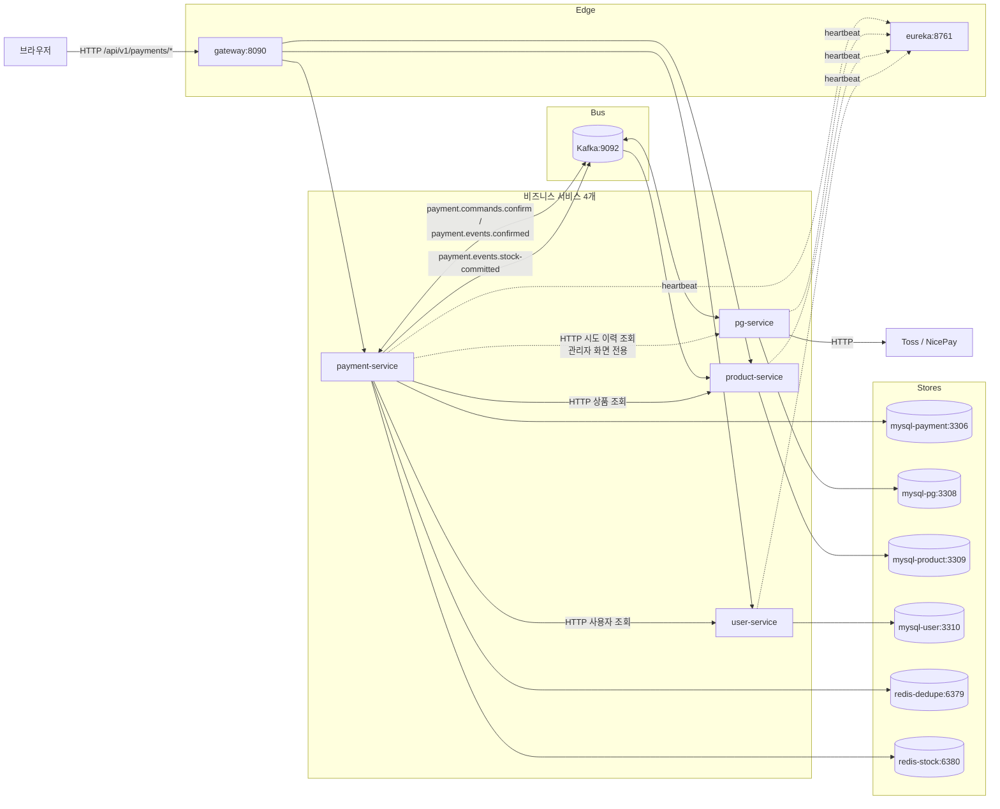

# 아키텍처

모듈 구성, 레이어와 의존 방향, 비동기 어댑터의 위치, 인프라별 책임, 지금 운영 중인 설계 결정을 다룬다.
결제 흐름은 [PAYMENT-FLOW.md](PAYMENT-FLOW.md), 비동기 확정 사이클은 [CONFIRM-FLOW.md](CONFIRM-FLOW.md)에 있다.
빌드·검증 명령과 코드 규칙은 [stack.md](../../.agents/profiles/stack.md)에 있다.

## 모듈

결제 도메인을 Spring Boot 모듈 6개로 나눈 MSA다. 모듈 사이에 코드 의존(`implementation project(':...')`)은 없고 통신은 HTTP와 Kafka뿐이다.

| 모듈 | 책임 |
|---|---|
| `payment-service` | 결제 도메인 본체. checkout, confirm, 상태 조회. 비동기 확정 사이클의 진입점이자 결제 상태의 권한자. PG를 직접 부르지 않고 Kafka로 맡긴다 |
| `pg-service` | PG 벤더(Toss, NicePay) 호출 격리. `payment.commands.confirm`을 소비해 벤더 승인·상태 조회를 하고 `payment.events.confirmed`를 발행한다 |
| `product-service` | 상품과 재고 원장. payment-service의 HTTP 조회와 재고 확정 이벤트(`payment.events.stock-committed`)를 처리한다 |
| `user-service` | 사용자. payment-service의 HTTP 조회 |
| `gateway` | Spring Cloud Gateway. 단일 진입점(8090), Eureka 기반 라우팅 |
| `eureka-server` | Netflix Eureka. 서비스 탐색 |

비즈니스 서비스마다 MySQL 인스턴스가 따로 있다(`mysql-payment`, `mysql-pg`, `mysql-product`, `mysql-user`).
Redis 두 개(`redis-dedupe`, `redis-stock`)는 용도별로 나뉘어 있고 payment-service만 쓴다. checkout 요청 멱등성과 재고 선차감이다.
pg-service와 product-service의 메시지 중복 판정은 각자의 DB에서 한다.

## 토폴로지



## 디렉토리 구성

```
payment-platform/
├── settings.gradle, build.gradle   # 모듈 6개 등록, 공통 플러그인·BOM·정적 분석·JaCoCo
├── AGENTS.md, CLAUDE.md, .agents/  # 에이전트 지침 (운영은 .agents/README.md)
├── config/                         # checkstyle/, spotbugs/, archunit/(레이어 규칙 공유 소스)
├── docker/                         # Compose: infra, apps, observability, smoke, quality, drill, scaleout 등
├── observability/                  # Prometheus 규칙, Grafana 대시보드, Loki, Tempo, Promtail
├── scripts/                        # compose-up.sh, smoke/, quality/, k6/, 문서·hook 검사
├── docs/                           # STATE, TODOS, context/, guides/, smoke/, quality/, topics/, archive/
└── eureka-server/ gateway/ payment-service/ pg-service/ product-service/ user-service/
```

비즈니스 서비스는 `com.hyoguoo.paymentplatform.<서비스>` 아래 같은 패키지 구성을 쓴다(`<서비스>`는 `payment`, `pg`, `product`, `user`).

```
src/main/java/.../<서비스>/
├── domain/          # 엔티티, 값 객체, 상태 enum, 도메인 이벤트. Spring·JPA 의존 없음
├── application/     # 유스케이스, 출력 포트(port/out), 보조 서비스, DTO, 토픽 상수(messaging/), AOP 어노테이션(aspect/annotation/)
├── presentation/    # 컨트롤러(presentation/ 바로 아래), 요청·응답 DTO, 입력 포트 선언(port/)
├── infrastructure/  # 포트 어댑터: entity/, repository/, messaging/, adapter/http/(Feign), http/(벤더 RestClient), cache/, dedupe/,
│                    #   idempotency/, scheduler/, listener/, channel/, aspect/, gateway/(벤더 전략), metrics/, config/, trace/
├── core/            # 횡단 관심사: 설정, 공통 로그(LogFmt), 공통 지표, 가상 스레드 실행기
└── exception/       # 애플리케이션 예외
src/main/resources/
├── application*.yml # 기본, docker, (payment) benchmark, (pg) smoke
├── db/migration/    # payment·pg Flyway (seed 없음)
├── db/schema/, db/seed/  # product·user Flyway (스키마와 시드 분리)
├── lua/             # payment Redis 재고 스크립트
└── static/, templates/   # payment 결제 화면과 관리자 화면
```

## 레이어 규칙

| 패키지 | 역할 | 의존 방향 |
|---|---|---|
| `domain` | 엔티티, 값 객체, 도메인 서비스 | 의존 없음(가장 안쪽) |
| `application` | 유스케이스, 출력 포트(`port/out`) | `domain`만 |
| `presentation` | HTTP 진입, 요청·응답 DTO, 입력 포트 선언 | 입력 포트만. 출력 포트를 직접 부르지 않는다 |
| `infrastructure` | 출력 포트 구현 어댑터 | `application.port.out` 구현 |
| `core` | `@Configuration`, AOP, MDC·LogFmt, 필터, Kafka 설정 | 모든 레이어(배선) |
| `exception` | 도메인·애플리케이션 예외 | `domain`, `application`에서 던진다 |

- 도메인은 외부에 의존하지 않는다. JPA·Spring 어노테이션을 쓰지 않는다.
- 입력 포트는 유스케이스 인터페이스이고 presentation만 부른다. 선언 위치는 대부분 `presentation/port/`다(payment 9개, pg 3개, product 2개, user 1개).
  `application/port/in/`에 둔 것도 있다: payment `PaymentExpirationService`, `PaymentHistoryService`, pg `PgInboxProcessUseCase`. 구현은 `application/` 루트나 `application/usecase/`에 둔다.
- presentation은 출력 포트를 직접 부르지 않는다. 조회 실패 흡수나 폴백 판단도 입력 포트 구현에 두고, 컨트롤러는 결과를 모델에 담기만 한다.
- 출력 포트는 application이 정의하고 infrastructure가 구현한다.
- AOP와 이벤트 발행 같은 횡단 관심사는 `core`나 `infrastructure/listener`에 둔다.
- 요청 DTO의 형식 검증은 Bean Validation(`@NotNull`, `@NotBlank`, `@Min`, `@Max` 등)으로 하고 `@Valid`는 컨트롤러 메서드 파라미터에만 붙인다.
  도메인 불변식은 도메인 메서드 안의 가드(`Objects.requireNonNull`, `IllegalArgumentException`)로 지킨다.

### 빌드가 강제하는 규칙

규칙 정의는 `config/archunit/`의 `HexagonalRules`, 서비스별 실행은 각 서비스의 `ArchitectureTest`다. 단위 테스트에서 돌아 종료 검증 hook이 위반을 막는다.

| 강제되는 규칙 | 대응하는 위 항목 |
|---|---|
| 도메인은 Spring·JPA를 참조하지 않는다 | 도메인은 외부에 의존하지 않는다 |
| 도메인은 `application`, `infrastructure`, `presentation`을 참조하지 않는다 | 도메인이 가장 안쪽 |
| `presentation`은 `infrastructure`를 참조하지 않는다 | presentation은 입력 포트만 |
| `@Transactional`은 `presentation`, `domain`에 붙지 않는다 | 트랜잭션 경계 위치 |
| `@FeignClient`는 `infrastructure` 아래에만 있다 | 어댑터는 infrastructure |
| 이름이 `*Port`인 타입은 interface다 | 포트는 의존성 역전 인터페이스 |

`@Transactional`을 `application`으로만 한정하지 않는 이유는, outbox 상태 전이나 `SKIP LOCKED` 조회처럼 저장소 구현이 스스로 트랜잭션 경계를 여는 자리가 정당하게 있기 때문이다.

### 이름 규칙

- 유스케이스: `<Action><Subject>UseCase` (예: `PaymentConfirmResultUseCase`, `StockCommitUseCase`)
- 출력 포트: `<Subject>Port` (예: `StockCachePort`)
- 메시지 record: 수신용 `<Subject>EventMessage`, 발행용 `<Subject>EventPayload`
- 테스트는 main과 같은 패키지에 두고 `*Test`, `*ContractTest`, `*IntegrationTest` 같은 접미사를 쓴다. 테스트 전용 Fake는 `Fake*`

## 비동기 토픽

브라우저 → checkout → PG SDK 창 → confirm → HTTP 202 즉시 반환 → Kafka 양방향 왕복 → 브라우저 상태 조회.

| 토픽 | 발행 | 소비 | 책임 |
|---|---|---|---|
| `payment.commands.confirm` | payment-service(최초), pg-service 재시도(시도 4회 미만이면 자기 자신에게 다시 발행) | pg-service | 확정 명령 전달과 재시도 |
| `payment.commands.confirm.dlq` | pg-service(`PgVendorCallService`, 시도 4회 이상) | pg-service(`PaymentConfirmDlqConsumer` → `PgDlqService`가 최종 확인 관문에 위임) | 재시도 소진 처리 |
| `payment.events.confirmed` | pg-service | payment-service | PG 결과 회신(APPROVED, FAILED, QUARANTINED) |
| `payment.events.confirmed.dlq` | Spring Kafka `DefaultErrorHandler` + `DeadLetterPublishingRecoverer`(재시도 한도 초과) | 관리자 수동 재주입(`KafkaDlqReprocessAdapter`) | 결과 처리 영구 실패 |
| `payment.events.stock-committed` | payment-service(EOS producer 트랜잭션 안에서 `stockCommittedKafkaTemplate`으로 직접 발행) | product-service | 승인된 결제의 재고 확정 |
| `payment.events.stock-committed.dlq` | product-service 에러 핸들러 | 없음(격리, `ProductStockQuarantineBacklog` 알람) | 재고 확정 실패 격리 |

## 비동기 어댑터 위치

| 어댑터 | 위치 | 이유 |
|---|---|---|
| `OutboxImmediateEventHandler` (`@TransactionalEventListener(AFTER_COMMIT)`) | payment `infrastructure/listener` | 트랜잭션 커밋 직후 발행을 트리거한다. 유스케이스와 분리해 폴백 워커와 같은 진입점을 쓴다 |
| `OutboxRelayService` | payment `application/service` | 선점 → 발행 → 완료의 업무 로직. 발행 결정은 도메인 책임이라 application에 둔다 |
| `KafkaMessagePublisher` | payment `infrastructure/messaging/publisher` | Spring Kafka 어댑터. 출력 포트 구현 |
| `OutboxWorker` (`@Scheduled`) | payment `infrastructure/scheduler` | 폴링 폴백(기본 5초, 배치 50). Spring 스케줄러 의존이라 infrastructure |
| `ConfirmedEventConsumer` (`@KafkaListener`) | payment `infrastructure/messaging/consumer` | 결과 입력 어댑터. `PaymentConfirmResultUseCase`를 부른다 |
| `StockHoldRecoveryWorker` (`@Scheduled`) | payment `infrastructure/scheduler` | 미회수 선차감 회수. 종결된 결제의 잡음 상태 `stock_hold_record`를 찾아 `StockHoldRecoveryUseCase`로 되돌린다. 결제 상태는 쓰기 경로와 같은 저장소 빈으로 원본 DB에서 읽는다 |
| `DedupeCleanupWorker` (`@Scheduled`) | payment·product `infrastructure/scheduler` | 중복 판정 테이블의 만료 행 청소. product는 `SchedulerConfig`(`scheduler.enabled`)로 켠다 |
| `JdbcPaymentEventDedupeStore` | payment `infrastructure/dedupe` | `payment_event_dedupe` INSERT IGNORE. EOS 트랜잭션 안에서 메시지를 한 번만 처리하게 표시한다 |
| `KafkaDlqReprocessAdapter` | payment `infrastructure/messaging/publisher` | `DlqReprocessPort` 구현. `events.confirmed.dlq`를 offset 커밋 없이 읽어 원 토픽으로 다시 발행한다. 실패하는 EOS 트랜잭션과 분리된 비트랜잭션 template을 쓴다 |
| `KafkaConsumerConfig` | payment `infrastructure/config` | `kafkaListenerContainerFactory`와 `KafkaTransactionManager`(EOS consumer). `isolation.level=read_committed`는 `spring.kafka.consumer.properties.isolation.level` |
| `KafkaProducerConfig` | payment `infrastructure/config` | EOS용 `stockCommittedProducerFactory`, `KafkaTransactionManager`, `stockCommittedKafkaTemplate`(transactional.id 접두사 `${spring.application.name}-${HOSTNAME:local}-`, 멱등 producer, 트랜잭션 타임아웃 10초) |
| `KafkaErrorHandlerConfig` | payment `infrastructure/config` | `DefaultErrorHandler` + `DeadLetterPublishingRecoverer` + `FixedBackOff`(1초 간격 5회). 재시도하지 않는 예외: `MessageConversionException`, `IllegalArgumentException`, `IllegalStateException`, `PaymentStatusException` |
| `InboxReadyEventHandler` (AFTER_COMMIT) | pg `infrastructure/listener` | 커밋 직후 접수 작업을 inbox 채널에 넣는다 |
| `PgInboxChannel` + `InboxJob` | pg `infrastructure/channel` | inbox 작업 큐(용량 1024). 작업에 OTel 컨텍스트를 함께 담아 Kafka 소비 스레드와 가상 스레드 워커 사이를 잇는다 |
| `PgInboxImmediateWorker` | pg `infrastructure/scheduler` | inbox 가상 스레드 워커 5개. 채널에서 작업을 꺼내 컨텍스트를 복원하고 `PgInboxProcessUseCase`를 부른다(트랜잭션 → 벤더 호출 → 트랜잭션) |
| `PgInboxPollingWorker` (`@Scheduled`) | pg `infrastructure/scheduler` | inbox 정체 회수(5초 주기). PENDING은 접수 시각, IN_PROGRESS는 갱신 시각 기준 60초가 지난 행을 회수하고 `pg_inbox.stored_traceparent`로 부모 trace를 복원한다 |
| `PgOutboxChannel` + `OutboxJob` | pg `infrastructure/channel` | outbox 발행 큐(용량 1024). 넣을 때 OTel 컨텍스트와 MDC를 캡처해 함께 담는다 |
| `PgOutboxImmediateWorker` | pg `infrastructure/scheduler` | outbox 발행 워커. 생명주기 골격은 `AbstractImmediateWorker` 공통 base이고 Spring `DefaultLifecycleProcessor`가 시작·종료를 부른다 |
| `PgOutboxPollingWorker` (`@Scheduled`) | pg `infrastructure/scheduler` | 채널이 가득 찼거나 워커가 죽었을 때의 폴링 폴백(2초 주기) |
| `TraceparentExtractor` | pg `infrastructure/trace` | traceparent 추출·복원. 관측 전용이며 업무 판단에 쓰지 않는다 |
| `ContextAwareVirtualThreadExecutors` | payment·pg `core/config/concurrent` | OTel 컨텍스트와 MDC를 감싼 가상 스레드 실행기 |

## 인프라별 책임

### MySQL 4개

서비스마다 DB를 따로 둔다. 스키마 결합을 끊고, 백업·복구·확장을 나누고, DB 직접 조인을 막아 서비스 사이 의존을 HTTP와 Kafka로만 만든다.
Flyway 운영은 [STACK.md](STACK.md#flyway)에 있다.

**payment 읽기 복제본(선택)**: `payment.datasource.replica.enabled`(기본 `false`)를 켜면 `ReplicaDataSourceConfig`가 복제본 데이터소스와 `JdbcTemplate`을 더 등록한다.
쓰는 곳은 상태 조회 하나뿐이다(`PaymentStatusQueryJdbcAdapter`). 확정·멱등·종결 판정은 모두 기본 데이터소스를 쓴다. 복제는 비동기라 지난 값이 판정에 섞이면 돈 사고가 된다.
기본 데이터소스와 그 `JdbcTemplate`에 `@Primary`를 붙였고(이름 없는 주입이 복제본 템플릿을 고르는 경로가 실제로 있었다), `ReplicaDataSourceIsolationTest`가 빈 의존 관계로 고정한다. 복제본이 끊겨도 원본으로 다시 조회하지 않는다.

### Redis 2개

| Redis | 책임 |
|---|---|
| `redis-dedupe` (6379) | checkout `Idempotency-Key` 결과 저장(`IdempotencyStore`). payment-service 전용 |
| `redis-stock` (6380) | 재고 선차감 게이트와 Lua 원자 처리 표시(`StockCachePort`). payment-service 전용 |

`redis-stock`은 상품 단위로 동작한다.

- 키는 상품 기준 해시태그(`stock:{productId}`, `decrement:done:{productId}:orderId`, `compensation:done:{productId}:orderId`)라 한 상품의 키가 같은 슬롯에 모인다.
- confirm은 주문 단위 선점(`acquireOrderLock`) 뒤 상품마다 `decrementAtomic`을 부른다. 재고가 부족하면 이미 차감한 상품만 `rejectCompensate`로 되돌리고(재고 복원 + 두 표시 삭제, 되돌리기 표시가 이미 있으면 복원 건너뜀) 거절한다.
  다른 되돌리기 경로는 차감 흔적이 있을 때만 복원하는 `compensateIfDecremented`를 쓴다. 차감 결과는 `StockDecrementAtomicResult`(OK, ALREADY_DONE, INSUFFICIENT)다.
- 진짜 재고는 product DB에 있고 이 캐시는 그 미러다. 부팅 직후 `scripts/seed-stock.sh`가 product DB에서 읽어 시드한다.
- 부팅 외 발산은 관리자 단건 재동기화(`POST /admin/stock/resync/{productId}`)로 맞춘다. 미종결 선차감 기록(`NOISE`)이 있으면 기본으로 거부하고 `?force=true`로만 넘긴다.
  사전 조회는 강제 여부와 무관하게 항상 먼저 하고 조회 실패도 거부다. 확인과 덮어쓰기 사이 창은 막지 않고, 덮어쓴 뒤 같은 조회를 다시 해 늘었으면 겹침을 알린다(`StockResyncOverlapStatus`).
- AOF `appendfsync=always`로 운영한다.

### Kafka

- broker 1대(`kafka:9092`), KRaft, 토픽 자동 생성 끔. 토픽 생성은 `scripts/smoke/create-topics.sh`, 설정 검증은 `scripts/smoke/kafka-topic-config.sh`.
- 직접 만든 ProducerFactory에도 traceparent 전파를 위해 `ObservationRegistry`를 명시적으로 연결한다.
- 파티션 수가 컨슈머 병렬도의 상한이다. 리스너 동시성을 올리든 인스턴스를 늘리든 그룹당 활성 컨슈머는 파티션 수를 넘지 못한다.
  운영 파티션은 3이고, pg-service 리스너 동시성은 지정하지 않아 Spring 기본 1이며, payment 결과 소비 동시성(`payment.kafka.events-confirmed.consumer.concurrency`)도 기본 1이다.
  파티션 값은 네 곳에 따로 적혀 있다. 승격 판단은 [TODOS](../TODOS.md)의 KAFKA-PARTITION-DEFAULT.

### Eureka와 Gateway

- Eureka(`payment-eureka:8761`)에 앱 5개가 등록된다(`spring.application.name` 기준).
- Gateway(8090)가 외부 단일 진입점이고 Eureka 탐색으로 라우팅한다.

## 횡단 관심사

| 관심사 | 위치 | 내용 |
|---|---|---|
| Tracing | `core/config/AsyncConfig`, `core/config/concurrent/`, infrastructure messaging·listener, pg `infrastructure/trace/` | OTel. Servlet, 가상 스레드, Async, Kafka producer·consumer 경계에서 traceparent를 전파한다. pg의 메모리 채널은 작업에 컨텍스트를 담고, inbox 폴링 회수는 DB에 저장한 traceparent로 부모를 복원한다 |
| MDC + LogFmt | `core/common/log/LogFmt` | `key=value` 로그 + traceparent 첨부. 예외·로그 규칙은 [error-logging](conventions/error-logging.md) |
| AOP | 어노테이션 `application/aspect/annotation/`, 구현 payment `DomainEventLoggingAspect`, pg `TossApiMetricsAspect` | `payment_history` 감사 기록, Toss 호출 지표 |
| 지표 | payment `core/common/metrics`, 서비스별 `infrastructure/metrics` | Prometheus 노출. 결제 흐름(`payment_event_published_total`, `terminal_total`), 가드 건너뜀, 격리, 의존성 가용성(`DependencyHealthMetrics`의 `dependency_up`), EOS producer 트랜잭션 지표. 관측 코드는 예외를 던지지 않고 결제 흐름에 끼어들지 않는다 |

## 지금 운영 중인 설계 결정

결정의 경위와 측정 근거는 [archive](../archive/README.md)의 해당 토픽에 있다.

| 결정 | 적용 위치 |
|---|---|
| 비동기 확정 | `OutboxAsyncConfirmService` + Kafka 양방향 |
| 격리 트리거(캐시 다운, 판단 불가) | `QuarantineCompensationHandler` |
| 결과 대기 상태 | `PaymentEventStatus.AWAITING_RESULT`. 리컨실러 1차 임계를 넘은 IN_PROGRESS가 가는 곳이다. 종결이 아니고 늦게 온 승인·실패·격리 결과를 그대로 받는다. READY에서 DONE으로 가는 길은 열지 않는다(확정에 진입한 적 없는 결제가 떠도는 승인으로 완료되는 것을 막는다) |
| 리컨실러 두 단계 | `PaymentReconciler`. 1차 IN_PROGRESS → 결과 대기(기본 300초), 2차 결과 대기 → 격리(기본 900초). 두 전이 모두 `WHERE id, status` 조건부 갱신(0건이면 건너뜀, `payment_order`는 건드리지 않음)이고 감사 기록을 남긴다 |
| 확정 결과 소비의 잠금 읽기 | `PaymentConfirmResultUseCase`의 첫 조회가 `findByOrderIdForUpdate`. 리컨실러의 자동 격리와 소비 경로의 덮어쓰기를 DB에서 직렬화한다 |
| 상태 예외 비재시도 | `KafkaErrorHandlerConfig`. 재시도해도 결과가 같은 거부가 백오프를 소진하며 컨슈머 스레드를 잡지 않게 한다 |
| 격리 결제 관리자 종결 | `QuarantineResolveUseCase`. 차감 흔적이 있을 때만 재고 보상 후 조건부 FAILED 전이와 감사 기록. 진입은 `PaymentRecoveryAdminService`, `PaymentAdminController`. 정상 결제의 DONE 복구는 [TODOS](../TODOS.md) TQ-2 |
| DLQ 관리자 재주입 | `DlqReprocessUseCase` + `DlqReprocessPort`. 종결 시각 + 8일을 넘긴 DONE은 막는다. `payment_dlq_reprocess_total` |
| 금액 불일치 양쪽 방어 | pg가 결과 메시지에 금액·승인 시각을 담고(null 불가), payment가 승인 처리 때 대조한다 |
| 최종 확인 관문(FCG) | pg `PgFinalConfirmationGate`. 재시도 소진 시 벤더 상태를 한 번 조회해 승인·확정 실패·격리로 가른다. 조회(트랜잭션 없음)와 반영(트랜잭션)을 나누고 금액을 먼저 대조한다. 격리 사유 4종: `FCG_INDETERMINATE`, `FCG_VENDOR_UNSETTLED`, `FCG_PARTIAL_CANCELED`, `AMOUNT_MISMATCH` |
| pg IN_PROGRESS 재시도 | 재수신 시 `PgConfirmService`가 채널에 다시 넣고 워커가 벤더를 다시 부른다. 시도 횟수는 `pg_inbox.attempt`에 저장되고 4회를 넘으면 DLQ로 간다. 동시 진입 때 횟수가 더 세어져 일찍 격리되는 것은 수용한 한계다 |
| pg 리스너 트랜잭션 분리와 작업 큐 | `PgInboxPendingService`(리스너 트랜잭션, INSERT IGNORE + 이벤트 발행) → AFTER_COMMIT → 채널 → 워커. 리스너 스레드에서 벤더를 부르지 않는다 |
| pg 보정 경로의 PENDING 우회 | `DuplicateApprovalHandler`가 PENDING을 거치지 않고 종결이나 IN_PROGRESS로 직접 옮긴다(보정은 결과 기록이지 처리 시작이 아니다) |
| payment EOS | `ConfirmedEventConsumer` + `KafkaTransactionManager`. 결과 소비 안에서 진입 가드, 메시지 중복 표시(`payment_event_dedupe`), 재고 확정 직접 발행이 한 트랜잭션이다. product-service도 `read_committed`로 읽는다 |
| 상태 조회 경로 분리 | `PaymentStatusQueryPort` + `PaymentStatusQueryJdbcAdapter`. 상태 조회 전용이며 켜져 있으면 복제본을 읽는다. 호출자는 `PaymentController` 하나 |
| `pg_inbox` 복합 인덱스 | `(status, updated_at)`. `status` 단일 인덱스는 선택도가 없어 옵티마이저가 유니크 인덱스와 index merge로 함께 잠가 데드락이 났다. 실측 데드락 163건(부하의 3.3%) → 0 |
| 시간 모델 | 4서비스 `Clock` 빈 주입, 도메인은 `Instant` 인자로 받는다(현재 시각 직접 호출 없음). UTC 저장(ORM `hibernate.jdbc.time_zone`, raw JDBC `connectionTimeZone`, UTC Calendar), 감사 컬럼 `Instant` + `DATETIME(6)`, 서비스 TZ를 Dockerfile·JVM·Compose 세 곳에서 UTC로 고정. 상세 [PITFALLS](PITFALLS.md) |
| HTTP 어댑터 회복성 | contract test만 있다. CircuitBreaker는 [TODOS](../TODOS.md) T4-D, 상세 [INTEGRATIONS](INTEGRATIONS.md) |
| Kafka 토픽과 중복 판정 보관 | 토픽 6개(운영 3 + DLQ 3), 중복 판정 표시 보관 8일 |

## 중복 판정 저장소를 서비스마다 다르게 둔 이유

| 서비스 | 어댑터 | 저장소 | 판정 뒤 작업 | 원자성 |
|---|---|---|---|---|
| payment | (1) 재고 차감·보상의 Lua 원자 표시 (2) `JdbcPaymentEventDedupeStore`(메시지 단위) | (1) redis-stock (2) mysql-payment | (1) 같은 Lua 안에서 재고 증감과 표시 (2) 같은 EOS 트랜잭션에서 DB 상태 전이와 Kafka 발행 | Lua 단일 실행, EOS 트랜잭션 |
| pg | `PgInboxRepository.insertPending`(`pg_inbox.order_id` UNIQUE + INSERT IGNORE) | mysql-pg | 같은 DB의 inbox·outbox 상태 전이 | 같은 트랜잭션 |
| product | `JdbcEventDedupeStore` | mysql-product(`stock_commit_dedupe`) | 같은 DB의 재고 차감 | 같은 트랜잭션 |

규칙: 중복 판정과 그 뒤 작업이 같은 자원 안에서 원자적으로 묶이는 방식을 고른다. DB면 같은 트랜잭션, Redis면 같은 Lua다.
Redis와 DB는 `@Transactional` 하나로 묶이지 않는다. Redis에 "처리됨"을 기록한 뒤 DB가 실패하면 그 메시지는 영영 처리되지 않는다.

- payment 재고: `lua/` 아래 스크립트가 표시 확인과 재고 증감을 한 번에 한다. 표시가 이미 있으면 `ALREADY_DONE`으로 바로 끝난다. 스크립트는 주문 선점·해제(`stock_order_lock_acquire`, `stock_order_lock_release`), 차감(`stock_decrement_atomic`), 거절 되돌리기(`stock_reject_compensation`), 흔적 조건부 보상(`stock_compensation_if_decremented`)이다.
  되돌리다 실패한 차감은 `stock_hold_record`와 회수 워커가 정리한다.
- pg: 리스너 진입부에 있던 Redis 이벤트 ID 필터는 제거했다. 중복 승인 방어에 기여하지 않으면서 Redis 가용성 의존과 유실 창(필터 기록 뒤 INSERT 커밋 전 크래시)을 만들었다.
- product: 만료 행 삭제 + INSERT IGNORE + 재고 차감을 한 트랜잭션에서 한다.
- 버린 대안: 모두 Redis로 통일하면 pg·product의 원자성이 깨진다. 모두 DB로 통일하면 payment 재고 경로가 행 잠금을 잡아 느려지고 청소 부담이 는다.
- `pg_inbox`는 청소하지 않는다. 종결 행이 확정 재전송의 중복 판정 근거다.

## 자주 찾는 위치

| 항목 | 경로 |
|---|---|
| 결제 진입점 | `payment-service/.../presentation/PaymentController.java` |
| 비동기 확정 사이클 | `payment-service/.../application/OutboxAsyncConfirmService.java` |
| 확정 명령 발행 | `application/service/OutboxRelayService.java`, `infrastructure/listener/OutboxImmediateEventHandler.java`, `infrastructure/scheduler/OutboxWorker.java` |
| 확정 결과 처리 | `payment-service/.../application/usecase/PaymentConfirmResultUseCase.java` |
| 재고 Lua 스크립트 | `payment-service/src/main/resources/lua/` |
| 재고 이벤트 키 도출 | `payment-service/.../application/util/StockEventUuidDeriver.java` |
| Kafka 토픽 상수 | `payment-service/.../application/messaging/PaymentTopics.java` |
| pg 확정 처리 | `pg-service/.../application/service/PgConfirmService.java`, `PgInboxPendingService.java`, `PgInboxProcessor.java` |
| pg 벤더 호출과 결과 반영 | `pg-service/.../application/service/PgVendorCallService.java` |
| pg 종결 재수신 재발행 | `pg-service/.../application/service/PgTerminalReemitService.java` (프록시를 거치게 별도 빈) |
| 벤더 전략 | `pg-service/.../infrastructure/gateway/` (toss, nicepay, fake) |
| Flyway 마이그레이션 | payment·pg `db/migration/`, product·user `db/schema/` + `db/seed/` |
