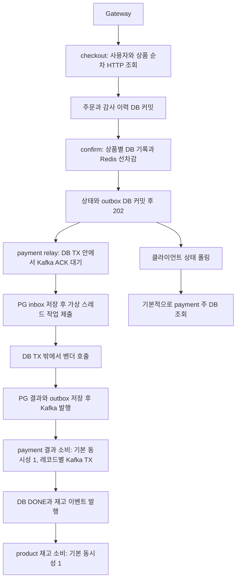

# 결제 서버의 TPS 제한 요인 분석

> 조사일: 2026-10-28 · 기준 소스: main `07f5196c` · 정적 코드·설정 조사

이 문서는 초기 정적 조사 기록이다. 당시의 미실측·미수정 서술은 그 조사 시점의 상태다.
이후 결과와 현재 조치는 [실측 보고서](tps-clean-measurements.html), [인계·미해결 항목](tps-handoff.md),
[현재 합의](../topics/PAYMENT-THROUGHPUT.md)에서 확인한다.

## 판단과 조사 범위

현재 구현에는 완료 TPS를 낮출 수 있는 구조가 있다.
우선 확인할 후보는 결과 소비자의 직렬 처리, DB 연결을 점유한 Kafka 발행 대기, 재고 Redis의 동기 디스크 기록이다.
checkout의 넓은 트랜잭션과 상품별 순차 HTTP 조회, 완료를 기다리는 동안 증가하는 상태 폴링도 부하를 증폭한다.
그러나 현재 몇 TPS가 나오는지, 어떤 부하·환경·지표에서 얻은 수치인지는 주어지지 않았다.
따라서 이 보고서는 원인 후보와 작동 조건을 확인하며, 특정 후보를 실측 병목이나 성능 개선 배수로 확정하지 않는다.

결제의 검증·영속 기록·멱등성에는 비용이 필요하지만, 현재의 모든 직렬화와 대기가 반드시 필요한 것은 아니다.
특히 “결제니까 느릴 수밖에 없다”, “모의 PG가 200ms이므로 최대 5 TPS”, “가상 스레드이므로 대기 비용이 없다”는 결론은 이 코드에서 성립하지 않는다.

조사 대상은 Gateway부터 checkout, confirm 접수, payment outbox, PG inbox·벤더·outbox, 결과 소비, 상품 재고 반영, 상태 조회까지다.
품질·벤치마크 설정과 부하 도구, 로깅·트레이스·주기 집계도 함께 확인했다.
관리자 전용 조회는 정상 결제 처리량의 직접 원인으로 취급하지 않는다.
기존 실험·제외 보고서의 수치를 새 공식 결과로 재사용하지 않았으며, 서버 기동·부하·장애 실험은 실행하지 않았다.

reviewer·domain-expert·실행 설정 담당의 독립 조사를 시작했으나 사용량 제한으로 모두 중단됐다.
중간에 전달된 후보는 메인이 소스와 대조했고, 이후 범위는 직접 조사했다.
완결된 독립 검토를 통과한 보고서는 아니다.

## TPS를 나눠야 하는 이유

| 지표 | 집계 대상 | 이 지표만으로 알 수 없는 것 |
|:---:|:---:|:---:|
| 구매 시도 유입률 | checkout을 시작한 구매 수/초 | 서버 최대 처리량 |
| checkout 처리율 | 주문 생성·기존 결과 반환 | PG 승인 완료 |
| confirm 접수율 | HTTP 응답, 정상 접수는 202 | DB DONE·재고 반영 완료 |
| 결제 완료 TPS | DB에서 DONE으로 전이한 주문 수/초 | product DB 재고 반영 완료 |
| 사용자 관측 완료율 | 제한 시간 안에 폴링으로 DONE 확인 | 기한 후 완료된 주문의 처리량 |
| 재고 정산 처리율 | product가 반영한 상품 이벤트 수/초 | 다상품 주문의 주문 수/초 |

한 주문에 상품이 여러 개면 재고 이벤트도 여러 개다.
HTTP 요청률에는 checkout·confirm·상태 조회가 섞이므로 주문 완료 TPS와 직접 비교하지 않는다.
짧은 유입 구간 뒤 긴 정리 시간을 합쳐 평균을 내면 부하 중 처리율과 다른 값이 나오며, 짧은 시험의 완료 수에는 파이프라인 시작·종료 효과도 들어간다.
안정 구간의 유입·접수·DONE·재고 반영을 같은 시간축에서 보고 잔량이 증가하는 위치를 찾아야 한다.

현재 [Grafana confirm 진입률](../../observability/grafana/dashboards/business-dashboard.json#L78)은 HTTP confirm 경로의 1분 rate다.
성공 상태나 application을 제한하지 않은 식이므로 오류·재요청이 포함될 수 있고, 일치하는 다른 서비스 시계열도 합쳐질 수 있다.
제목은 진입률로 구분돼 있으며, 이를 결제 완료 TPS로 읽으면 안 된다.

## 경로와 우선 조사 위치

| 우선순위 | 후보 | 분류 | 주로 영향을 받는 구간 |
|:---:|:---:|:---:|:---:|
| 1 | payment 결과 소비 기본 1개 + 레코드별 Kafka 트랜잭션 | 조정 가능한 직렬화 | DB DONE 처리량 |
| 1 | payment relay가 DB 트랜잭션 안에서 Kafka ACK 대기 | 피할 수 있는 자원 점유 | 발행·접수·조회가 공유하는 DB 풀 |
| 1 | redis-stock의 AOF appendfsync always | 내구성 선택 비용 | confirm 접수와 재고 선차감 |
| 2 | checkout 전체 트랜잭션 + 사용자·상품 순차 HTTP | 피할 수 있는 자원 점유·왕복 | 주문 생성 |
| 2 | 500ms 폴링과 주 DB 공유 | 부하 증폭 | 조회와 쓰기 처리량 |
| 2 | PG의 제한 없는 작업 제출·중복 발행 경합 | 과부하·중복 처리 위험 | PG와 결과 소비 |
| 2 | product 소비 기본 1개 | 조정 가능한 직렬화 | 최종 재고 반영 |
| 3 | 반복 조회·엔티티 재조립·IDENTITY 삽입 | 왕복·할당 비용 | DB·CPU |
| 조건부 | 폴백·재시도·동일 키 경합 | 장애·중복 요청 비용 | 완료 지연·기한 내 완료율 |
| 장기 | 미처리 전체 조회·정리량 부족·메모리 누적 | 데이터 증가 비용 | 긴 시험·장기 운영 |

이 순서는 원인 규명에 유용한 조사 순서다.
실측하지 않은 영향도나 개선 효과의 순위가 아니다.

## 필요한 비용과 현재 설계의 선택

### 승인 대기와 다단계 영속 기록

품질 설정은 모의 PG 응답을 100~300ms 지연시킨다.
[quality 설정](../../docker/docker-compose.quality.yml#L17)과 [모의 PG](../../pg-service/src/main/java/com/hyoguoo/paymentplatform/pg/infrastructure/gateway/fake/FakePgGatewayStrategy.java#L333)에서 확인된다.
실제 PG라면 외부 네트워크·승인망 지연도 존재하지만, 그 시간이나 호출 한도는 이 조사에서 확인하지 않았다.

주문 저장, 재고 선차감 기록, 확정 의도 저장, PG 접수·결과 저장, 결제 결과·재고 반영이 서로 다른 커밋 경계에 있다.
이는 주문 하나를 INSERT하는 API보다 많은 DB·메시지 왕복을 요구한다.
감사 이력도 [BEFORE_COMMIT](../../payment-service/src/main/java/com/hyoguoo/paymentplatform/payment/infrastructure/listener/PaymentHistoryEventListener.java#L20)에 함께 저장한다.
기록을 빼면 더 빨라질 수 있지만 장애 후 복구·감사 보장도 달라진다.
보장을 유지하면서 각 경계의 불필요한 조회·점유·발행 단위를 먼저 줄이는 접근이 적절하다.

벤더 지연은 단건 지연의 일부이며 곧바로 전역 TPS 상한이 아니다.
병렬 처리 수가 확보되면 여러 승인을 동시에 기다릴 수 있고, 정상 PG 경로는 실제로 [벤더 호출을 DB 트랜잭션 밖](../../pg-service/src/main/java/com/hyoguoo/paymentplatform/pg/application/service/PgInboxProcessor.java#L77)에서 수행한다.
평균 대기 0.2초에 100건/초가 흐른다면 벤더 단계의 평균 진행 중 작업은 대략 20개라는 관계를 참고할 수 있다.
이는 평균값이 안정적인 경우의 예시이며 현재 시스템의 성능 추정값은 아니다.

### 같은 주문·상품의 순서와 멱등성

[결과 반영](../../payment-service/src/main/java/com/hyoguoo/paymentplatform/payment/application/usecase/PaymentConfirmResultUseCase.java#L131)은 주문 행을 잠근 뒤 상태를 판정한다.
리컨실러와 결과 소비가 서로의 결정을 덮어쓰지 않도록 하는 장치이며, 다른 주문 전체를 전역으로 잠그는 구조는 아니다.
주문별 Redis 선점도 같은 주문의 상품 반복이 겹치지 않게 한다.
동일 주문의 직렬화와 모든 주문의 단일 소비는 별개의 선택이다.

재고 이벤트는 [productId를 메시지 키](../../payment-service/src/main/java/com/hyoguoo/paymentplatform/payment/application/usecase/PaymentConfirmResultUseCase.java#L243)로 사용한다.
[product 재고 차감](../../product-service/src/main/java/com/hyoguoo/paymentplatform/product/application/usecase/StockCommitUseCase.java#L88)은 이 순서에 기대는 조회 후 저장 구조다.
상품이 하나에 몰리면 해당 파티션의 처리량이 제한되며, 다른 상품까지 같은 파티션을 공유할 수 있다.
파티션 수는 병렬성의 상한이지 고정 TPS 수치가 아니다.
저장소의 기본 생성 스크립트와 토픽 선언은 3파티션이지만 이미 실행 중인 토픽의 실제 수는 따로 확인해야 한다.
순서를 무시하고 동일 파티션 레코드를 임의 병렬화하거나 주문번호로 재분배하면 재고 갱신 유실이 생길 수 있다.

### Redis 내구성은 성능과 맞바꾼 선택

[인프라 설정 91~101행](../../docker/docker-compose.infra.yml#L91)은 redis-stock에 AOF와 `appendfsync always`, `save 60 1`을 적용한다.
quality·benchmark는 이 명령을 덮지 않는다.
Redis 공식 문서에 따르면 always는 응답 전에 AOF 동기화를 기다리며 동시 쓰기는 묶일 수 있다.
따라서 “명령 하나당 물리 fsync 한 번”으로 단정해서 계산할 수는 없지만 디스크 대기를 포함하는 것은 맞다.
근거: [Redis persistence](https://redis.io/docs/latest/management/persistence/).

상품 하나의 정상 confirm도 주문 락 획득, 상품 차감, 주문 락 해제라는 쓰기 스크립트 왕복을 거친다.
상품 수가 늘면 차감 호출도 늘어난다.
[Redis 어댑터](../../payment-service/src/main/java/com/hyoguoo/paymentplatform/payment/infrastructure/cache/StockCacheRedisAdapter.java#L87)와 [조립 순서](../../payment-service/src/main/java/com/hyoguoo/paymentplatform/payment/application/usecase/PaymentTransactionCoordinator.java#L52)에서 확인된다.
하나의 Redis 인스턴스와 디스크를 공유하므로 상품 분산만으로 AOF 비용이 사라지지는 않는다.

확인 방법은 Redis 명령 지연, AOF 쓰기·동기화 상태, 호스트 디스크 지연과 confirm 단계 시간을 대조하는 것이다.
`everysec`나 영속성 해제를 적용한 수치를 같은 내구성의 개선으로 제시하면 안 된다.
선차감 기록이 유실될 때 재시작·재요청·재고 재구성에서 초과판매를 막을 수 있는지 먼저 설계해야 한다.
RDB 스냅샷·AOF rewrite도 긴 실행 중 CPU·메모리·I/O 변동 후보이며 실제 발생 여부를 확인해야 한다.

## 정상 경로에서 개선을 검토할 패턴

### 결과 소비 1개가 DB 작업과 Kafka 커밋을 매번 수행

[payment Kafka 설정 72·97·103행](../../payment-service/src/main/java/com/hyoguoo/paymentplatform/payment/infrastructure/config/KafkaConsumerConfig.java#L72)은 기본 동시성을 1로 두고 Kafka 트랜잭션 매니저를 연결한다.
배치 리스너가 아닌 레코드 리스너이며, 각 레코드에서 주문 조회·잠금, 멱등 기록, 상태·주문 항목 갱신, 선차감 확정, 감사 이력, 재고 이벤트 발행을 수행한다.
컨테이너는 리스너 처리 후 오프셋과 Kafka 트랜잭션을 커밋한다.
근거: [Spring Kafka EOS](https://docs.spring.io/spring-kafka/reference/kafka/exactly-once.html).

다른 주문들도 이 소비 스레드에서는 차례로 처리된다.
한 건의 DB 처리와 Kafka 커밋을 포함한 평균 점유 시간이 길면 해당 스레드가 전역 완료 처리량을 제한할 수 있다.
예를 들어 총 점유가 20ms면 약 50건/초, 100ms면 약 10건/초 규모라는 계산이 가능하다.
이 숫자는 설명용 가정이며 현재 점유 시간이나 측정 TPS가 아니다.
Kafka에서 여러 레코드를 한 번에 가져오더라도 현재 구조의 레코드별 트랜잭션 커밋 비용이 자동으로 없어지지는 않는다.

확인할 신호는 events.confirmed lag 증가, PG 승인량 대비 DB DONE 증가량 감소, 레코드 처리·Kafka 커밋 시간이다.
동시성 1과 파티션 수 이내의 다른 값만 바꿔 같은 보장·데이터 조건에서 비교하는 실험이 우선이다.
동시성 증가는 DB와 Kafka의 부하도 늘리므로 선형 개선을 보장하지 않는다.
배치 처리는 가능한 후속 후보지만 롤백 범위·불량 레코드·재고 재발행·지연을 다시 검증해야 한다.
EOS를 제거하는 것을 단순 성능 개선으로 취급하지 않는다.

### payment relay가 DB 연결과 행 락을 잡은 채 Kafka를 기다림

[OutboxRelayService 49~92행](../../payment-service/src/main/java/com/hyoguoo/paymentplatform/payment/application/service/OutboxRelayService.java#L49)은 하나의 DB 트랜잭션에서 선점 UPDATE, outbox·주문 조회, Kafka 발행, DONE 저장을 수행한다.
[발행 어댑터 64~66행](../../payment-service/src/main/java/com/hyoguoo/paymentplatform/payment/infrastructure/messaging/publisher/KafkaMessagePublisher.java#L64)은 ACK를 동기 대기하며 기본 대기 설정은 10초다.
발행 호출 자체의 내부 대기와 DB 조회 시간까지 합친 전체 메서드 실행 시간을 10초로 제한하는 설정은 아니다.

가상 스레드는 대기 중 OS 스레드를 양보할 수 있지만 이미 획득한 DB 연결과 행 락을 반납하지 않는다.
정상 ACK가 느려져도 점유가 늘고, 브로커 장애 때는 같은 payment 풀의 checkout·confirm·상태 조회까지 막을 수 있다.
풀 크기는 docker 기본 30이며, 30은 TPS가 아니라 동시 DB 연결 수다.
확인은 Kafka ACK 시간과 Hikari active·pending·사용 시간의 동반 증가로 한다.

개선 후보는 짧은 선점 커밋, 트랜잭션 밖 발행, 조건부 완료 기록으로 경계를 나누는 것이다.
다만 임대 만료·선점 소유권·서버 크래시·발행 성공 후 DB 실패를 다뤄야 하며, 중복 재발행을 허용하는 outbox와 소비자 멱등성을 유지해야 한다.
현재 주석의 “VT 블로킹은 저비용”만으로 DB 점유까지 무해하다고 판단하면 안 된다.
PG outbox relay는 외부 전체 트랜잭션이 없으므로 같은 문제라고 묶지 않는다.

### checkout 트랜잭션이 Redis와 외부 HTTP까지 감쌈

[checkout 35~63행](../../payment-service/src/main/java/com/hyoguoo/paymentplatform/payment/application/PaymentCheckoutServiceImpl.java#L35)은 Redis 멱등 처리, 사용자 조회, 상품 조회, 주문 생성을 한 트랜잭션 안에 둔다.
현재 Hikari·Hibernate 설정에는 연결의 autocommit 해제와 획득 지연을 함께 보장하는 별도 구성이 없다.
Hibernate의 기본 resource-local 동작에서는 트랜잭션 시작 시 autocommit 처리를 위해 연결을 얻을 수 있으므로, 첫 SQL 전 HTTP·Redis 대기도 풀 점유에 포함되는 후보다.
근거: [Hibernate 연결 관리](https://docs.hibernate.org/orm/6.6/userguide/html_single/#database-connection-handling).
실제 획득 시점과 사용 시간은 JDBC·Hikari 계측으로 확인해야 한다.

사용자·상품 조회가 느리거나 같은 키의 Redis 결과를 기다리는 요청이 늘면 DB 풀도 함께 고갈될 수 있다.
외부 검증·멱등 조립과 주문 저장 트랜잭션의 경계를 좁히는 방향을 검토할 수 있다.
현재 Redis 결과는 DB 커밋 전에 저장되므로, 경계만 기계적으로 이동하면 안 된다.
이미 진행 중인 안전한 재요청 설계의 구매 키·주문 원자성과 함께 다뤄야 한다.

### 상품 수만큼 순차 HTTP 호출과 별도 선차감 기록 커밋

[OrderedProductUseCase 16~20행](../../payment-service/src/main/java/com/hyoguoo/paymentplatform/payment/application/usecase/OrderedProductUseCase.java#L16)은 상품별 HTTP 조회를 순차 수행한다.
그 앞의 사용자 조회도 완료된 뒤 상품 조회로 넘어간다.
각 [상품 조회](../../product-service/src/main/java/com/hyoguoo/paymentplatform/product/application/usecase/ProductQueryUseCase.java#L24)는 product DB를 조회하며, 정상 경로에 명시적 상품·사용자 응답 캐시는 없다.
요청당 내부 호출은 상품 수 n에 대해 사용자 1회와 상품 n회다.
상품마다 [선차감 상태 조회·기록 커밋·Redis 차감](../../payment-service/src/main/java/com/hyoguoo/paymentplatform/payment/application/usecase/PaymentTransactionCoordinator.java#L80)도 차례로 진행된다.
[선차감 기록 저장](../../payment-service/src/main/java/com/hyoguoo/paymentplatform/payment/infrastructure/repository/StockHoldRecordRepositoryImpl.java#L45)은 confirm 외부 트랜잭션과 분리돼 상품별로 커밋된다.

다상품 주문은 단일 상품보다 HTTP·DB 커밋·Redis 왕복이 늘어난다.
특히 네트워크·디스크 지연이 크면 CPU가 한가해도 TPS가 낮아질 수 있다.
품질 시나리오는 상품 1개이므로 이 증폭이 전부 드러나는 조건은 아니다.
상품 일괄 조회, 동일 상품 조회 정리, 독립 조회의 제한된 병렬 실행이 후보이며 가격·사용자 유효성 기준을 정해야 한다.
상품별 기록의 일괄 저장도 가능성을 검토할 수 있으나 기록이 차감보다 먼저 남는 순서, 부분 실패·회수와 상품별 Redis Cluster 슬롯 경계를 보존해야 한다.
전체 상품을 하나의 거대한 트랜잭션·Lua로 묶는 방식은 자동 해법이 아니다.

### 폴링이 느린 처리를 더 느리게 만드는 피드백

[상태 서비스](../../payment-service/src/main/java/com/hyoguoo/paymentplatform/payment/application/PaymentStatusServiceImpl.java#L22)는 active outbox를 확인한 뒤 필요하면 결제 snapshot을 추가 조회한다.
[JDBC 어댑터](../../payment-service/src/main/java/com/hyoguoo/paymentplatform/payment/infrastructure/repository/PaymentStatusQueryJdbcAdapter.java#L29)는 필요한 컬럼만 읽지만 한 폴링에 최대 두 SELECT가 발생한다.
[복제본 설정](../../payment-service/src/main/java/com/hyoguoo/paymentplatform/payment/infrastructure/config/ReplicaDataSourceConfig.java#L74)은 기본 false이며 quality에서도 별도로 켜지 않는다.
따라서 기본적으로 쓰기와 같은 주 DB·풀을 사용한다.

품질 클라이언트는 500ms 간격으로 반복 조회한다.
진행 중 주문이 W개이고 응답이 충분히 빠르다면 조회 유입은 대략 2W회/초, DB SELECT는 최대 약 4W회/초 규모가 된다.
응답 지연·실패·종결에 따라 실제 값은 달라진다.
처리 지연 → 진행 중 주문 증가 → 폴링 증가 → DB 경쟁 증가라는 증폭이 가능하다.

확인은 상태 API 비중, 쿼리 수, Hikari 점유, 백로그를 함께 보는 것이다.
순수 쓰기 경로 진단에서는 폴링을 끈 부하와 전수 폴링 부하를 구분하되, 최종 사용자 품질 검증에는 실제 폴링 비용을 다시 포함해야 한다.
지터·백오프·최소 snapshot 조회 통합·진행 중 상태의 짧은 캐시를 비교할 수 있다.
복제본은 조회 경쟁을 줄일 후보지만 복제 지연 때문에 완료 관측이 늦어질 수 있고 돈 경로 판정에 그대로 사용하면 안 된다.

### PG 작업 제출에는 실제 처리 동시성 제한이 없음

[AbstractImmediateWorker 101~105행](../../pg-service/src/main/java/com/hyoguoo/paymentplatform/pg/infrastructure/scheduler/AbstractImmediateWorker.java#L101)은 채널에서 작업을 꺼내 executor에 제출하고 다음 작업을 받는다.
[PG executor](../../pg-service/src/main/java/com/hyoguoo/paymentplatform/pg/core/config/concurrent/ContextAwareVirtualThreadExecutors.java#L21)는 작업마다 가상 스레드를 생성한다.
따라서 inbox worker-count 5와 outbox worker-count 1은 벤더·발행 동시 실행 개수의 상한이 아니다.
“5개 × PG 200ms → 25 TPS 상한”이라는 계산은 잘못이다.

오히려 DB·벤더·브로커가 느려지면 실행 중 가상 스레드와 대기가 누적될 수 있다.
[채널 queue size](../../pg-service/src/main/java/com/hyoguoo/paymentplatform/pg/infrastructure/channel/PgInboxChannel.java#L52)가 작아도 이미 제출한 작업 수가 크면 정상이라는 뜻이 아니다.
작업 중복 적재까지 겹치면 불필요한 DB 조회·외부 호출도 늘어난다.
확인은 제출·실행·완료 수, 활성 작업·대기 시간, DB pending, 힙·GC를 분리해서 한다.
리소스별 동시성 제한과 대기·재접수 정책을 추가하는 후보이며, 단순히 worker-count를 늘리는 처방은 맞지 않는다.

### PG outbox의 조회 후 발행은 동시 중복을 막지 못함

[PG relay 49~79행](../../pg-service/src/main/java/com/hyoguoo/paymentplatform/pg/application/service/PgOutboxRelayService.java#L49)은 미처리 행 조회, Kafka 발행, processed_at 저장 순서다.
그 사이 소유권을 확정하는 조건부 선점이나 락은 없다.
[폴링 조회](../../pg-service/src/main/java/com/hyoguoo/paymentplatform/pg/infrastructure/repository/JpaPgOutboxRepository.java#L23)도 일반 SELECT다.
즉시 경로와 [2초 폴러](../../pg-service/src/main/java/com/hyoguoo/paymentplatform/pg/infrastructure/scheduler/PgOutboxPollingWorker.java#L68)가 같은 미처리 행을 읽으면 양쪽이 발행할 수 있다.
관련 주석의 exactly-once·SKIP LOCKED 설명은 실제 구현을 보장하지 않는다.

이 경합은 서버 크래시가 없어도 가능하며 발행·소비·멱등 조회 비용을 늘린다.
DONE+APPROVED 결과 재수신은 [재고 이벤트도 재발행](../../payment-service/src/main/java/com/hyoguoo/paymentplatform/payment/application/usecase/PaymentConfirmResultUseCase.java#L140)하므로 product까지 비용이 전파될 수 있다.
동일 outbox ID·event UUID의 발행 횟수와 terminal resend를 확인해야 한다.
안전한 선점은 이 경합을 줄일 수 있지만 발행 후 프로세스 종료 같은 중복 가능성까지 제거하지는 못하므로 소비자 멱등성은 유지해야 한다.
실제 중복 빈도는 확인하지 않았다.

### product 소비도 기본 1개이며 상품 수만큼 작업이 증가

[StockCommitConsumer](../../product-service/src/main/java/com/hyoguoo/paymentplatform/product/infrastructure/messaging/consumer/StockCommitConsumer.java#L55)는 기본 컨테이너를 사용하며 별도 동시성 설정이 없다.
기본 단일 소비 조건에서는 서로 다른 상품 이벤트도 한 스레드가 처리한다.
주문당 상품 수가 n이면 주문 하나의 재고 확정에 이벤트 n개가 필요하므로 이벤트/초를 주문 TPS로 바로 읽을 수 없다.
product lag만 늘면 결제 DB DONE은 빠른데 재고 정산이 늦는 결과가 가능하다.

독립 파티션의 소비 동시성을 늘리는 실험은 가능하지만 같은 상품의 순서를 보존해야 한다.
현행 조회 후 저장을 무조건 병렬화하는 것은 금지할 방향이며, 필요하다면 조건부 원자 UPDATE와 멱등 기록의 동일 커밋까지 함께 설계해야 한다.
payment와 product가 각각 단일 소비라고 해서 두 제한을 곱해 TPS를 계산하는 것도 잘못이다.
파이프라인에서는 먼저 포화되는 단계와 잔량을 확인한다.

PG 명령 소비도 기본 자동 구성의 동시성 1을 사용하며, [리스너](../../pg-service/src/main/java/com/hyoguoo/paymentplatform/pg/infrastructure/messaging/consumer/PaymentConfirmConsumer.java#L55)는 상태 조회·신규 inbox 저장까지 동기 수행한다.
벤더 대기는 별도 작업으로 넘어가므로 리스너가 승인 시간 전체를 기다리지는 않는다.
commands.confirm lag가 먼저 늘면 이 접수 경로의 DB 왕복·커밋과 소비 동시성을 조사해야 한다.
앱 HTTP의 가상 스레드 활성화가 Kafka 리스너 동시성까지 자동으로 늘리지는 않는다.

### 반복 조회·도메인 재조립과 삽입 배치의 한계

payment의 [주문 로드](../../payment-service/src/main/java/com/hyoguoo/paymentplatform/payment/infrastructure/repository/PaymentEventRepositoryImpl.java#L42)는 이벤트와 주문 항목을 별도 SELECT로 읽는다.
relay가 금액·키·상태를 확인할 때도 주문 전체를 읽고, [저장](../../payment-service/src/main/java/com/hyoguoo/paymentplatform/payment/infrastructure/repository/PaymentEventRepositoryImpl.java#L79)은 도메인 객체를 새 JPA 엔티티로 바꿔 항목별 save와 이벤트 save를 수행한다.
트랜잭션·영속성 컨텍스트에 따라 merge의 추가 조회와 할당·dirty checking 비용이 생길 수 있다.
모든 save마다 반드시 SELECT가 추가된다고 단정하지 않고 실제 SQL 수를 확인해야 한다.

PG도 [즉시 처리 분기 조회](../../pg-service/src/main/java/com/hyoguoo/paymentplatform/pg/infrastructure/scheduler/PgInboxImmediateWorker.java#L145) 뒤 [processor에서 다시 조회](../../pg-service/src/main/java/com/hyoguoo/paymentplatform/pg/application/service/PgInboxProcessor.java#L67)하고 선점 조회·UPDATE를 별도 수행한다.
PG outbox는 저장한 JSON을 [다시 역직렬화한 뒤 발행](../../pg-service/src/main/java/com/hyoguoo/paymentplatform/pg/infrastructure/messaging/publisher/PgEventPublisher.java#L95)한다.
정합성 판정에 필요한 재확인은 보존하되 전용 projection·조건부 갱신의 반환값·이미 확보한 snapshot 재사용 가능성을 비교할 수 있다.

[payment_order](../../payment-service/src/main/java/com/hyoguoo/paymentplatform/payment/infrastructure/entity/PaymentOrderEntity.java#L29)와 이벤트는 IDENTITY PK를 사용한다.
Hibernate는 이 삽입을 JDBC 배치로 묶지 못하므로 batch_size=25와 saveAll이 곧 주문 항목 25개를 한 번에 INSERT한다는 뜻이 아니다.
근거: [Hibernate JDBC batching](https://docs.hibernate.org/orm/6.6/userguide/html_single/#batch-session-batch).
다상품·대량 삽입에서 확인할 후보이며 상품 1개 주문의 낮은 TPS를 이것 하나로 설명하기는 어렵다.
[상품 내용 매칭](../../payment-service/src/main/java/com/hyoguoo/paymentplatform/payment/application/usecase/PaymentCreateUseCase.java#L79)도 각 상품마다 원 목록을 다시 순회해 O(n²)지만 작은 장바구니에서는 네트워크·DB 비용보다 우선순위가 낮다.

### 매 재고 이벤트의 만료 DELETE가 추가 왕복을 만듦

[product 멱등 저장 79~100행](../../product-service/src/main/java/com/hyoguoo/paymentplatform/product/infrastructure/idempotency/JdbcEventDedupeStore.java#L79)은 새 이벤트도 UUID별 만료 DELETE 후 INSERT IGNORE를 수행한다.
신규 고유 UUID가 대부분인 정상 부하에서는 지울 것이 없는 DELETE도 매번 발생한다.
8일 만료 후 같은 UUID를 다시 허용하는 현재 계약 때문에 있는 코드이며, 단순 삭제로 없애면 의미가 달라진다.
계약을 보존하는 원자 UPSERT·조건부 처리 등의 가능성을 비교하고 락·동시 요청·만료 경계와 JDBC 왕복을 검증할 수 있다.
성능 기여도는 SQL 프로파일 없이는 정하지 않는다.

## 실패·재배달·과부하 때만 커지는 비용

### 즉시 경로를 놓치면 폴백 처리율과 60초 회수 지연에 걸림

PG inbox는 [기본 임계 60초와 5초 폴링](../../pg-service/src/main/resources/application.yml#L92)으로 누락·실패 작업을 회수한다.
폴러는 [PENDING과 IN_PROGRESS 배치를 순차 처리](../../pg-service/src/main/java/com/hyoguoo/paymentplatform/pg/infrastructure/scheduler/PgInboxPollingWorker.java#L119)하며 각각 batch-size 10이다.
품질 클라이언트는 checkout 시작 후 60초까지만 관측하므로 이 경로로 밀린 작업은 복구가 돼도 기한 내 완료로 잡히기 어렵다.
예외·회수 건수가 소수여도 p99와 99.9% 완료 목표에는 크게 보일 수 있다.

PG outbox 폴백은 10행을 순차 발행한 뒤 2초 쉬므로, 폴백만으로 처리한다면 인스턴스당 처리율은 `10 / (2초 + 배치 처리 시간)` 이하이며 이상적으로도 약 5행/초를 넘지 못한다.
이 값은 즉시 경로가 정상 작동하는 전체 서버의 상한이 아니다.
payment 폴백도 quality 기준 배치 50·5초 간격이어서 폴백 의존이 커지면 적체가 발생할 수 있다.
즉시 경로 실패·큐 누락·회수 비중을 먼저 확인하며, 지연을 줄이려고 좀비 임계를 무턱대고 낮추면 아직 처리 중인 PG 호출과 겹칠 수 있다.

### 중복 승인 확인은 별도의 외부 조회와 DB 점유를 만듦

정상 PG 승인 호출은 DB 트랜잭션 밖이지만, 중복 승인 응답은 [결과 반영 트랜잭션](../../pg-service/src/main/java/com/hyoguoo/paymentplatform/pg/application/service/PgVendorCallService.java#L136)에서 [중복 승인 핸들러](../../pg-service/src/main/java/com/hyoguoo/paymentplatform/pg/application/service/DuplicateApprovalHandler.java#L131)로 들어간다.
핸들러는 그 트랜잭션 안에서 벤더 상태를 조회한다.
중복·재시도가 많고 실 PG 조회가 느리면 DB 연결 점유가 늘어 정상 처리도 영향을 받는다.
quality fake의 상태 조회는 메모리 조회라 실 PG와 같은 대기 비용이 재현되는 것은 아니다.
이미 처리됐다는 응답만 믿고 성공 처리하면 안 되므로, 외부 조회와 최종 DB 검증·반영을 분리하는 개선을 검토해야 한다.

### 재배달과 재시도는 신규 구매 처리량을 소모

PG 실패 재시도는 [2·6·18초 기준 백오프](../../pg-service/src/main/java/com/hyoguoo/paymentplatform/pg/domain/RetryPolicy.java#L41)와 지터를 사용하며 추가 PG 호출·outbox·Kafka 소비가 생긴다.
이는 장애 때 폭주를 줄이는 정책이고 정상 성공 건마다 지불하는 고정 지연이 아니다.
payment 결과와 product 소비에는 기본 1초 간격·5회 재시도 경로가 있다.
해당 소비 스레드에서 실패 레코드를 기다리면 같은 스레드에 배정된 다른 주문도 지연될 수 있다.
비재시도 예외 분류는 이미 있으므로 모든 실패가 5회 대기한다고 주장할 수는 없다.
예외 유형별 재시도량·DLQ·lag를 확인하고 실제 영구 오류가 재시도를 소모하는지 조사한다.

PG의 IN_PROGRESS 재진입은 짧은 락 조회 트랜잭션을 끝낸 뒤 벤더 호출을 수행한다.
[재진입 구현](../../pg-service/src/main/java/com/hyoguoo/paymentplatform/pg/application/service/PgInboxProcessor.java#L115)의 이 락은 외부 호출 동안 유지되는 처리 임대가 아니다.
같은 주문의 중복 명령이 적재되면 겹친 벤더 호출·거부·조회가 추가될 수 있다.
중복 발행·좀비 회수·self-retry를 구분해 확인하고, 안전한 소유권·재시도 도착 시각을 보존하는 제한을 검토한다.

### 같은 checkout 키의 경합은 50ms 폴링과 최대 2초 대기

[Redis 멱등 어댑터 38~86행](../../payment-service/src/main/java/com/hyoguoo/paymentplatform/payment/infrastructure/idempotency/IdempotencyStoreRedisAdapter.java#L38)은 경쟁 패자가 50ms마다 최대 40회 조회한다.
creator가 실패해도 IN_PROGRESS 마커는 TTL 10초까지 남는다.
동일 키 폭주에서는 요청마다 반복 GET과 대기가 생기며, 넓은 checkout 트랜잭션의 점유와 결합할 수 있다.
반면 품질 시나리오는 구매별 고유 키이므로 정상 단일 시도의 저TPS를 이 폴링으로 설명하면 안 된다.
승자 공유·진행 중 응답·클라이언트 재시도 정책과 영속 키 설계를 함께 검토할 항목이다.

### 주기 작업이 하나의 스케줄러를 공유할 수 있음

별도 TaskScheduler 설정은 조사한 서비스 코드에서 발견하지 못했다.
기본 자동 구성이라면 VT 활성 서비스는 SimpleAsyncTaskScheduler를, benchmark payment는 VT 비활성 기본 스케줄러를 사용한다.
VT 스케줄러의 fixed-delay 작업들도 같은 스케줄러 스레드에서 실행된다.
근거: [Spring Boot 3.4 scheduling](https://docs.spring.io/spring-boot/3.4/reference/features/task-execution-and-scheduling.html), [Spring Framework scheduling](https://docs.spring.io/spring-framework/reference/integration/scheduling.html).

따라서 PG 폴백의 느린 동기 발행·벤더 재호출이나 큰 지표 집계가 같은 프로세스의 다른 주기 작업을 밀 수 있다.
정상 즉시 경로가 반드시 한 스케줄러에서 직렬 처리된다는 뜻은 아니다.
실행 시 scheduler 빈 타입과 작업별 실제 시작 지연을 확인하고, 복구·집계의 실행 자원을 분리하는 후보를 검토한다.
재진입 방어 없이 fixedDelay를 fixedRate로 바꾸는 방식은 피한다.

## 실행 환경·관측·데이터 증가의 영향

### 여러 서비스가 한 호스트의 CPU·메모리·디스크를 공유

quality는 각 서비스 1개와 DB 4개, Kafka, Redis 2개, 관측 도구 등을 함께 실행한다.
JVM Xmx는 [quality overlay](../../docker/docker-compose.quality.yml#L5)에 있지만 컨테이너 전체 RSS나 전체 스택 메모리 한도를 뜻하지 않는다.
여러 DB의 커밋과 Redis 동기화, Kafka 기록, Loki·Tempo 저장이 한 Docker 환경의 디스크·메모리를 경쟁할 수 있다.
따라서 이 환경의 낮은 수치가 바로 서버 비즈니스 로직만의 한계라고 볼 수는 없다.

호스트·Docker 할당량, 컨테이너별 CPU·메모리·OOM, swap·GC·디스크 지연을 기록해야 한다.
DB 영속 설정의 런타임 값과 실제 커밋 비용은 이번에 확인하지 않았다.
앱 인스턴스만 늘리면 DB 풀·스레드·힙·로그도 늘어나 같은 호스트에서는 오히려 악화될 수 있다.
역할별 자원 분리 실험과 정상 사용자 경로 실험을 구분해 해석해야 한다.

### 100% 트레이스와 동기 콘솔 로그

[apps Compose](../../docker/docker-compose.apps.yml#L64)는 각 서비스와 Gateway의 트레이스 샘플링을 1.0으로 지정한다.
HTTP·Kafka·작업 문맥 전파와 로그가 결제 한 건에서 여러 번 발생한다.
[payment logback](../../payment-service/src/main/resources/logback-spring.xml#L18)은 동기 ConsoleAppender이며 로그마다 민감정보 마스킹 정규식도 적용한다.
[Gateway 필터](../../gateway/src/main/java/com/hyoguoo/paymentplatform/gateway/filter/TraceContextPropagationFilter.java#L70)도 요청별 INFO를 기록하므로 폴링이 증가하면 이벤트 루프 경로에서 출력 비용이 늘 수 있다.
모든 로그가 콘솔·수집·저장까지 거치면 CPU·할당·I/O 비용이 누적된다.

관측을 끄면 성능이 좋아진다는 결론은 아직 실측하지 않았다.
진단용으로 로그량·샘플링을 한 요소씩 비교하고 프로파일에서 비용을 확인할 수 있다.
현재 추적 토픽에서 필요한 증거를 잃지 않도록 최종 검증은 합의된 관측 설정으로 수행해야 한다.
비동기 로그도 큐 포화·유실·종료 시 flush 정책을 동반하므로 무조건적인 개선은 아니다.

### 지표 수집이 미처리 전체를 읽고, 정리량은 고정됨

[상태 지표](../../payment-service/src/main/java/com/hyoguoo/paymentplatform/payment/core/common/metrics/PaymentStateMetrics.java#L48)는 10초마다 상태별 COUNT를 수행한다.
인덱스를 사용해도 누적 데이터 규모에 따라 읽는 엔트리 수가 증가할 수 있다.
[outbox 지표](../../payment-service/src/main/java/com/hyoguoo/paymentplatform/payment/infrastructure/metrics/PaymentOutboxMetrics.java#L93)는 매분 Integer.MAX_VALUE로 실행 가능한 PENDING 전체를 엔티티로 읽고 histogram을 기록한다.
브로커 장애로 적체가 클수록 지표 수집이 메모리·조회·정렬 비용을 더하는 패턴이다.
대기 전체를 필요로 하는 histogram은 DB 집계·표본·상한 조회로 바꿀 가능성을 검토할 수 있다.

payment와 product의 [멱등 기록 정리](../../payment-service/src/main/java/com/hyoguoo/paymentplatform/payment/infrastructure/scheduler/DedupeCleanupWorker.java#L80)는 기본 1시간마다 최대 1,000행 한 배치다.
[product 정리](../../product-service/src/main/java/com/hyoguoo/paymentplatform/product/infrastructure/scheduler/DedupeCleanupWorker.java#L80)도 같은 형태다.
만료 도달 후 지속 유입이 1,000건/시간보다 많으면 기본 정리량이 만료 생성량을 따라가지 못한다.
10건/초라면 시간당 36,000건이므로 장기 실행에서 차이가 커진다.
단기 새 DB 시험의 초기 TPS를 설명하는 원인은 아니며, 보존 기간이 지난 이후의 크기·인덱스·정리 지연 문제다.

모의 PG의 processedOrders는 [ConcurrentHashMap](../../pg-service/src/main/java/com/hyoguoo/paymentplatform/pg/infrastructure/gateway/fake/FakePgGatewayStrategy.java#L108)에 승인 결과를 계속 보관하며 정상 승인 기록의 제거·크기 상한이 없다.
긴 fake 부하에서는 힙 점유·GC가 늘 수 있지만 실제 PG 구현 전체의 문제로 일반화하지 않는다.
Redis 상품 차감 토큰도 8일간 유지되므로 지속 부하에서는 메모리·AOF 크기가 증가한다.
보관 기간 단축·정리 변경은 재배달·안전한 재시도 범위와 같이 판단해야 한다.

### 설정을 올려도 실제 객체에 반영되지 않는 손잡이

[benchmark Compose](../../docker/docker-compose.benchmark.yml#L71)는 SPRING_DATA_REDIS_LETTUCE_POOL_MAX_ACTIVE 등을 지정하지만 현재 [기본 Redis factory](../../payment-service/src/main/java/com/hyoguoo/paymentplatform/payment/infrastructure/config/RedisConfig.java#L67)와 [재고 Redis factory](../../payment-service/src/main/java/com/hyoguoo/paymentplatform/payment/infrastructure/config/StockRedisConfig.java#L61)는 자체 LettuceClientConfiguration을 구성한다.
여기에 pooling builder나 해당 pool 속성 바인딩이 없다.
따라서 이 환경변수로 현재 Redis 연결 풀이 16개가 되고, 값을 올리면 개선된다고 해석할 근거가 없다.
공유 Lettuce 연결을 사용하는 구조 자체가 모든 명령을 호출 스레드에서 하나씩만 처리한다는 뜻도 아니다.

payment의 명시적 ProducerFactory는 필요한 속성을 Map에 직접 구성한다.
YAML의 spring.kafka.producer 배치·압축·linger 변경이 그 팩토리에 자동 반영된다고 가정하면 안 된다.
PG는 Spring Boot가 자동 구성한 ProducerFactory를 주입받으므로 이 지적을 PG에 그대로 적용하지 않는다.
실제 producer 설정과 빈을 확인한 뒤 실험해야 한다.
이 항목은 낮은 TPS를 직접 증명하는 원인보다, 효과 없는 튜닝·잘못된 원인 판정을 만드는 문제다.

### HTTP 연결과 Java 21 pinning은 확인 대상

[PG HTTP 어댑터](../../pg-service/src/main/java/com/hyoguoo/paymentplatform/pg/infrastructure/http/HttpOperatorImpl.java#L32)는 SimpleClientHttpRequestFactory를 명시한다.
Feign용 HC5·OkHttp와 명시적 풀 튜닝은 payment 빌드·설정에서 확인하지 못했으며, 런타임 classpath와 실제 Client 빈까지 확정하지 않았다.
연결 재사용이 전혀 없다거나 모든 호출이 새 TCP 연결이라는 주장은 하지 않는다.
실 PG에서 연결·TLS 비용, 동시 연결 대기, keep-alive와 timeouts를 측정한 뒤 클라이언트 변경 효과를 판단한다.
fake PG는 외부 HTTP를 호출하지 않으므로 이 경로가 quality TPS의 직접 원인은 아니다.

Java 21은 라이브러리 내부의 긴 synchronized I/O로 가상 스레드가 pinning될 수 있다.
그러나 이번 정적 조사만으로 JDBC·HTTP·로그에서 실제 pinning이 발생했다고 판단하지 않았다.
JFR의 VirtualThreadPinned와 스택을 확인할 항목이다.
근거: [Java 21 virtual threads](https://docs.oracle.com/en/java/javase/21/core/virtual-threads.html).
DB 풀 30, Tomcat threads.max 200, 가상 스레드 수를 서로 같은 종류의 제한으로 취급하지 않는다.

서비스들의 Hikari 설정에는 connection-test-query=SELECT 1이 있다.
Hikari는 JDBC4 드라이버에서 이 속성 대신 드라이버 검증을 사용하는 구성을 권장한다.
검증 시 추가 왕복 여부·빈도는 풀의 연결 재사용 상태에 따라 달라지므로 요청마다 반드시 SELECT 1이 실행된다고 계산하지 않는다.
큰 병목을 확인한 뒤 평가할 부가 후보이며, 근거는 [HikariCP 설정 설명](https://github.com/brettwooldridge/HikariCP#frequently-used)이다.

이번에 확인한 Gateway·정상 결제 application 코드에는 모든 구매를 특정 TPS로 제한하는 전역 RateLimiter나 전역 synchronized 구간은 발견하지 못했다.
주문·이벤트 조회의 고유 인덱스와 주문 항목의 부모 ID 인덱스도 이미 있다.
PG inbox의 상태 인덱스는 V8에서 (status, updated_at)으로 교체됐으므로 과거 index_merge 문제를 미수정 현행 원인으로 재기재하지 않는다.
현재 실행계획·테이블 통계까지 확인한 것은 아니므로 잔존 쿼리 문제는 EXPLAIN과 락 대기로 판단한다.

## 측정 때문에 낮게 보이거나 비교가 어긋나는 경우

[품질 시나리오](../../scripts/k6/quality-payment.js#L23)는 기본 10시도/초의 constant-arrival-rate이며 최대 처리량 탐색이 아니다.
최대 VU는 650이고 한 iteration이 최대 약 60초 관측을 포함한다.
예를 들어 모든 시도가 60초를 소모하는 상황에서는 10시도/초에도 약 600개의 동시 VU가 필요하다.
목표 rate만 높이고 VU·발생기 CPU·메모리를 확보하지 않으면 dropped_iterations가 늘어난다.
근거: [k6 arrival-rate VU allocation](https://grafana.com/docs/k6/latest/using-k6/scenarios/concepts/arrival-rate-vu-allocation/).
최악 조건 기준 650/60 계산은 부하 도구의 지속 유입 조건이며 서버 최대 TPS가 아니다.

헤더 없이 같은 사용자·상품·수량으로 반복 호출하면 [fallback 구매 키](../../payment-service/src/main/java/com/hyoguoo/paymentplatform/payment/application/IdempotencyKeyHasher.java#L16)가 같아져 Redis 결과 유효 기간에 기존 주문을 반환할 수 있다.
이때 HTTP 처리량과 신규 주문 생성량의 차이를 서버가 새 주문을 처리하지 못한 것으로 해석하면 안 된다.
현재 두 k6 경로는 고유 Idempotency-Key를 보내므로 그 정상 시나리오의 직접 원인은 아니다.

[별도 비동기 벤치마크](../../scripts/k6/async-payment.js#L75)는 폴링 생략·지연 표본을 지원하고, [공유 helper](../../scripts/k6/helpers.js#L35)는 기본 단일 상품과 다상품 설정을 지원한다.
quality는 100종에 분산한 상품 1개 주문과 전수 폴링을 사용한다.
두 도구의 수치는 같은 workload로 볼 수 없다.
docker·quality는 HTTP VT가 활성인 반면 payment benchmark 프로필은 HTTP VT를 끈다.
관측·리컨실러 임계·폴링·상품 수·유입 모델까지 맞춰야 비교가 성립한다.

[품질 판정기](../../scripts/quality/results.py#L139)의 60초 내 완료율은 사용자 기한을 측정한다.
60초 뒤 DB DONE으로 끝났어도 그 성공률에 다시 더하지 않으며, 이는 의도된 기준이다.
실패·응답 유실로 주문을 연결하지 못한 건은 미접수로 단정하지 않는다.
현재 요청 추적의 미확인 문제와 순수 처리 용량 문제를 같은 실패 원인으로 합치지 않는다.

## 원인 규명을 위한 검증 순서

아래는 실행 제안이며 이번 조사에서 수행한 실험 결과가 아니다.
기존 운영 데이터를 초기화하거나 부하를 즉시 시작하는 지시도 아니다.

1. 수치의 출처 고정: 실행 ID, 소스 SHA, 이미지·활성 프로필·실제 env, rate·기간·VU·상품 수·폴링, Docker 자원과 수치의 정의를 함께 기록
2. 정상 실패 없는 낮은 부하에서 단계별 기준 확보: checkout·confirm 응답, command 발행 ACK, PG 승인, result 소비·DB DONE, Kafka 커밋, product 반영, 사용자 관측 시간을 구분
3. 유입을 단계적으로 높이고 충분한 안정 구간 관측: 실제 시작률·드롭·오류·DB DONE·재고 반영·잔량을 같은 시간축에서 대조
4. 첫 포화 위치 확인: payment outbox, PG inbox와 활성 작업, PG outbox, result lag, stock lag 중 증가하는 위치와 DB·Redis·Kafka 자원 대기를 연결
5. 한 번에 한 요소 비교: 결과 소비 동시성, 폴링 유무·간격, 상품 수, 로그·트레이스 수준, TX 경계 후보를 같은 보장·데이터·유입 조건에서 비교
6. 변경 후보 검증: 동시 재요청·중복 메시지·커밋 후 응답 유실·브로커 지연에서 돈·주문·재고 불변식과 복구 시간 확인

기존 지표에서 얻을 수 없는 단계 점유 시간·활성 작업 수는 먼저 계측해야 한다.
Hikari active가 높다는 사실만으로 DB가 느리다고 결론 내리지 않는다.
HTTP·Kafka를 기다리며 연결을 점유할 수도 있다.
Kafka lag가 없다는 사실만으로 PG가 비어 있다고 판단하지 않는다.
inbox 저장 후 offset이 전진하고 실제 처리는 별도 가상 스레드에서 대기할 수 있다.

| 관측 패턴 | 먼저 조사할 위치 |
|:---:|:---:|
| checkout부터 느리고 payment Hikari pending 증가 | 넓은 checkout TX, 외부 사용자·상품 조회, relay와 풀 공유 |
| confirm만 느리고 Redis 쓰기 지연 증가 | AOF 동기화, 상품별 기록 커밋, Redis·DB 왕복 |
| 접수는 빠르고 events.confirmed lag 증가 | 결과 소비 동시성·DB 처리·Kafka 커밋 |
| PG Kafka lag는 낮지만 IN_PROGRESS·활성 작업 증가 | PG executor, 벤더 대기, DB 풀과 결과 저장 |
| DB DONE은 빠르고 stock lag만 증가 | product 소비 병렬도·상품 편중·멱등 SQL |
| 지연 꼬리가 60초 이상으로 분리 | 즉시 처리 예외·누락, inbox 회수 임계, 재시도 |
| 시간이 지날수록 GC·메모리·집계 쿼리 증가 | fake 승인 Map, 멱등 기록·토큰 증가, 전체 미처리 지표 조회 |

## 조사 결론과 검증 한계

현재 구조에서 낮은 TPS가 나올 이유는 충분히 발견되며 일부는 정합성 비용, 일부는 조정 가능한 직렬화·자원 점유·중복 처리 패턴이다.
확인 순서는 결과 소비의 레코드 점유 시간, relay의 DB 연결 점유, Redis 동기 기록 지연을 우선으로 잡는 것이 타당하다.
그 뒤 checkout·폴링·상품 수·PG 활성 작업으로 부하가 증폭되는지 확인한다.
특정 수치가 필연적이라는 근거나, 한 설정만 바꾸면 몇 배 빨라진다는 근거는 아직 없다.

최종 산출물은 이 조사 문서 한 개다.
서비스 코드·설정·기존 활성 토픽·STATE는 수정하지 않았다.
문서 strict 검사는 문제 0건으로 통과했으나 이 검사의 기본 대상에는 docs/reports 본문이 포함되지 않는다.
별도 검사에서 로컬 링크 64건·라인 앵커·Mermaid 금지 문자·공백은 문제 0건이었으며 외부 참고 링크 9건을 식별했다.
git diff --check도 통과했다.
Java 테스트·정적 분석·통합 테스트·실측은 실행하지 않았다.
