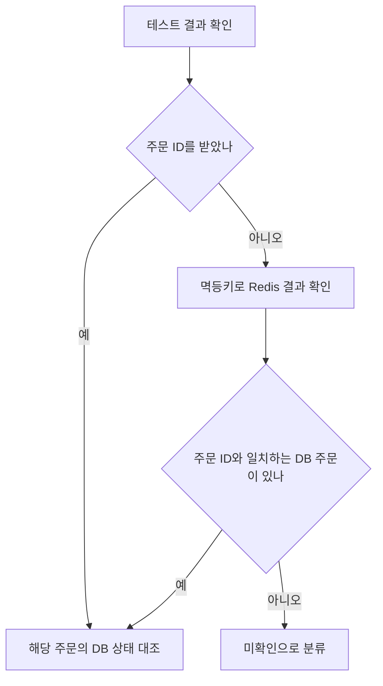

# 서버 중단 후 요청 추적 — 코드 점검 결과

> 2026-10-15 · 정적 코드 검토와 독립 reviewer 검토 · 구현·장애 재현 없음

> workflow 재개 후 범위: 사용자는 요청 추적과 안전한 재요청을 한 토픽에서 모두 진행한다고 확정했다.
> 아래는 보고서 정정 당시의 코드 점검 결과다. 영속 구매 키 연결은 안전한 재요청 목표의 설계 후보로 함께 검토한다.
> 최신 사용자 결정·통합 범위·검토 보완은 [discuss 문서](BRIEF.md)에 기록한다.

## 결론과 검토 범위

기존 trace·로그를 활용하는 경로부터 점검해야 한다.
새 접수 조회 API, trace ID의 DB 저장, k6의 trace ID 생성을 필수 변경으로 추천할 근거는 현재 부족하다.
이 문서는 이전의 영속 접수·자동 복구 설계 중심 검토를 대체한다.
앞선 범위 확대와 부정확한 설명은 [과설계 및 설명 정정 기록](checkout-receipt-tracking-corrections.md)에 남겼다.

사용자가 해결하려는 문제는 서버 중단·재기동 뒤 실패한 요청이 Gateway, payment, 주문 DB 중 어디까지 처리됐는지 알기 어려웠다는 것이다.
요청 도달, 주문 저장, 결제 승인은 서로 다른 사실이며 각각의 증거를 확인해야 한다.
처리 위치를 조사하는 기능이 주문 중복을 막거나 결제를 복구하는 기능은 아니다.

사람용 흐름은 [플로우 보고서](checkout-receipt-tracking-flow.html), 논의 상태와 과거 선택은 [discuss 문서](BRIEF.md)에서 확인한다.

## 현재 코드에서 확인한 사실

### 1. 서버 추적 기능은 이미 있다

Gateway와 payment에는 Micrometer의 OpenTelemetry 연동과 trace ID를 출력하는 로그 설정이 있다.
Gateway의 수신 필터는 유효한 입력 traceparent가 있으면 trace ID를 로그 문맥에 넣고 메서드·경로를 기록한다.
헤더가 없을 때 커스텀 필터가 직접 ID를 만드는 코드는 없으며, 서버 자동 계측을 사용하도록 구성돼 있다.

계측 의존성과 설정이 존재한다는 사실만으로 모든 로그 지점에서 같은 ID가 출력된다고 확정할 수는 없다.
특히 헤더 없는 일반 요청의 Gateway 수신 로그, payment 로그, Tempo trace를 함께 확인한 실행 근거는 이번 검토에 없다.
필터 우선순위만 보고 자동 계측보다 먼저 실행돼 ID가 반드시 누락된다고 단정하는 것도 잘못이다.

근거: [Gateway 의존성](../../../gateway/build.gradle), [수신 필터](../../../gateway/src/main/java/com/hyoguoo/paymentplatform/gateway/filter/TraceContextPropagationFilter.java#L53), [Gateway 로그 설정](../../../gateway/src/main/resources/logback-spring.xml), [payment 로그 설정](../../../payment-service/src/main/resources/logback-spring.xml).

### 2. 기존 스모크는 클라이언트가 traceparent를 제공한 경우만 검사한다

기존 스모크는 trace ID를 생성하고 요청 헤더에 넣은 뒤 여러 서비스 로그에서 같은 ID를 찾는다.
따라서 이 검사는 서버가 처음 ID를 만드는 일반 요청 경로의 검증을 대신하지 못한다.
또한 여러 요청에 같은 trace ID를 사용하는 검사이므로 trace ID 자체가 언제나 HTTP 요청 한 건의 고유 ID라는 해석도 맞지 않는다.

클라이언트에서 trace를 시작하는 것은 가능한 방식이다.
앞선 설명의 문제는 이를 이번 작업의 필수 변경처럼 추천한 것이며, 클라이언트 생성 자체가 기술적으로 잘못됐다는 뜻은 아니다.
[W3C Trace Context](https://www.w3.org/TR/trace-context/#no-traceparent-received)는 입력 traceparent가 없으면 새 trace를 시작하는 처리를 설명한다.
현재 서버 생성 방식을 변경해야 한다는 결론은 나오지 않는다.

근거: [스모크의 ID 생성과 요청 헤더](../../../scripts/smoke/trace-continuity-check.sh#L120).

### 3. 품질 판정 도구는 서버 로그를 사용하지 않는다

k6는 요청 전 attemptId와 멱등키를 기록하고, 응답에서 주문 ID를 얻으면 결과에 보관한다.
현재 결과에는 서버 trace ID가 없고 요청에 traceparent도 보내지 않는다.
Gateway의 수신 로그에는 k6의 attemptId나 멱등키와 대응하는 값이 없으므로, 특정 실패 시도와 서버 trace의 일대일 연결은 현재 자료만으로 자동 보장되지 않는다.
동시 요청의 시각·경로가 비슷하다는 이유로 같은 요청이라고 확정하면 안 된다.

현재 판정 흐름은 다음과 같다.

이 흐름에는 서버 로그·Tempo에서 주문 ID를 찾는 경로가 없다.
수집 도구도 실행 구간의 서버 로그·trace를 원자료로 저장하지 않는다.
따라서 기존 관측으로 일부 상황을 확인할 여지가 있는데도 판정 도구는 이를 사용하지 않는다.
이 누락을 확인했다고 해서 과거 미확인 요청을 모두 복원할 수 있다는 뜻은 아니다.
공식 결과에서 제외한 과거 자료는 파일 구조와 판정 사유만 확인했으며 측정 결과로 재사용하지 않았다.

근거: [k6 요청과 기록](../../../scripts/k6/quality-payment.js#L81), [주문 ID 없는 요청 판정](../../../scripts/quality/settlement.py#L225), [증거 수집](../../../scripts/quality/evidence.py), [실행 도구](../../../scripts/quality/run.py).

### 4. 주문 생성 로그는 DB 저장 완료 증거가 아니다

checkout 시작 로그는 HTTP 수신 필터가 아니라 주문 생성 서비스에 진입한 지점이다.
이 로그가 있으면 해당 업무 코드까지 도달한 것이지만, 없다고 payment가 HTTP 요청을 받지 않았다고 말할 수는 없다.

신규 주문 생성 로그에는 주문 ID가 남는다.
그러나 로그와 Redis 결과 저장 모두 checkout 트랜잭션 커밋 전에 실행된다.
로그에서 찾은 주문 ID는 DB 조회의 단서이며 저장 완료는 커밋된 DB 레코드로 확인해야 한다.
기존 주문 결과를 Redis에서 반환한 요청에는 신규 주문 생성 로그가 다시 남지 않는다.

근거: [checkout 트랜잭션과 로그](../../../payment-service/src/main/java/com/hyoguoo/paymentplatform/payment/application/PaymentCheckoutServiceImpl.java#L35), [Redis 결과 저장](../../../payment-service/src/main/java/com/hyoguoo/paymentplatform/payment/infrastructure/idempotency/IdempotencyStoreRedisAdapter.java#L61).

## 장애 조사에서 가능한 판단

아래는 해당 요청의 trace 또는 주문 ID를 신뢰할 수 있는 근거로 식별한 경우다.
특정 k6 실패 요청과 서버 trace를 연결하는 방식은 아직 정하지 않았다.

| 남은 증거 | 확인 가능한 사실 | 확정할 수 없는 사실 |
| :---: | :---: | :---: |
| Gateway 수신 로그만 발견 | Gateway의 기록 지점까지 도달 | payment 미도달 여부 |
| payment checkout 시작 로그 발견 | payment의 주문 생성 업무에 진입 | 주문 저장 성공 여부 |
| 주문 생성 로그와 주문 ID 발견 | 해당 ID로 주문 생성 처리를 수행 | 트랜잭션 커밋 성공 여부 |
| 해당 주문 ID의 커밋된 DB 레코드 존재 | 그 주문이 DB에 저장됨 | 어떤 응답이 클라이언트에 도착했는지 |
| DB를 정상 조회했지만 해당 주문 없음 | 조회 시점에 레코드가 없음 | 미도달·롤백·아직 진행 중 중 어느 경우인지 |
| 로그·ID가 없거나 DB 조회 실패 | 현재 증거로는 판정 불가 | 미처리 또는 실패 확정 |

DB 부재를 판단할 때는 primary DB와 조회 시점을 구분하고, 진행 중인 요청이 뒤늦게 커밋할 가능성을 고려한다.
로그 부재는 프로세스 종료·수집 실패 등으로도 발생하므로 미도달의 증명이 아니다.
DB와 로그가 서로 다른 시점의 기록이라는 점도 고려해야 한다.

## confirm은 기존 주문 ID에서 시작한다

confirm은 주문 생성 응답에서 얻은 주문 ID를 요청에 포함한다.
응답이 유실돼도 이미 알고 있는 ID로 결제 상태, 승인 작업 outbox, 후속 처리 기록을 대조할 수 있다.
checkout처럼 주문 ID 자체를 잃은 문제와 구분해야 한다.

정상 승인 접수 경로는 결제 상태 변경과 outbox 생성을 같은 DB 트랜잭션으로 저장한다.
outbox는 이후 승인 작업을 전달하기 위한 기록이며, 존재 자체가 PG 승인 완료를 뜻하지 않는다.
또한 outbox가 없다는 사실만으로 confirm 요청이 payment에 도달하지 않았다고 판단할 수 없다.

동시 confirm의 ALREADY_PROCESSING 분기는 새 outbox를 저장하지 않고 202를 반환할 수 있다.
따라서 모든 202가 그 순간의 영속 접수 완료를 보장한다고 설명하면 안 된다.
현재 상태 API도 모든 내부 상태를 그대로 반환하지 않으므로 조사에서 DB 상태·이력을 함께 볼 필요가 있다.

근거: [confirm의 동시 요청 분기](../../../payment-service/src/main/java/com/hyoguoo/paymentplatform/payment/application/OutboxAsyncConfirmService.java#L79), [상태와 outbox 저장 경계](../../../payment-service/src/main/java/com/hyoguoo/paymentplatform/payment/application/usecase/PaymentTransactionCoordinator.java#L182), [기존 상태 조회](../../../payment-service/src/main/java/com/hyoguoo/paymentplatform/payment/application/PaymentStatusServiceImpl.java).

## 현재 권고와 남은 선택

기존 관측을 확인하고 조사에 활용하는 방향을 먼저 논의한다.
이는 아래 작업이 구현됐거나 구체적 변경 방식까지 합의됐다는 뜻은 아니다.

- 실행 검증 대상: traceparent 없는 일반 요청의 Gateway 수신 로그와 payment 로그, 서비스 간 trace 연속성
- 도구 개선 후보: 실행 구간의 서버 로그 보존, 식별 가능한 trace에서 주문 ID를 찾고 DB와 대조하는 읽기 전용 조사
- 미결: k6의 특정 실패 요청과 서버 trace를 정확히 연결하는 방법, 식별되지 않는 요청을 미확인으로 남길 범위
- 현시점 필수 추천 철회: k6의 trace 생성, 별도 HTTP 시도 ID 도입, trace ID의 DB 컬럼, 공개 접수 조회 API

연결 방법을 비교할 때는 기존 키·응답 정보로 가능한지, 응답 자체가 사라지면 무엇을 잃는지부터 확인한다.
미확인 구간을 반드시 없애야 한다는 요구가 확정되기 전에 새 영속 기록을 도입하지 않는다.
로그 수집·보관도 비용이 있으므로 필요한 실행 구간과 의미 있는 이벤트로 제한하는 방향을 검토한다.
추가 지연이나 성능 수치는 측정하지 않았으며 효율이 검증됐다고 표현하지 않는다.

## 멱등성은 별도 판단이 필요한 실제 문제다

현재 checkout 결과 TTL과 처리 중 잠금 TTL의 기본값은 10초다.
키가 만료되면 DB에서 같은 구매의 기존 주문을 찾는 경로 없이 새 주문 생성으로 들어갈 수 있고, Redis 결과 저장과 주문 DB 커밋도 원자적이지 않다.
추적 개선만으로 이 한계가 해결되지는 않는다.
반대로 이 한계가 존재한다는 이유만으로 사용자 공개 조회 API까지 이번 범위에 포함할 필요도 없다.

사용자가 원래 주문을 의도했으므로 미저장 주문을 재요청으로 생성하는 것은 정상 복구다.
다만 현재 구현이 장애와 TTL 만료를 넘어 안전한 재요청을 보장한다는 설명과는 구분한다.
앞서 사용자가 선택한 사용자용 복구 요구는 이력으로 보존하고, 별도 범위로 계속 추진할지는 논의에서 결정한다.

근거: [기본 TTL](../../../payment-service/src/main/java/com/hyoguoo/paymentplatform/payment/infrastructure/idempotency/IdempotencyProperties.java), [Redis 중복 억제 처리](../../../payment-service/src/main/java/com/hyoguoo/paymentplatform/payment/infrastructure/idempotency/IdempotencyStoreRedisAdapter.java).

## 검증 범위

현재 코드·설정·스크립트와 기존 자료의 구조를 대조하고 독립 reviewer 검토를 수행했다.
서비스 코드 변경, 실제 스택 기동, 부하 실행, 장애 재현, 일반 요청의 자동 생성 trace 연속성 검증은 수행하지 않았다.
이전 도메인 검토 이후 추가 domain-expert 호출은 사용량 제한으로 미실시했으며, 이번 문서 정정의 결제 경계는 메인이 코드와 대조했다.
실제 측정·성능 탐색은 별도 작업으로 유지한다.
