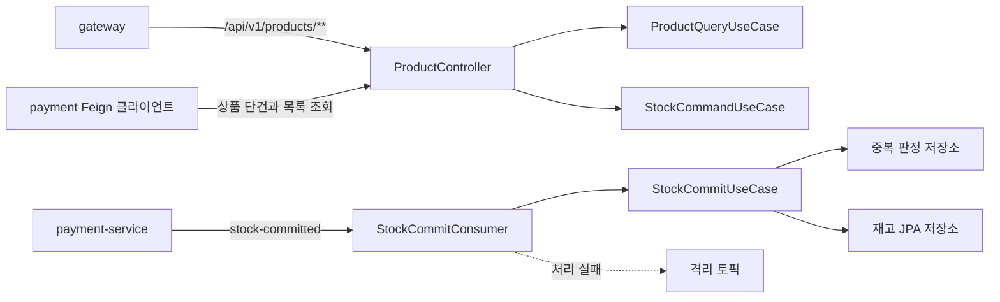
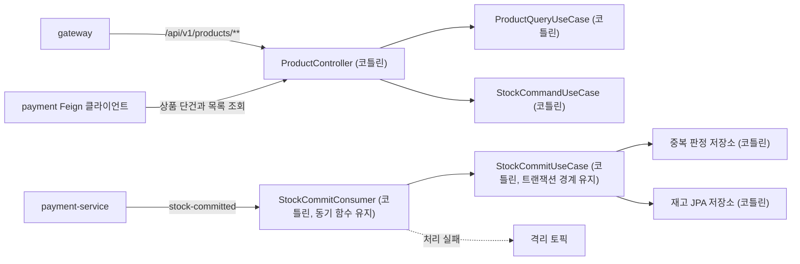
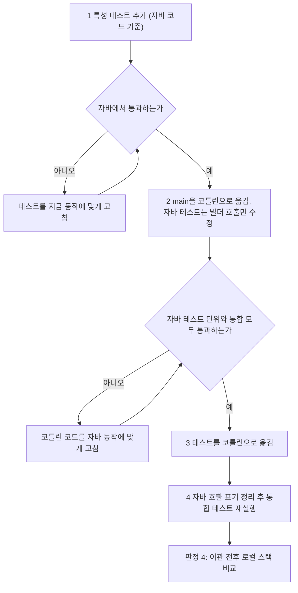

# KOTLIN-PILOT-PRODUCT: product-service를 코틀린으로 시범 이관

> 개발자가 읽고 승인하는 문서다. 섹션마다 한 화면 안에 들어오게 쓰되, 넘치는 상세는 빼지 말고 DESIGN으로 옮겨 링크한다.
> 상세 근거는 [DESIGN](DESIGN.md)에 있다. 작성 기준은 사용자 수준 `writing` 스킬의 work-doc 장르다.

## 사전 브리핑

**상태**: 승인됨 (2026-11-22)
**제안 규모**: 큼. 재고 확정 경로(`*Stock*`, `infrastructure/{messaging,idempotency,scheduler}`, `config/Kafka*`)가 risk.md의 핵심 경로라 DESIGN을 risk-reviewer가 사전 점검하고, 합의 브리핑은 따로 확정받는다.

### 목표

product-service의 main과 테스트가 모두 코틀린이고 Lombok을 쓰지 않는다. API 응답, Kafka 메시지 처리, DB 스키마, 다른 모듈과의 통신은 이관 전과 같다.

**판정**:

1. main을 옮긴 뒤 자바 테스트가 단위·통합 모두 통과한다. 테스트에서 고치는 줄은 객체를 만드는 줄(Lombok 빌더 호출)뿐이고, 단언과 시나리오 줄은 diff에 없다.
2. 테스트를 코틀린(MockK)으로 옮긴 뒤 1과 같은 시나리오가 모두 통과한다.
3. ktlint와 detekt가 CI 게이트로 돌고, `product-service/src/main/java`가 비어 있고, product-service에 Lombok 의존이 없다.
4. 이관 전(자바)과 후(코틀린)에 로컬 스택에서 아래 시나리오를 돌려 결과가 같다.

| 시나리오 | 확인하는 통신 |
|---|---|
| gateway 경유 상품 단건·목록 조회 | gateway에서 product HTTP로. 응답 JSON이 필드·null 표기까지 같은지 |
| 결제 1건 뒤 재고 확정 | payment의 상품 조회(Feign), 확정 메시지 발행, product의 소비와 DB 재고 감소 |
| 같은 확정 메시지를 두 번 발행 | 재고가 한 번만 줄어든다 |
| 재고보다 큰 수량의 확정 메시지 | 재고는 그대로이고 메시지가 격리 토픽(`payment.events.stock-committed.dlq`)으로 간다 |
| `smoke-all.sh --with-trace` | 컨테이너 상태, Eureka 등록, 서비스 간 trace 연속 |

### 요구사항

- R1. product-service의 main 코드는 모두 코틀린이고 Lombok을 쓰지 않는다.
- R2. product-service의 테스트 코드는 모두 코틀린이고, 목 객체는 MockK, Spring 빈 목은 springmockk로 만든다.
- R3. HTTP 엔드포인트 3개(`GET /api/v1/products`, `GET /api/v1/products/{id}`, `POST /api/v1/products/stock/decrease`)의 요청·응답 형식, 상태 코드, 오류 응답이 이관 전과 같다.
- R4. `payment.events.stock-committed` 메시지 처리 결과가 이관 전과 같다. 처음 받은 메시지는 재고를 차감하고, 같은 키의 메시지는 무시하고, 처리할 수 없는 메시지는 격리 토픽으로 보낸다.
- R5. 재고 확정은 지금처럼 같은 상품의 메시지를 한 파티션의 컨슈머 스레드 하나가 순서대로 처리하고, 중복 판정과 차감이 한 트랜잭션 안에서 일어난다.
- R6. DB 스키마와 Flyway 이력, Eureka 등록 이름, 메트릭 이름, 로그 마스킹 동작이 바뀌지 않는다.
- R7. ktlint와 detekt는 위반이 있으면 빌드를 깨뜨리고, CI와 편집·종료 hook에서 product-service의 코틀린 파일을 검사한다. SpotBugs와 단위 커버리지 게이트(라인 97%)는 계속 돈다. 다른 5개 모듈의 Checkstyle 검사는 그대로다.
- R8. product-service의 빌드 스크립트는 `build.gradle.kts`다. 루트 `build.gradle`은 Groovy로 두고, 다른 5개 모듈의 빌드와 검사 결과는 바뀌지 않는다.

### 지금 동작 (as-is)

product-service에 들어오는 경로는 HTTP 두 갈래와 Kafka 한 갈래다.

- `POST /api/v1/products/stock/decrease`는 저장소 안에서 호출하는 곳을 찾지 못했다(미확인: 저장소 밖 호출자).
- 빌드는 루트 `build.gradle`의 `subprojects`가 Lombok, Checkstyle(커스텀 Check 포함), SpotBugs, JaCoCo를 모든 모듈에 똑같이 건다.

### 문제

모든 서비스가 자바라서 코틀린으로 옮기는 절차와 빌드·정적 분석 설정이 정해져 있지 않다. 전체(main 약 2만 4천 줄)를 한 번에 옮기면 회귀가 생겼을 때 어느 변경 때문인지 좁히기 어렵다.
product-service(main 44개 파일 약 1,900줄, 테스트 23개 파일 약 2,300줄)는 user-service(약 700줄) 다음으로 작으면서 JPA, Kafka 소비, 스케줄러, 중복 판정을 모두 가지고 있어 이관 방식을 먼저 정하기에 알맞다. user-service에는 `@KafkaListener`가 없고 `@Scheduled`는 메트릭 수집(`DependencyHealthMetrics`)에만 있다.

조사한 사실(2026-11-22):

- JPA 엔티티 2개(`ProductEntity`, `StockEntity`), QueryDSL 없음, 코루틴·비동기 코드 없음, 이미 가상 스레드를 쓴다.
- Lombok은 `@Getter` 9, `@RequiredArgsConstructor` 9, `@Value` 5, `@Builder` 4곳. 테스트 8개 파일이 Lombok 빌더를 부른다.
- 테스트의 Spring 빈 목은 `@MockitoBean` 6, `@MockBean` 1, `@MockitoSpyBean` 1곳.
- Checkstyle은 코틀린을 검사하지 못한다. 검증 hook의 `VERIFY_PATTERN`(stack.md)에 `.kt`가 없어 지금은 코틀린 변경이 hook 검사 대상이 아니다.

### 제안 방향

main을 먼저 코틀린으로 옮기고 자바 테스트로 동작이 같음을 확인한 뒤, 테스트를 코틀린으로 옮긴다. 레이어·포트 구조와 외부 동작은 그대로 두고, 클래스 안만 null 타입, data class, sealed, 확장 함수 같은 코틀린 표현으로 다시 쓴다.

새로 들이는 라이브러리와 도구는 아래와 같다. 모두 product-service에만 건다.

| 이름 | 쓰는 곳 |
|---|---|
| Kotlin Gradle 플러그인(`kotlin-jvm`, `kotlin-spring`, `kotlin-jpa`) | 컴파일, Spring 프록시용 open 클래스, JPA 기본 생성자 |
| `jackson-module-kotlin`, `kotlin-reflect` | Spring이 코틀린 클래스를 JSON으로 읽고 쓸 때 |
| MockK, springmockk | 테스트의 목 객체와 Spring 빈 목 |
| ktlint, detekt | 형식 검사와 정적 분석 |

### 결정이 필요한 질문

1. 이번 토픽에서 테스트 코드까지 옮기는가 (무엇이 달라지는가: 작업량, 동작이 그대로라는 근거를 무엇으로 삼는가)
   - A: main만 옮기고 테스트는 자바로 둔다. 테스트 전환은 다음 토픽
   - B: 한 토픽 안에서 main을 먼저 옮겨 자바 테스트로 확인하고, 그 뒤 테스트를 코틀린(MockK)으로 옮긴다
   - C: main과 테스트를 같이 옮긴다
   - 추천: B. 자바 테스트를 둔 채 통과시키는 단계가 동작 보존의 근거가 되고, 모듈이 작아서 한 토픽에 끝까지 갈 수 있다
   - **답**: B (2026-11-22)
2. 코드를 얼마나 코틀린 표현으로 다시 쓰는가 (무엇이 달라지는가: diff 크기, 회귀 위험)
   - A: 구조 그대로 문법만 옮긴다(자동 변환 후 정리)
   - B: 레이어·포트 구조와 외부 동작은 그대로 두고, 클래스 안은 코틀린 표현(null 타입, data class, sealed, 확장 함수)으로 다시 쓴다
   - C: 코루틴 도입처럼 설계까지 바꾼다
   - 추천: B. 외부 동작을 고정하면 기존 테스트로 회귀를 잡을 수 있다
   - **답**: B, 코루틴은 넣지 않는다 (2026-11-22). 코루틴을 넣을 수 있는지 되물어 아래 조사로 답했다
   - 조사: product-service는 이미 가상 스레드를 쓰고 병렬로 묶을 외부 호출이 없어 코루틴으로 얻는 처리 이점이 없다.
     JPA 트랜잭션은 스레드에 묶여 suspend 함수 안에서 스레드가 바뀌면 트랜잭션 문맥을 잃을 수 있다.
     `StockCommitUseCase`의 잠금 없는 차감은 같은 상품을 컨슈머 스레드 하나가 순서대로 처리한다는 전제에 기대므로(R5, INV-5), 리스너를 suspend로 바꾸면 이 전제를 다시 증명해야 한다.
     비동기 코드는 payment-service(`OutboxWorker`, `OutboxImmediateEventHandler`, `KafkaMessagePublisher`, `PaymentTransactionCoordinator`)에 모여 있어 코루틴은 그 서비스를 옮길 때 따로 다룬다
3. Checkstyle 자리를 무엇으로 채우는가 (무엇이 달라지는가: 새 도구 도입, CI·hook·stack.md 변경)
   - A: ktlint(형식)와 detekt(정적 분석)를 도입하고 CI·편집 hook·stack.md에 반영한다
   - B: ktlint만 도입한다
   - C: 도구 없이 컴파일러 경고만 쓴다
   - 추천: A. 빼면 "규칙은 빌드를 깨뜨린다"는 이 저장소의 원칙이 product-service에서만 사라진다
   - **답**: A (2026-11-22)
4. 목표·판정 초안이 맞는가 (무엇이 달라지는가: ship 전체 검증 기준)
   - 초안: 판정 1~3은 위와 같고, 판정 4는 `smoke-all.sh` 통과였다
   - 근거: 테스트 8개 파일이 Lombok 빌더(`Stock.allArgsBuilder()` 15곳 등)를 불러 자바 테스트를 한 줄도 고치지 않고 통과시킬 수는 없다. getter는 코틀린 `val`이 자바에서 `getX()`로 보여 그대로 맞는다
   - **답**: 초안대로 하되, 모듈 간 통신까지 기존 동작이 그대로여야 한다 (2026-11-22). 판정 4는 질문 7로 다시 정했다
   - 조사: `smoke-all.sh` 기본 실행은 컨테이너 상태·포트·Eureka 등록만 본다. 서비스 간 실제 호출은 `--with-trace`(결제 1건 선행)에서 trace 연속성으로만 확인한다
5. 빌드 스크립트도 Kotlin DSL(`build.gradle.kts`)로 바꾸는가 (무엇이 달라지는가: 검증 범위가 product-service에서 전 모듈로 넓어지는가)
   - A: product-service의 `build.gradle`만 `.kts`로 바꾼다. 루트는 Groovy로 둔다
   - B: 루트까지 전부 바꾼다. 공유 빌드가 바뀌어 6개 모듈을 모두 검증해야 한다
   - C: 바꾸지 않는다
   - 추천: A. 루트를 건드리지 않으면 영향이 product-service에 머문다
   - **답**: A (2026-11-22)
6. product-service에 SpotBugs를 계속 돌리는가 (무엇이 달라지는가: 기존 게이트 유지 여부)
   - A: 유지한다. SpotBugs는 바이트코드를 보므로 코틀린에도 돈다. 첫 실행에서 코틀린 컴파일러가 만든 코드 때문에 생기는 오탐만 제외 필터에 넣는다
   - B: detekt로 대체하고 product-service에서는 끈다
   - 추천: A. detekt는 소스 규칙이고 SpotBugs는 바이트코드 버그 패턴이라 겹치는 부분이 적다
   - **답**: A (2026-11-22)
7. 판정 4를 이관 전후 비교로 바꾸는가 (무엇이 달라지는가: ship 전체 검증 범위)
   - 안: 이관 전(자바)과 후(코틀린)에 로컬 스택에서 같은 시나리오를 돌려 비교한다(위 "판정" 4의 표)
   - **답**: 안대로 (2026-11-22)

8. 재고 확정 메시지의 `idempotencyKey`가 null일 때 지금 동작을 유지하는가 (무엇이 달라지는가: 기존 동작 변경 여부, 이관 범위)
   - 배경(DESIGN 사전 점검): 자바에서는 null 키도 역직렬화되고, 중복 판정 저장의 `INSERT IGNORE`가 NOT NULL 기본 키에 NULL 대신 `''`를 넣는 것으로 보인다(미확인, 특성 테스트로 확인).
     그러면 첫 건은 재고를 차감하고, 이후 8일간 키가 null인 메시지는 상품과 관계없이 모두 중복으로 무시된다. 코틀린에서 non-null로 선언하면 즉시 격리로 바뀐다
   - 발행 쪽: payment-service는 한 곳(`PaymentConfirmResultUseCase.sendStockCommittedEvents`)에서만 발행하고 키는 항상 `StockEventUuidDeriver.derive()`의 UUID다. null 키는 수동 발행이나 외부 메시지에서만 생긴다
   - A: 지금 동작을 그대로 지킨다(`String?`). 특성 테스트로 고정하고, 결함은 docs/TODOS.md에 남겨 따로 고친다
   - B: 이번에 즉시 격리로 바꾼다. 외부 동작 변경이라 BRIEF 목표의 "이관 전과 같다"에 예외를 둔다
   - 추천: A. 정상 발행 경로에서는 생기지 않고, 이관 커밋에 동작 변경을 섞으면 판정 4의 전후 비교가 흐려진다
   - **답**: A (2026-11-22). docs/TODOS.md `STOCK-COMMIT-NULL-KEY`로 남김

### 이번 범위가 아닌 것

- product-service 외 서비스 이관
- 루트 `build.gradle`의 Kotlin DSL 전환
- 코루틴·WebFlux 도입
- 외부 동작 변경과 기능 추가
- 확정 메시지 `idempotencyKey`가 null일 때의 결함 수정(질문 8, TODOS `STOCK-COMMIT-NULL-KEY`)

## 합의 브리핑

**상태**: 확정됨 (2026-11-22)

### 바뀐 뒤 동작 (to-be)

들어오는 경로와 처리 흐름은 as-is와 같다. 바뀌는 것은 각 클래스의 언어와 빌드·검사 도구이고, 외부에서 보이는 동작은 같다.

이관은 네 단계로 하고, 단계마다 앞 단계의 테스트가 그대로 통과해야 다음으로 간다.

### 확정된 결정

질문으로 정한 것은 질문 목록의 답과 같다. 아래는 그 밖에 설계에서 정한 것이다. 전체 22개 결정과 근거는 [DESIGN](DESIGN.md#결정)에 있다.

| 결정 | 이유 | 근거 |
|---|---|---|
| 이관 전에 특성 테스트를 자바로 추가한다. 확정 메시지는 실제 MySQL·Kafka 통합 테스트에서 호출 횟수, 격리 여부와 키, 재고, 중복 판정 행을 단언한다 | 코틀린 Jackson은 null·누락 필드 처리가 달라 그대로 옮기면 구버전 메시지가 격리될 수 있다. 단위 테스트는 운영 경로의 변환기와 DB를 지나지 않아 이 차이를 못 잡는다 | 사전 점검(major 2건) |
| 확정 메시지의 6개 필드는 자바에서 null이 들어오던 그대로 nullable로 두고, null 처리에 `requireNotNull`·`?: return`을 쓰지 않는다 | 코틀린 표현마다 던지는 예외가 달라 재시도 여부가 바뀐다. `?: return`은 메시지를 조용히 버린다 | 사전 점검, 승인된 브리핑(R4) |
| record 7개는 먼저 `@JvmRecord data class`로 옮겨 자바 테스트를 그대로 두고, 테스트를 옮긴 뒤 지운다 | 판정 1(객체 만드는 줄만 수정)을 지킨다 | 승인된 브리핑 + 제안 |
| 엔티티는 일반 class로 두고 `kotlin-jpa`·`allOpen`·`kotlin-spring` 플러그인으로 기본 생성자와 open 클래스를 만든다 | data class는 지연 로딩 프록시와 충돌하고, final 클래스는 Spring 프록시를 못 만든다 | 제안 |
| risk.md의 product-service 핵심 경로 패턴을 kotlin 경로까지 넓힌다. 첫 태스크에서 한다 | 넓히지 않으면 이관 뒤 재고 확정 코드를 바꿔도 위험 검토가 호출되지 않는다 | 사전 점검 |

구조에 영향을 주는 제안이다. 확정하면 이대로 진행한다.

| 제안 | 내용 | 버린 대안 |
|---|---|---|
| Kotlin 2.4.21 + detekt 1.23.8 | 최신 안정판 Kotlin을 쓴다. detekt 안정판은 Kotlin 2.0.21로 빌드돼 있어 detekt 실행용 Kotlin만 2.0.21로 고정한다. 타입 분석이 필요한 detekt 규칙은 쓰지 못한다 | detekt 2.0 알파를 빌드 게이트에 씀, Kotlin을 2.0.21로 낮춤 |
| 새 파일 3개(구현 뒤 4개) | 루트 `.editorconfig`(ktlint 설정), `config/detekt/detekt.yml`, `config/lint-file.sh`(편집 hook이 `.java`는 Checkstyle, `.kt`는 ktlint로 나눠 보냄). 구현에서 ktlint를 파일 하나에 돌리는 `config/ktlint/check-file.sh`가 더해졌다 | hook 스크립트에 언어 분기 추가 |
| CI 입력 `kotlin-lint` | `_service-ci.yml`에 입력을 두고 product job만 켠다. ktlint·detekt 결과는 기존 reviewdog 경로로 올린다 | 모든 서비스에서 태스크 유무 탐지 |
| main 컴파일 경고를 오류로 처리 | 경고를 남기지 않는 저장소 원칙(`maxWarnings = 0`)과 맞춘다 | 경고 허용 |
| try 밖 변수 재할당 금지 규칙은 코틀린에서 없앤다 | 코틀린은 `try`가 값을 돌려주는 식이라 같은 문제를 문법으로 피한다. detekt에 대응 규칙이 없다 | detekt 커스텀 규칙 작성 |

### 완료 기준과 검증 방법

- R1: `product-service/src/main/java`가 비어 있고 컴파일 classpath에 Lombok이 없다. `find`와 `dependencies`로 확인
- R2: `product-service/src/test/java`가 비어 있고 목은 MockK·springmockk로 만든다. `find`와 `grep`으로 확인
- R3: HTTP 특성 테스트(응답 JSON 엄격 비교, 입력 누락·null, 오류 응답)가 이관 전 자바와 이관 후 코틀린에서 모두 통과한다. 판정 4의 조회 비교
- R4: 확정 메시지 특성 테스트(중복, 재고 부족, 필드 null·누락, 모르는 필드, 빈 값 레코드)가 이관 전후 모두 통과한다. 판정 4의 확정·중복·재고 부족 비교
- R5: 차감 실패 뒤 중복 판정 행이 남지 않는다는 통합 테스트 단언이 통과하고, 리스너·Kafka 설정 diff가 없다
- R6: `src/main/resources` diff가 없고 메트릭·마스킹 테스트가 통과하며 `smoke-all.sh`가 Eureka 등록을 확인한다
- R7: ktlint·detekt에 위반을 일부러 넣어 빌드가 실패하는지 확인하고 되돌린다. `bash scripts/test-hooks.sh`로 hook이 `.kt`를 검사하는지 확인한다. SpotBugs·JaCoCo 게이트가 통과한다. CI는 푸시를 승인받으면 확인한다
- R8: 루트 `build.gradle` diff가 없고 다른 5개 모듈의 `test`·`checkstyleMain`·`spotbugsMain`이 통과한다

### 남은 위험

- 단위 커버리지 게이트(라인 97%)가 코틀린 이관 뒤 떨어질 수 있다. 떨어지면 기준을 바꾸지 않고 멈춰서 묻는다.
- 특성 테스트로 확인하기 전까지는 MySQL `INSERT IGNORE`의 NULL 처리, Spring Kafka 기본 재시도 제외 목록, 누락된 `qty`의 Jackson 처리가 추정이다. 결과가 추정과 다르면 DESIGN의 필드별 처리 표를 고친다. 자바 동작을 그대로 지킨다는 기준은 같다.
- detekt 실행용 Kotlin(2.0.21)이 2.4 전용 문법을 읽지 못한다. 이번 이관에서는 그런 문법을 쓰지 않는다.
- CI 변경은 푸시해야 확인할 수 있다. 푸시는 요청할 때만 한다.

### 미결 사항

없음

## 변경 요청

없음

## 완료 요약
