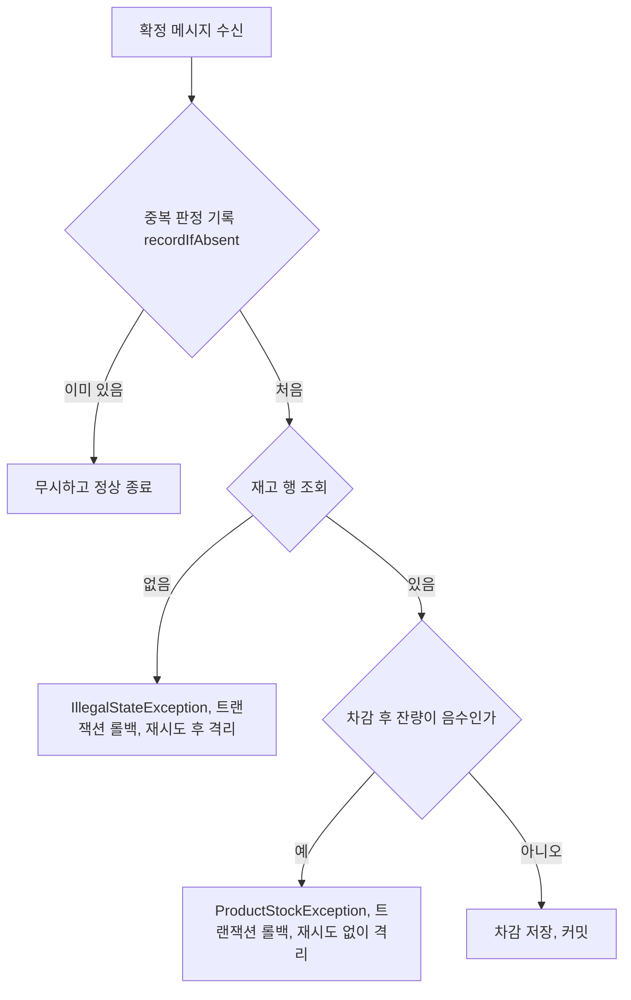

# KOTLIN-PILOT-PRODUCT 설계 상세

> 에이전트가 근거와 작업 기록으로 쓰는 문서다. 필요한 만큼 자세히 쓴다.
> [BRIEF](BRIEF.md)에서 합의하지 않은 결정은 넣지 않는다. 에이전트가 근거 없이 정한 것은 "제안"으로 표시한다.

## 결정

| ID | 결정 | 이유 | 버린 대안 (가장 단순한 방법 포함) | 근거 |
|---|---|---|---|---|
| D1 | 순서는 특성 테스트 추가(자바) → main 이관(자바 테스트 유지) → 테스트 이관 → 자바 호환 표기 정리 | 이관 전 동작을 자바 코드 기준으로 먼저 고정해야 이관 후 비교가 성립한다 | main과 테스트 동시 이관(동작 보존 근거가 약함) | 개발자 답변(질문 1) |
| D2 | 레이어·포트·패키지·클래스 이름은 그대로 두고 클래스 안만 코틀린 표현으로 다시 쓴다. 코루틴은 쓰지 않고 리스너·스케줄러·컨트롤러는 동기 함수로 둔다 | 외부 동작 고정, R5의 파티션 직렬화 전제 유지 | 문법만 번역(질문 2-A), 코루틴 도입(질문 2-C) | 개발자 답변(질문 2) |
| D3 | Kotlin 2.4.21. product-service `build.gradle.kts`에서 `extra["kotlin.version"] = "2.4.21"`로 Spring Boot BOM의 관리 버전(1.9.25)을 덮어쓴다 | 2026-11 기준 최신 안정판. 스파이크(아래 "확인한 라이브러리 동작")에서 Boot 3.4.4·Jackson 2.18.3·springmockk 4.0.2와 함께 동작 확인 | BOM 기본 1.9.25(K2 컴파일러 이전 세대), 2.5.0-RC(RC를 빌드에 씀) | 제안 |
| D4 | detekt 1.23.8(안정판). detekt 설정의 Kotlin 의존을 `getSupportedKotlinVersion()`(2.0.21)으로 고정하고, 타입 분석이 필요한 `detektMain`·`detektTest`는 게이트에 넣지 않는다. 게이트는 `detekt` 태스크 | 1.23.8은 Kotlin 2.0.21로 빌드됐고 2.4.21과 섞이면 실행을 거부한다. 고정하면 소스 규칙은 돈다(스파이크 확인) | detekt 2.0.0-alpha.6(Kotlin 2.4.10 기반, 알파를 빌드 게이트에 씀), Kotlin을 2.0.21로 낮춤(D3와 충돌) | 제안 |
| D5 | ktlint는 `org.jlleitschuh.gradle.ktlint` 14.2.0 + ktlint 1.8.0. ktlint 설정도 BOM의 Kotlin 버전 덮어쓰기에서 뺀다. 줄 길이 120은 루트 `.editorconfig`로 정한다 | BOM이 ktlint 실행용 Kotlin 컴파일러까지 2.4.21로 바꿔 파싱이 실패한다(스파이크 확인) | ktlint CLI만 쓰기(Gradle 게이트 없음) | 개발자 답변(질문 3) + 제안(버전) |
| D6 | 기존 Checkstyle 규칙의 코틀린 대응: 줄 길이 120 → ktlint, `var` 지역 변수 금지 → detekt `VarCouldBeVal`, 광범위 예외 삼킴(커스텀 Check) → detekt `TooGenericExceptionCaught`·`SwallowedException`, try 밖 변수 재할당(커스텀 Check) → 대응 규칙 없음, 코틀린 `try` 식으로 쓴다, `@Data`·`return null` 금지 → 코틀린에 해당 없음 | 규칙마다 같은 목적을 지킬 수단이 있다. try 밖 재할당만 규칙이 사라진다 | detekt 커스텀 규칙 작성(이번 범위 대비 과함) | 제안 |
| D7 | 의도된 광범위 catch(`DedupeCleanupWorker.executeDeleteExpired`처럼 로그·카운터 후 다음 주기 재시도)는 `@Suppress("TooGenericExceptionCaught")`와 이유 주석으로 남긴다 | 현재 동작(R6, FS-8)을 바꾸지 않는다 | catch 타입을 좁힘(동작 변경) | 기존 규칙(현재 코드 동작) |
| D8 | Java record 7개는 main 단계에서 `@JvmRecord data class`로 옮긴다. 자바 테스트가 부르는 static 멤버는 `const val`·`@JvmField`·`@JvmStatic`으로 노출한다. 테스트 이관 뒤 이 자바 호환 표기를 지운다 | 자바 테스트의 `getRecordComponents()`·`productId()` 호출과 static 접근을 그대로 두어 판정 1(객체 만드는 줄만 수정)을 지킨다. 자바 호출자가 없어지면 남길 이유가 없다 | 처음부터 일반 data class(자바 테스트 대량 수정), 호환 표기 유지(자바 호출자 없이 남음) | 승인된 브리핑(판정 1) + 제안(정리 시점) |
| D9 | Lombok 빌더(`Stock.allArgsBuilder()` 등)는 주 생성자와 이름 붙인 인자로 바꾼다. 자바 테스트는 빌더 호출을 생성자 호출로만 고친다 | 판정 1 | 코틀린에 자바용 빌더 유지(이관 뒤 지울 코드) | 승인된 브리핑(판정 1) |
| D10 | 외부 입력 DTO(HTTP 요청, Kafka 메시지)의 null 가능 여부는 자바에서 null이 들어올 수 있던 그대로 정한다. 확정 메시지는 아래 "확정 메시지 필드별 처리" 표를 따른다. 이 경로에서 `requireNotNull`·`require`·`check`·`?: return`으로 null을 처리하지 않는다 | 코틀린 모듈이 붙은 Jackson은 non-null 필드에 null이나 누락이 오면 역직렬화를 실패시키고, 그 예외는 재시도 제외 목록에 있어 1회 만에 격리된다. 코틀린 표준 예외도 재시도 분류를 바꾼다(아래 표). 자바와 다른 결과가 되면 R4가 깨진다 | 전부 non-null(구버전 메시지 격리) | 승인된 브리핑(R3, R4) + 사전 점검 M1 |
| D11 | 특성 테스트를 이관 전에 자바로 추가한다. 확정 메시지 시나리오(FS-3·4·5·12·13·14)는 `StockCommitQuarantineIntegrationTest`(MySQL, EmbeddedKafka, Boot ObjectMapper, 실제 프록시)에 넣고, 시나리오마다 `commit` 호출 횟수, 격리 토픽 도달과 키, 재고, `stock_commit_dedupe` 행을 단언한다. HTTP는 응답 JSON 엄격 비교(필드·null 표기), 입력 누락·null 필드, 오류 응답 형식을 `@WebMvcTest`로 단언한다 | 단위 테스트는 `new ObjectMapper()`(`KafkaErrorHandlerConfigTest.java:31`)와 Fake 저장소(`FakeEventDedupeStore.java:36`, null 키에 NPE)를 써서 운영 경로의 변환기와 JDBC 동작을 재현하지 못한다. 기존 통합 테스트 payload(`:211-218`)는 6개 필드를 항상 채운다 | JSON 역직렬화 단위 테스트(이관 뒤 null 처리가 바뀌어도 통과함) | 테스트 구성(에이전트 결정) + 사전 점검 M2 |
| D12 | JPA 엔티티는 data class가 아닌 일반 class로 두고 `kotlin-jpa`(기본 생성자)와 `allOpen`(`@Entity`·`@MappedSuperclass`·`@Embeddable`)을 건다. `kotlin-spring`으로 `@Transactional`·`@Configuration` 클래스를 open으로 만든다 | data class의 `equals`·`hashCode`는 지연 로딩 프록시와 충돌한다. final 클래스는 Spring 프록시를 만들 수 없다 | 클래스마다 `open` 직접 표기(빠뜨리면 트랜잭션이 조용히 빠짐) | 제안 |
| D13 | 컴파일 옵션 `-Xjsr305=strict`, JVM 툴체인 21. main 컴파일은 경고를 오류로 처리한다(`allWarningsAsErrors`) | Spring의 null 표기를 코틀린 타입에 반영한다. 경고를 남기지 않는 저장소 원칙(루트 `maxWarnings = 0`)과 맞춘다 | 경고 허용 | 제안 |
| D14 | Lombok은 product-service에서 의존을 뺀다. 루트 `subprojects`가 넣는 `compileOnly`·`annotationProcessor` Lombok을 product-service `build.gradle.kts`에서 제외한다 | R1, R8(루트 수정 없음) | 루트에서 모듈별 분기(R8 위반) | 승인된 브리핑(R1, R8) |
| D15 | 편집 hook: `LINT_FILE_PATTERN`을 `\.(java|kts?)$`로 넓히고 `LINT_FILE`을 확장자별 분배 스크립트(`config/lint-file.sh`)로 바꾼다. `.java`는 기존 `check-file.sh`, `.kt`·`.kts`는 ktlint CLI로 파일 하나만 검사한다. ktlint CLI classpath는 product-service의 Gradle 태스크가 파일로 떨군다(`writeCheckstyleCliClasspath`와 같은 방식). detekt는 편집 hook에 넣지 않는다 | hook 스크립트는 스택과 무관하게 `verify-config` 한 블록만 읽으므로 설정과 분배 스크립트만 바꾸면 된다. detekt는 파일 단위로 돌리기에 느리다 | hook 스크립트에 언어 분기 추가(스택 무관 원칙 위반) | 개발자 답변(질문 3) + 제안(방식) |
| D16 | 종료 hook: `VERIFY_PATTERN`에 `kts?`를 더하고 `ROOT_FILES`에 `.editorconfig`, `config/detekt/`를 더한다 | 코틀린 변경이 종료 검증 대상이 되도록(R7) | 없음 | 개발자 답변(질문 3) |
| D17 | CI: `_service-ci.yml`에 입력 `kotlin-lint`(기본 false)를 두고 product job만 true로 준다. true면 `ktlintCheck`·`detekt`를 돌리고, 결과(checkstyle 형식 XML)를 기존 reviewdog checkstyle 경로로 올리고, lint 게이트 판정에 넣는다 | ktlint·detekt 모두 checkstyle 형식 리포트를 낼 수 있어 기존 reviewdog 흐름을 그대로 쓴다. 다른 서비스 job은 바뀌지 않는다 | 모든 서비스에서 태스크 유무를 탐지(불필요한 일반화) | 개발자 답변(질문 3) + 제안(방식) |
| D18 | SpotBugs는 그대로 돌린다. 첫 실행에서 코틀린 컴파일러 생성 코드 때문에 생긴 지적만 `spotbugs-exclude.xml`에 넣되, 클래스 전체가 아니라 생성 메서드(`$default`, `componentN`, `copy`, `Companion`)와 버그 패턴을 함께 지정한다 | 클래스 단위로 빼면 `StockCommitUseCase`·`JdbcEventDedupeStore` 같은 핵심 클래스의 null·노출 패턴 검사도 꺼진다 | 끄기(질문 6-B), 클래스 단위 제외 | 개발자 답변(질문 6) + 사전 점검 m5 |
| D19 | risk.md 핵심 경로의 `product-service/src/main/java/**/*Stock*`를 `product-service/src/main/{java,kotlin}/**/*Stock*`로 넓힌다. 첫 태스크에서 적용한다 | 나머지 product 패턴은 `**/product/...`로 시작해 kotlin 경로에도 걸리지만 이 패턴만 java 경로에 묶여 있다. main 이관보다 늦으면 그사이 `StockCommitUseCase`·`Stock`·`StockEntity`·`StockRepositoryImpl` 변경이 위험 검토 대상에서 빠진다 | 그대로 둠(핵심 경로 검토 누락), 이관 뒤 적용 | 제안 + 사전 점검 m4 |
| D20 | 단위 커버리지 게이트(라인 97%)는 그대로 둔다. 코틀린 이관 뒤 떨어지면 기준을 바꾸지 않고 멈춰서 개발자에게 묻는다 | 기준 변경은 기존 게이트를 바꾸는 결정이다 | 미리 기준 낮춤 | 승인된 브리핑(R7) |
| D21 | 로그는 `@Slf4j` 대신 `LoggerFactory.getLogger`로 만든 private 로거를 쓰고 `LogFmt` 호출과 문구는 그대로 둔다 | R6(로그 마스킹), 로그 기반 알람·스모크 영향 없음 | kotlin-logging 도입(새 라이브러리, 합의 밖) | 승인된 브리핑(R6) |
| D22 | 확정 메시지 `idempotencyKey`가 null일 때 자바 동작을 그대로 지킨다 | 정상 발행 경로(`PaymentConfirmResultUseCase.sendStockCommittedEvents`, 키는 항상 UUID)에서는 생기지 않고, 이관에 동작 변경을 섞지 않는다 | 즉시 격리로 바꿈(질문 8-B) | 개발자 답변(질문 8) |

## 확정 메시지 필드별 처리

`StockCommittedMessage`(`StockCommittedMessage.java:25-32`)의 6개 필드다. "자바 현재 결과"는 코드를 읽고 정한 예상이며, 이관 전에 특성 테스트(D11)로 확인해 이 표를 고친다.

| 필드 | 자바 타입 | 자바 현재 결과(null 또는 누락) | 코틀린 선언과 처리 |
|---|---|---|---|
| `productId` | `Long` | `StockCommitConsumer.java:72`에서 unboxing NPE. 재시도 대상이라 (max-attempts+1)회 호출 뒤 원본 키로 격리 | `Long?`, 넘길 때 `!!`(NPE로 같은 재시도 분류) |
| `qty` | `int` | 미확인. Jackson 기본값이면 0으로 들어와 재고가 그대로인 채 중복 판정 행만 남는다 | 특성 테스트 결과에 맞춘다(`Int` 기본값 0 등) |
| `idempotencyKey` | `String` | 미확인(사전 점검 추정): `INSERT IGNORE`가 NOT NULL 기본 키에 NULL 대신 `''`를 넣어 첫 건은 차감하고, 이후 8일간 키가 null인 메시지는 모두 중복으로 무시된다 | `String?`. 자바 결과를 그대로 지킨다(BRIEF 질문 8-A). 결함은 TODOS `STOCK-COMMIT-NULL-KEY` |
| `occurredAt` | `Instant` | `expiresAt` 대체값 계산에서 `now`를 쓴다 | `Instant?` |
| `orderId` | `String` | 빈 문자열로 대체 | `String?`, `?: ""` |
| `expiresAt` | `Instant` | `occurredAt + 8일`, 없으면 `now + 8일` | `Instant?` |

재시도 분류는 두 곳에서 정해진다. 코틀린 표현이 던지는 예외가 어느 쪽에 걸리는지에 따라 호출 횟수와 격리 시점이 바뀐다.

| 예외 | 나오는 곳 | 분류 |
|---|---|---|
| `MessageConversionException`, `IllegalArgumentException`, `ProductStockException` | `KafkaErrorHandlerConfig.java:83-87` 명시 목록. non-null 필드 역직렬화 실패, `require`·`requireNotNull` | 재시도 없이 격리 |
| Spring Kafka 기본 제외 목록(ConversionException 등) | `DefaultErrorHandler` 기본값(미확인: 목록 내용은 테스트로 확인) | 재시도 없이 격리 |
| `NullPointerException`(`!!`), `IllegalStateException`(`check`, `error`, 재고 행 없음) | 그 밖 | 재시도 후 격리 |

## 확인한 라이브러리 동작

2026-11-22, 저장소 밖 임시 Gradle 프로젝트(Spring Boot 3.4.4, `io.spring.dependency-management` 1.1.6, 저장소의 Gradle 8.14.4 wrapper)로 확인했다.

| 확인 | 결과 |
|---|---|
| Kotlin 2.4.21 + `kotlin-spring` + `kotlin-jpa` 컴파일, `@SpringBootTest` 컨텍스트 기동 | 통과 |
| `@Transactional` 코틀린 서비스가 프록시로 만들어지는가(`AopUtils.isAopProxy`) | 통과 |
| `jackson-module-kotlin`(BOM 2.18.3)으로 null 필드가 JSON에 `null`로 나가는가(엄격 비교) | 통과 |
| springmockk 4.0.2 `@MockkBean` + `@WebMvcTest` | 통과 |
| JaCoCo가 코틀린 클래스 커버리지를 집계하는가 | 집계됨. data class 응답 DTO는 놓친 줄 0 |
| detekt 1.23.8을 그대로 쓰면 | 실패: "detekt was compiled with Kotlin 2.0.21 but is currently running with 2.4.21" |
| detekt 설정의 Kotlin 의존을 2.0.21로 고정하면 | 실행됨(`SpreadOperator` 지적 1건 보고) |
| ktlint 기본 버전(1.5.0)을 그대로 쓰면 | 실패: 파일 파싱 불가. BOM이 ktlint의 Kotlin 컴파일러 2.1.0을 2.4.21로 바꿈 |
| ktlint 1.8.0 + Kotlin 의존 고정 | 실행됨(형식 위반 보고) |

확인하지 않은 것: Kafka 리스너·`@Scheduled`·Flyway·Testcontainers와의 조합(execute 첫 태스크의 빌드에서 확인), detekt의 Kotlin 2.0.21 파서가 2.4 전용 문법을 못 읽는 경우(새 문법을 쓰지 않는다).

## 영향 범위

| 대상 | 바뀌는 것 |
|---|---|
| `product-service/src/main/java/**` (44개) | `src/main/kotlin/**`로 옮겨 다시 쓴다. 패키지·클래스 이름은 같다 |
| `product-service/src/test/java/**` (23개) | 1단계에서 빌더 호출만 수정, 2단계에서 `src/test/kotlin/**`로 옮긴다. 특성 테스트가 더해진다 |
| `product-service/build.gradle` | `build.gradle.kts`로 바뀐다. Kotlin 플러그인, ktlint·detekt, Lombok 제외, Kotlin 버전 덮어쓰기, ktlint CLI classpath 태스크 |
| `product-service/src/main/resources/**` | 바뀌지 않는다(스키마, Flyway, `application*.yml`, logback) |
| 루트 `build.gradle`, `settings.gradle` | 바뀌지 않는다 |
| 루트 `.editorconfig` (새 파일) | 코틀린 파일 줄 길이 120 등 ktlint 설정. 다른 모듈 빌드에는 영향 없음 |
| `config/detekt/detekt.yml` (새 파일), `config/lint-file.sh` (새 파일), `config/spotbugs/spotbugs-exclude*.xml` | detekt 규칙, 편집 hook 분배, SpotBugs 오탐 제외 |
| `.agents/profiles/stack.md` | 버전 표, product-service 정적 분석 명령, `verify-config` |
| `.agents/profiles/risk.md` | product-service 핵심 경로 패턴 |
| `.github/workflows/_service-ci.yml`, `ci.yml` | `kotlin-lint` 입력과 product job 설정 |
| `docs/context/**` | ship 문서 동기화에서 product-service 관련 서술 확인 |

외부 계약(HTTP 3개 엔드포인트, `payment.events.stock-committed`·`.dlq` 토픽과 메시지 형식, DB 스키마, Eureka 이름 `product-service`, 메트릭 이름)은 바뀌지 않는다. 다른 모듈의 코드는 바뀌지 않는다.

의존 방향: ArchUnit `HexagonalRules`는 금지 패키지 목록(`org.springframework..`, `jakarta.persistence..` 등)으로 검사하므로 코틀린 표준 라이브러리 의존(`kotlin..`)은 위반이 아니다. 규칙은 그대로 둔다.

## 상태 전이

상태 모델을 바꾸지 않는다. 재고 확정 처리 흐름은 그대로다.

## 장애 시나리오

| ID | 상황 | 기대 동작 | 관련 불변식 | 확인 방법 |
|---|---|---|---|---|
| FS-1 | 같은 확정 메시지가 두 번 온다 | 재고는 한 번만 줄고 두 번째는 정상 종료 | INV-5 | `StockCommitUseCaseTest`, 판정 4 |
| FS-2 | 재고보다 큰 수량의 확정 메시지 | 저장하지 않고 재시도 없이 격리 토픽으로 간다. 키는 `orderId:productId` | INV-5 | `StockCommitQuarantineIntegrationTest` #1, `KafkaErrorHandlerConfigTest`, 판정 4 |
| FS-3 | 차감이 실패한다(재고 행 없음, 재고 부족) | 중복 판정 기록도 롤백되어 재시도가 다시 차감을 시도한다. 롤백이 빠지면 두 번째 시도가 "중복"으로 끝나 격리되지 않는다. 클래스가 final이면 CGLIB 프록시를 못 만들어 컨텍스트 기동이 실패하고, 메서드만 final이면 프록시의 빈 필드로 NPE가 난다(조용히 빠지지 않음) | INV-5 | 격리 통합 테스트 #2(`:180-181` 격리 단언), 같은 테스트에 실패 뒤 `stock_commit_dedupe` 행 없음 단언 추가 |
| FS-4 | 구버전 producer가 `expiresAt`·`occurredAt`·`orderId`를 null로 보내거나 빠뜨린다 | 역직렬화 성공, 기존 대체값 계산(`occurredAt + 8일`, 없으면 `now + 8일`, `orderId`는 빈 문자열) | INV-5 | 격리 통합 테스트에 시나리오 추가(D11의 4가지 단언) |
| FS-5 | `productId`가 null이거나 빠진다 | 자바 기준: NPE로 재시도하고 소진 뒤 원본 키로 격리 | INV-5 | 격리 통합 테스트에 시나리오 추가(`atLeast(2)` 호출, 격리 키) |
| FS-5b | `qty`가 빠지거나 null이다 | 이관 전 자바 동작과 같다(특성 테스트로 먼저 고정) | INV-5 | 격리 통합 테스트에 시나리오 추가 |
| FS-12 | `idempotencyKey`가 null이거나 빠진다 | 이관 전 자바와 같다(BRIEF 질문 8-A). 특성 테스트로 확인한 자바 결과를 그대로 단언한다 | INV-5 | 격리 통합 테스트: 같은 상품 2건을 보내 재고, 중복 판정 행, 격리 여부 단언 |
| FS-13 | payload에 모르는 필드가 있다(producer가 먼저 배포된 경우) | 무시하고 정상 차감한다. 변환기가 Boot ObjectMapper(모르는 필드 무시)를 계속 쓴다 | INV-5 | 격리 통합 테스트: 추가 필드가 있는 payload로 재고 감소 단언 |
| FS-14 | 값이 null인 레코드(tombstone) | 이관 전 자바와 같다. 리스너 파라미터를 nullable로 선언하면 Spring이 선택 파라미터로 보고 null을 넘겨 결과가 바뀌므로 non-null로 둔다 | INV-5 | 격리 통합 테스트: null 값을 보내 호출 횟수와 격리 여부 단언 |
| FS-6 | 같은 상품의 확정 메시지가 연달아 온다 | 한 파티션의 컨슈머 스레드 하나가 순서대로 처리한다. 리스너는 동기 함수, 리스너 동시성·컨테이너 설정은 그대로 | INV-5 | `application.yml`·Kafka 설정 diff 없음, 리뷰 |
| FS-7 | HTTP 응답 직렬화 | 필드 이름·순서·null 표기가 이관 전과 같다. 코틀린 `is` 접두 Boolean 속성 이름 같은 차이를 만들지 않는다 | 없음(R3) | 새 특성 테스트(엄격 JSON 비교), 판정 4 |
| FS-8 | HTTP 요청 본문의 필드 누락·null, 잘못된 JSON | 상태 코드와 오류 응답 형식이 이관 전과 같다 | 없음(R3) | 새 특성 테스트 |
| FS-9 | 만료 행 청소 중 DB 오류 | 예외를 밖으로 던지지 않고 실패 카운터를 올리고 다음 주기에 재시도 | INV-5(중복 판정 보존 기간) | `DedupeCleanupWorkerTest` |
| FS-10 | `@Configuration`·`@Bean`·`@ConditionalOnProperty` 빈 구성 | Kafka 설정 유무에 따른 빈 등록이 이관 전과 같다 | 없음 | `ProductServiceApplicationTest`, `KafkaErrorHandlerConfigTest`, 통합 테스트 |
| FS-11 | 로그에 민감정보 | 로그 문구와 마스킹 레이아웃이 그대로라 새로 남는 값이 없다 | INV-7 | `MaskingPatternLayoutTest`, 리뷰 |

전제: 재고 확정 메시지의 파티션 키가 상품번호다(payment-service 발행 쪽, 이번 범위에서 바뀌지 않음). 이 전제가 깨지면 FS-6이 성립하지 않으며, 이는 이관 전에도 같다.

## 검증 기준

| 요구사항 | 성공 조건 | 확인 |
|---|---|---|
| R1 | `product-service/src/main/java`에 파일이 없고 Lombok이 컴파일 classpath에 없다 | `find`, `./gradlew :product-service:dependencies --configuration compileClasspath` |
| R2 | `product-service/src/test/java`에 파일이 없고 MockK·springmockk로 목을 만든다 | `find`, `grep` |
| R3 | 특성 테스트(응답 JSON, 입력 누락·null, 오류 응답)가 이관 전 자바와 이관 후 코틀린 모두에서 통과 | `./gradlew :product-service:test`, 판정 4의 조회 비교 |
| R4 | FS-1·2·4·5 테스트 통과, 판정 4의 확정·중복·재고 부족 시나리오가 이관 전후 같다 | 단위·통합 테스트, 로컬 스택 비교 |
| R5 | FS-3 롤백 특성 테스트 통과, 리스너·Kafka 설정 diff 없음 | `./gradlew :product-service:integrationTest`, `git diff` |
| R6 | `src/main/resources` diff 없음, 메트릭·마스킹 테스트 통과, Eureka 등록 이름 확인 | `git diff`, 단위 테스트, `smoke-all.sh` |
| R7 | `ktlintCheck`·`detekt`가 위반이 있으면 실패한다(위반을 넣어 실패 확인 후 되돌림), CI product job에서 돈다, 편집·종료 hook이 `.kt`를 검사한다, SpotBugs·JaCoCo 게이트 통과 | Gradle 태스크, `bash scripts/test-hooks.sh`, CI 실행(푸시 승인 시) |
| R8 | 루트 `build.gradle` diff 없음, 다른 5개 모듈 `test`·`checkstyleMain`·`spotbugsMain` 결과가 이관 전과 같다 | `git diff`, 5개 모듈 검사 |

D8의 자바 호환 표기 정리(`@JvmRecord` 제거 등)는 Jackson 역직렬화 경로를 다시 바꾸므로, 정리 커밋 뒤에도 `integrationTest`와 FS-4·5·5b·12·13·14를 다시 돌린다. 스키마 대조 테스트(`StockCommittedMessageSchemaParityTest`)의 `getRecordComponents()`는 `primaryConstructor.parameters` 순서로 바꾼다(`memberProperties`는 이름순이라 순서 검사가 무의미해진다).

판정 1의 "객체 만드는 줄만 수정"은 1단계 커밋의 자바 테스트 diff에서 바뀐 줄이 모두 빌더 호출을 생성자 호출로 바꾼 줄인지 확인한다.

## 사전 점검 (risk-reviewer)

1회 실시(2026-11-22). critical 0, major 2, minor 5. 모두 코드와 대조해 반영했다.

| 지적 | 등급 | 반영 |
|---|---|---|
| M1. nullable 목록에서 `idempotencyKey`·`productId` 누락, `productId`를 원시 타입으로 잘못 적음(`StockCommittedMessage.java:26` boxed `Long`) | major | D10을 "확정 메시지 필드별 처리" 표로 바꿈. 재시도 분류 표 추가. `idempotencyKey` 처리는 기존 동작 변경 여부가 걸려 BRIEF 질문 8로 올림 |
| M2. 특성 테스트가 운영 변환기·실제 DB를 지나지 않으면 차이를 못 잡음 | major | D11을 격리 통합 테스트 기반으로 바꾸고 시나리오마다 4가지 단언 |
| m1. 변환기 ObjectMapper 교체(`jacksonObjectMapper()`는 모르는 필드에서 실패) | minor | FS-13 추가 |
| m2. `@JvmRecord` 제거 때 Jackson 경로가 다시 바뀜, 스키마 대조 테스트 대체 방법 | minor | 검증 기준에 정리 커밋 뒤 재실행과 `primaryConstructor.parameters` 명시 |
| m3. FS-3 전제 오류(final이면 조용히 빠지지 않고 기동 실패) | minor | FS-3 수정. 기존 통합 테스트 #2가 롤백 누락을 잡는다는 근거 추가 |
| m4. D19 적용 시점 | minor | 첫 태스크에서 적용으로 명시 |
| m5. SpotBugs 클래스 단위 제외가 핵심 클래스 검사를 끔 | minor | D18을 생성 메서드·패턴 단위 제외로 수정 |

사전 점검이 재현하지 않고 라이브러리 지식으로 판단한 것(MySQL `INSERT IGNORE`의 NULL 처리, Spring Kafka 기본 제외 목록, 누락된 `Int` 필드의 Jackson 처리, `@JvmRecord` + 코틀린 모듈 역직렬화)은 이관 전 특성 테스트로 확인한다. 질문 8의 답(A, 지금 동작 유지)이 설계를 바꾸지 않아 2차 점검은 하지 않는다.

## 태스크

plan에서 채운다.

## 리뷰 처리

| 항목 | 등급 | 결정 | 근거 |
|---|---|---|---|

## 진행 기록

- 2026-11-22: 사전 브리핑 승인. DESIGN 초안 작성, 도구 조합을 임시 프로젝트로 확인. risk-reviewer 사전 점검 대기.
