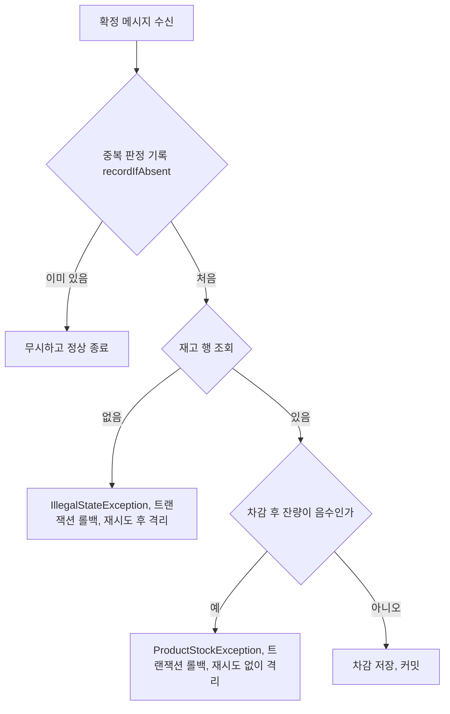

# KOTLIN-PILOT-PRODUCT 설계 상세

> 에이전트가 근거와 작업 기록으로 쓰는 문서다. 필요한 만큼 자세히 쓴다.
> [BRIEF](BRIEF.md)에서 합의하지 않은 결정은 넣지 않는다. 에이전트가 근거 없이 정한 것은 "제안"으로 표시한다.

## 결정

| ID | 결정 | 이유 | 버린 대안 (가장 단순한 방법 포함) | 근거 |
|---|---|---|---|---|
| D1 | 순서는 특성 테스트 추가(자바) → main 이관(자바 테스트 유지) → 테스트 이관 → 자바 호환 표기 정리 | 이관 전 동작을 자바 코드 기준으로 먼저 고정해야 이관 후 비교가 성립한다 | main과 테스트 동시 이관(동작 보존 근거가 약함) | 개발자 답변(질문 1) |
| D2 | 레이어·포트·패키지·클래스 이름은 그대로 두고 클래스 안만 코틀린 표현으로 다시 쓴다. 코루틴은 쓰지 않고 리스너·스케줄러·컨트롤러는 동기 함수로 둔다 | 외부 동작 고정, R5의 파티션 직렬화 전제 유지 | 문법만 번역(질문 2-A), 코루틴 도입(질문 2-C) | 개발자 답변(질문 2) |
| D3 | Kotlin 2.4.21. product-service `build.gradle.kts`에서 `extra["kotlin.version"] = "2.4.21"`로 Spring Boot BOM의 관리 버전(1.9.25)을 덮어쓴다 | 2026-11 기준 최신 안정판. 스파이크(아래 "확인한 라이브러리 동작")에서 Boot 3.4.4·Jackson 2.18.3·springmockk 4.0.2와 함께 동작 확인 | BOM 기본 1.9.25(K2 컴파일러 이전 세대), 2.5.0-RC(RC를 빌드에 씀) | 제안 |
| D4 | detekt 1.23.8(안정판). detekt 설정의 Kotlin 의존을 `getSupportedKotlinVersion()`(2.0.21)으로 고정하고, 타입 분석이 필요한 `detektMain`·`detektTest`는 게이트에 넣지 않는다. 게이트는 `detekt` 태스크 | 1.23.8은 Kotlin 2.0.21로 빌드됐고 2.4.21과 섞이면 실행을 거부한다. 고정하면 소스 규칙은 돈다(스파이크 확인) | detekt 2.0.0-alpha.6(Kotlin 2.4.10 기반, 알파를 빌드 게이트에 씀), Kotlin을 2.0.21로 낮춤(D3와 충돌) | 제안 |
| D5 | ktlint는 `org.jlleitschuh.gradle.ktlint` 14.2.0 + ktlint 1.8.0. ktlint 설정도 BOM의 Kotlin 버전 덮어쓰기에서 뺀다. 줄 길이 120은 루트 `.editorconfig`로 정한다 | BOM이 ktlint 실행용 Kotlin 컴파일러까지 2.4.21로 바꿔 파싱이 실패한다(스파이크 확인) | ktlint CLI만 쓰기(Gradle 게이트 없음) | 개발자 답변(질문 3) + 제안(버전) |
| D6 | 기존 Checkstyle 규칙의 코틀린 대응: 줄 길이 120 → ktlint·detekt `MaxLineLength`, 광범위 예외 삼킴(커스텀 Check) → detekt `TooGenericExceptionCaught`·`SwallowedException`, try 밖 변수 재할당(커스텀 Check) → 대응 규칙 없음, 코틀린 `try` 식으로 쓴다, `var` 지역 변수 금지·`@Data`·`return null` 금지 → 코틀린에 해당 없음. (T5에서 고침: 처음에는 `var` 금지를 detekt `VarCouldBeVal`로 대응시켰으나, 자바 규칙은 타입 추론 키워드를 막는 것이고 코틀린 `var`는 변경 가능 여부라 목적이 다르다. `VarCouldBeVal`은 타입 분석이 필요해 D4의 `detekt` 태스크에서는 돌지도 않는다) | 규칙마다 같은 목적을 지킬 수단이 있거나 코틀린 문법이 대신한다. try 밖 재할당만 규칙이 사라진다 | detekt 커스텀 규칙 작성(이번 범위 대비 과함) | 제안 |
| D7 | 의도된 광범위 catch(`DedupeCleanupWorker.executeDeleteExpired`처럼 로그·카운터 후 다음 주기 재시도)는 `@Suppress("TooGenericExceptionCaught")`와 이유 주석으로 남긴다 | 현재 동작(R6, FS-8)을 바꾸지 않는다 | catch 타입을 좁힘(동작 변경) | 기존 규칙(현재 코드 동작) |
| D8 | Java record 7개는 main 단계에서 `@JvmRecord data class`로 옮긴다. 자바 테스트가 부르는 static 멤버는 `const val`·`@JvmField`·`@JvmStatic`으로 노출한다. 테스트 이관 뒤 이 자바 호환 표기를 지운다 | 자바 테스트의 `getRecordComponents()`·`productId()` 호출과 static 접근을 그대로 두어 판정 1(객체 만드는 줄만 수정)을 지킨다. 자바 호출자가 없어지면 남길 이유가 없다 | 처음부터 일반 data class(자바 테스트 대량 수정), 호환 표기 유지(자바 호출자 없이 남음) | 승인된 브리핑(판정 1) + 제안(정리 시점) |
| D9 | Lombok 빌더(`Stock.allArgsBuilder()` 등)는 주 생성자와 이름 붙인 인자로 바꾼다. 자바 테스트는 빌더 호출을 생성자 호출로만 고친다 | 판정 1 | 코틀린에 자바용 빌더 유지(이관 뒤 지울 코드) | 승인된 브리핑(판정 1) |
| D10 | 외부 입력 DTO(HTTP 요청, Kafka 메시지)의 null 가능 여부는 자바에서 null이 들어올 수 있던 그대로 정한다. 확정 메시지는 아래 "확정 메시지 필드별 처리" 표를 따른다. 이 경로에서 `requireNotNull`·`require`·`check`·`?: return`으로 null을 처리하지 않는다 | 코틀린 모듈이 붙은 Jackson은 non-null 필드에 null이나 누락이 오면 역직렬화를 실패시키고, 그 예외는 재시도 제외 목록에 있어 1회 만에 격리된다. 코틀린 표준 예외도 재시도 분류를 바꾼다(아래 표). 자바와 다른 결과가 되면 R4가 깨진다 | 전부 non-null(구버전 메시지 격리) | 승인된 브리핑(R3, R4) + 사전 점검 M1 |
| D11 | 특성 테스트를 이관 전에 자바로 추가한다. 확정 메시지 시나리오(FS-3·4·5·12·13·14)는 `StockCommitQuarantineIntegrationTest`(MySQL, EmbeddedKafka, Boot ObjectMapper, 실제 프록시)에 넣고, 시나리오마다 `commit` 호출 횟수, 격리 토픽 도달과 키, 재고, `stock_commit_dedupe` 행을 단언한다. HTTP는 응답 JSON 엄격 비교(필드·null 표기), 입력 누락·null 필드, 오류 응답 형식을 `@WebMvcTest`로 단언한다 | 단위 테스트는 `new ObjectMapper()`(`KafkaErrorHandlerConfigTest.java:31`)와 Fake 저장소(`FakeEventDedupeStore.java:36`, null 키에 NPE)를 써서 운영 경로의 변환기와 JDBC 동작을 재현하지 못한다. 기존 통합 테스트 payload(`:211-218`)는 6개 필드를 항상 채운다 | JSON 역직렬화 단위 테스트(이관 뒤 null 처리가 바뀌어도 통과함) | 테스트 구성(에이전트 결정) + 사전 점검 M2 |
| D12 | JPA 엔티티는 data class가 아닌 일반 class로 두고 `kotlin-jpa`(기본 생성자)와 `allOpen`(`@Entity`·`@MappedSuperclass`·`@Embeddable`)을 건다. `kotlin-spring`으로 `@Transactional`·`@Configuration` 클래스를 open으로 만든다 | data class의 `equals`·`hashCode`는 지연 로딩 프록시와 충돌한다. final 클래스는 Spring 프록시를 만들 수 없다 | 클래스마다 `open` 직접 표기(빠뜨리면 트랜잭션이 조용히 빠짐) | 제안 |
| D13 | 컴파일 옵션 `-Xjsr305=strict`, JVM 툴체인 21. main 컴파일은 경고를 오류로 처리한다(`allWarningsAsErrors`) | Spring의 null 표기를 코틀린 타입에 반영한다. 경고를 남기지 않는 저장소 원칙(루트 `maxWarnings = 0`)과 맞춘다 | 경고 허용 | 제안 |
| D14 | Lombok은 product-service에서 의존을 뺀다. 루트 `subprojects`가 넣는 `compileOnly`·`annotationProcessor` Lombok을 product-service `build.gradle.kts`에서 제외한다 | R1, R8(루트 수정 없음) | 루트에서 모듈별 분기(R8 위반) | 승인된 브리핑(R1, R8) |
| D15 | 편집 hook: `LINT_FILE_PATTERN`을 `\.(java|kts?)$`로 넓히고 `LINT_FILE`을 확장자별 분배 스크립트(`config/lint-file.sh`)로 바꾼다. `.java`는 기존 `check-file.sh`, `.kt`·`.kts`는 ktlint CLI로 파일 하나만 검사한다. ktlint CLI classpath는 product-service의 Gradle 태스크가 파일로 떨군다(`writeCheckstyleCliClasspath`와 같은 방식). detekt는 편집 hook에 넣지 않는다 | hook 스크립트는 스택과 무관하게 `verify-config` 한 블록만 읽으므로 설정과 분배 스크립트만 바꾸면 된다. detekt는 파일 단위로 돌리기에 느리다 | hook 스크립트에 언어 분기 추가(스택 무관 원칙 위반) | 개발자 답변(질문 3) + 제안(방식) |
| D16 | 종료 hook: `VERIFY_PATTERN`에 `kts?`를 더하고 `ROOT_FILES`에 `.editorconfig`, `config/detekt/`를 더한다 | 코틀린 변경이 종료 검증 대상이 되도록(R7) | 없음 | 개발자 답변(질문 3) |
| D17 | CI: `_service-ci.yml`에 입력 `kotlin-lint`(기본 false)를 두고 product job만 true로 준다. true면 `ktlintCheck`·`detekt`를 돌리고, 결과(checkstyle 형식 XML)를 기존 reviewdog checkstyle 경로로 올리고, lint 게이트 판정에 넣는다 | ktlint·detekt 모두 checkstyle 형식 리포트를 낼 수 있어 기존 reviewdog 흐름을 그대로 쓴다. 다른 서비스 job은 바뀌지 않는다 | 모든 서비스에서 태스크 유무를 탐지(불필요한 일반화) | 개발자 답변(질문 3) + 제안(방식) |
| D18 | SpotBugs는 그대로 돌린다. 첫 실행에서 코틀린 컴파일러 생성 코드 때문에 생긴 지적만 `spotbugs-exclude.xml`에 넣되, 클래스 전체가 아니라 생성 메서드(`$default`, `componentN`, `copy`, `Companion`)와 버그 패턴을 함께 지정한다 | 클래스 단위로 빼면 `StockCommitUseCase`·`JdbcEventDedupeStore` 같은 핵심 클래스의 null·노출 패턴 검사도 꺼진다 | 끄기(질문 6-B), 클래스 단위 제외 | 개발자 답변(질문 6) + 사전 점검 m5 |
| D19 | risk.md 핵심 경로의 `product-service/src/main/java/**/*Stock*`를 `product-service/src/main/{java,kotlin}/**/*Stock*`로 넓힌다. 첫 태스크에서 적용한다 | 나머지 product 패턴은 `**/product/...`로 시작해 kotlin 경로에도 걸리지만 이 패턴만 java 경로에 묶여 있다. main 이관보다 늦으면 그사이 `StockCommitUseCase`·`Stock`·`StockEntity`·`StockRepositoryImpl` 변경이 위험 검토 대상에서 빠진다 | 그대로 둠(핵심 경로 검토 누락), 이관 뒤 적용 | 제안 + 사전 점검 m4 |
| D20 | 단위 커버리지 게이트(라인 97%)는 그대로 둔다. 코틀린 이관 뒤 떨어지면 기준을 바꾸지 않고 멈춰서 개발자에게 묻는다 | 기준 변경은 기존 게이트를 바꾸는 결정이다 | 미리 기준 낮춤 | 승인된 브리핑(R7) |
| D21 | 로그는 `@Slf4j` 대신 `LoggerFactory.getLogger`로 만든 private 로거를 쓰고 `LogFmt` 호출과 문구는 그대로 둔다 | R6(로그 마스킹), 로그 기반 알람·스모크 영향 없음 | kotlin-logging 도입(새 라이브러리, 합의 밖) | 승인된 브리핑(R6) |
| D22 | 확정 메시지 `idempotencyKey`가 null일 때 자바 동작을 그대로 지킨다 | 정상 발행 경로(`PaymentConfirmResultUseCase.sendStockCommittedEvents`, 키는 항상 UUID)에서는 생기지 않고, 이관에 동작 변경을 섞지 않는다 | 즉시 격리로 바꿈(질문 8-B) | 개발자 답변(질문 8) |

## 확정 메시지 필드별 처리

`StockCommittedMessage`(`StockCommittedMessage.java:25-32`)의 6개 필드다. "자바 현재 결과"는 T2 특성 테스트(`StockCommitMessageCompatibilityIntegrationTest`, 2026-11-22 자바 코드에서 12건 통과)로 확인한 결과다.

| 필드 | 자바 타입 | 자바 현재 결과(null 또는 누락) | 코틀린 선언과 처리 |
|---|---|---|---|
| `productId` | `Long` | 유스케이스를 부르기 전 `StockCommitConsumer`에서 unboxing NPE. 원인 예외 `NullPointerException`(재시도 대상)으로 재시도 뒤 원본 Kafka 키로 격리. 중복 판정 행 없음 | `Long?`, 넘길 때 `!!`(NPE로 같은 재시도 분류) |
| `qty` | `int` | null·누락 모두 0으로 들어온다. 유스케이스가 `qty=0`으로 한 번 불리고, 재고는 그대로, 중복 판정 행이 남고, 격리되지 않는다 | `Int`에 기본값 0(누락), null도 0이 되도록 맞춘다. 결과는 T2 테스트로 확인 |
| `idempotencyKey` | `String` | null·누락 모두 유스케이스에 null로 넘어가고 중복 판정 행이 `''` 키로 저장된다. 같은 상품에 null 키 메시지 2건이면 첫 건만 차감되고 두 번째는 중복으로 무시된다 | `String?`. 자바 결과를 그대로 지킨다(BRIEF 질문 8-A). 결함은 TODOS `STOCK-COMMIT-NULL-KEY` |
| `occurredAt` | `Instant` | null이면 만료 시각이 수신 시각 + 8일 | `Instant?` |
| `orderId` | `String` | null·누락이면 빈 문자열로 유스케이스에 넘어간다 | `String?`, `?: ""` |
| `expiresAt` | `Instant` | null·누락이면 `occurredAt + 8일`, `occurredAt`도 없으면 수신 시각 + 8일 | `Instant?` |

메시지 자체에 대한 결과:

| 상황 | 자바 현재 결과 |
|---|---|
| 모르는 필드가 있음 | 무시하고 정상 차감(Boot ObjectMapper가 모르는 필드에서 실패하지 않음) |
| 값이 null인 레코드 | 유스케이스를 부르지 않고 원인 예외 `MethodArgumentNotValidException`으로 원본 Kafka 키로 격리. 중복 판정 행 없음 |
| 재고 행 없음 | 원인 예외 `IllegalStateException`, 재시도 뒤 격리, 중복 판정 행 롤백 |
| 재고 부족 | 원인 예외 `ProductStockException`, 재시도 없이 격리, 중복 판정 행 롤백, 재고 그대로 |

재시도 분류는 두 곳에서 정해진다. 코틀린 표현이 던지는 예외가 어느 쪽에 걸리는지에 따라 호출 횟수와 격리 시점이 바뀐다.

| 예외 | 나오는 곳 | 분류 |
|---|---|---|
| `MessageConversionException`, `IllegalArgumentException`, `ProductStockException` | `KafkaErrorHandlerConfig.java:83-87` 명시 목록. non-null 필드 역직렬화 실패, `require`·`requireNotNull` | 재시도 없이 격리 |
| `DeserializationException`, `MessageConversionException`, `ConversionException`, `MethodArgumentResolutionException`(빈 값 레코드의 `MethodArgumentNotValidException` 포함), `NoSuchMethodException`, `ClassCastException` | Spring Kafka 3.3.4 `ExceptionClassifier.defaultFatalExceptionsList()`(소스 확인) | 재시도 없이 격리 |
| `NullPointerException`(`!!`), `IllegalStateException`(`check`, `error`, 재고 행 없음) | 그 밖 | 재시도 후 격리 |

## 확인한 라이브러리 동작

2026-11-22, 저장소 밖 임시 Gradle 프로젝트(Spring Boot 3.4.4, `io.spring.dependency-management` 1.1.6, 저장소의 Gradle 8.14.4 wrapper)로 확인했다.

| 확인 | 결과 |
|---|---|
| Kotlin 2.4.21 + `kotlin-spring` + `kotlin-jpa` 컴파일, `@SpringBootTest` 컨텍스트 기동 | 통과 |
| `@Transactional` 코틀린 서비스가 프록시로 만들어지는가(`AopUtils.isAopProxy`) | 통과 |
| `jackson-module-kotlin`(BOM 2.18.3)으로 null 필드가 JSON에 `null`로 나가는가(엄격 비교) | 통과 |
| springmockk 4.0.2 `@MockkBean` + `@WebMvcTest` | 통과 |
| JaCoCo가 코틀린 클래스 커버리지를 집계하는가 | 집계됨. data class 응답 DTO는 놓친 줄 0 |
| detekt 1.23.8을 그대로 쓰면 | 실패: "detekt was compiled with Kotlin 2.0.21 but is currently running with 2.4.21" |
| detekt 설정의 Kotlin 의존을 2.0.21로 고정하면 | 실행됨(`SpreadOperator` 지적 1건 보고) |
| ktlint 기본 버전(1.5.0)을 그대로 쓰면 | 실패: 파일 파싱 불가. BOM이 ktlint의 Kotlin 컴파일러 2.1.0을 2.4.21로 바꿈 |
| ktlint 1.8.0 + Kotlin 의존 고정 | 실행됨(형식 위반 보고) |

확인하지 않은 것: Kafka 리스너·`@Scheduled`·Flyway·Testcontainers와의 조합(execute 첫 태스크의 빌드에서 확인), detekt의 Kotlin 2.0.21 파서가 2.4 전용 문법을 못 읽는 경우(새 문법을 쓰지 않는다).

## 영향 범위

| 대상 | 바뀌는 것 |
|---|---|
| `product-service/src/main/java/**` (44개) | `src/main/kotlin/**`로 옮겨 다시 쓴다. 패키지·클래스 이름은 같다 |
| `product-service/src/test/java/**` (23개) | 1단계에서 빌더 호출만 수정, 2단계에서 `src/test/kotlin/**`로 옮긴다. 특성 테스트가 더해진다 |
| `product-service/build.gradle` | `build.gradle.kts`로 바뀐다. Kotlin 플러그인, ktlint·detekt, Lombok 제외, Kotlin 버전 덮어쓰기, ktlint CLI classpath 태스크 |
| `product-service/src/main/resources/**` | 바뀌지 않는다(스키마, Flyway, `application*.yml`, logback) |
| 루트 `build.gradle`, `settings.gradle` | 바뀌지 않는다 |
| 루트 `.editorconfig` (새 파일) | 코틀린 파일 줄 길이 120 등 ktlint 설정. 다른 모듈 빌드에는 영향 없음 |
| `config/detekt/detekt.yml` (새 파일), `config/lint-file.sh` (새 파일), `config/spotbugs/spotbugs-exclude*.xml` | detekt 규칙, 편집 hook 분배, SpotBugs 오탐 제외 |
| `.agents/profiles/stack.md` | 버전 표, product-service 정적 분석 명령, `verify-config` |
| `.agents/profiles/risk.md` | product-service 핵심 경로 패턴 |
| `.github/workflows/_service-ci.yml`, `ci.yml` | `kotlin-lint` 입력과 product job 설정 |
| `docs/context/**` | ship 문서 동기화에서 product-service 관련 서술 확인 |

외부 계약(HTTP 3개 엔드포인트, `payment.events.stock-committed`·`.dlq` 토픽과 메시지 형식, DB 스키마, Eureka 이름 `product-service`, 메트릭 이름)은 바뀌지 않는다. 다른 모듈의 코드는 바뀌지 않는다.

의존 방향: ArchUnit `HexagonalRules`는 금지 패키지 목록(`org.springframework..`, `jakarta.persistence..` 등)으로 검사하므로 코틀린 표준 라이브러리 의존(`kotlin..`)은 위반이 아니다. 규칙은 그대로 둔다.

## 상태 전이

상태 모델을 바꾸지 않는다. 재고 확정 처리 흐름은 그대로다.

## 장애 시나리오

| ID | 상황 | 기대 동작 | 관련 불변식 | 확인 방법 |
|---|---|---|---|---|
| FS-1 | 같은 확정 메시지가 두 번 온다 | 재고는 한 번만 줄고 두 번째는 정상 종료 | INV-5 | `StockCommitUseCaseTest`, 판정 4 |
| FS-2 | 재고보다 큰 수량의 확정 메시지 | 저장하지 않고 재시도 없이 격리 토픽으로 간다. 키는 `orderId:productId` | INV-5 | `StockCommitQuarantineIntegrationTest` #1, `KafkaErrorHandlerConfigTest`, 판정 4 |
| FS-3 | 차감이 실패한다(재고 행 없음, 재고 부족) | 중복 판정 기록도 롤백되어 재시도가 다시 차감을 시도한다. 롤백이 빠지면 두 번째 시도가 "중복"으로 끝나 격리되지 않는다. 클래스가 final이면 CGLIB 프록시를 못 만들어 컨텍스트 기동이 실패하고, 메서드만 final이면 프록시의 빈 필드로 NPE가 난다(조용히 빠지지 않음) | INV-5 | 격리 통합 테스트 #2(`:180-181` 격리 단언), 같은 테스트에 실패 뒤 `stock_commit_dedupe` 행 없음 단언 추가 |
| FS-4 | 구버전 producer가 `expiresAt`·`occurredAt`·`orderId`를 null로 보내거나 빠뜨린다 | 역직렬화 성공, 기존 대체값 계산(`occurredAt + 8일`, 없으면 `now + 8일`, `orderId`는 빈 문자열) | INV-5 | 격리 통합 테스트에 시나리오 추가(D11의 4가지 단언) |
| FS-5 | `productId`가 null이거나 빠진다 | 자바 기준: NPE로 재시도하고 소진 뒤 원본 키로 격리 | INV-5 | T2 특성 테스트(유스케이스 미호출, 원본 키 격리, 원인 예외 `NullPointerException`. 유스케이스를 부르기 전에 실패해 호출 횟수로는 재시도를 셀 수 없어 원인 예외로 재시도 분류를 고정한다) |
| FS-5b | `qty`가 빠지거나 null이다 | 이관 전 자바 동작과 같다(특성 테스트로 먼저 고정) | INV-5 | 격리 통합 테스트에 시나리오 추가 |
| FS-12 | `idempotencyKey`가 null이거나 빠진다 | 이관 전 자바와 같다(BRIEF 질문 8-A). 특성 테스트로 확인한 자바 결과를 그대로 단언한다 | INV-5 | 격리 통합 테스트: 같은 상품 2건을 보내 재고, 중복 판정 행, 격리 여부 단언 |
| FS-13 | payload에 모르는 필드가 있다(producer가 먼저 배포된 경우) | 무시하고 정상 차감한다. 변환기가 Boot ObjectMapper(모르는 필드 무시)를 계속 쓴다 | INV-5 | 격리 통합 테스트: 추가 필드가 있는 payload로 재고 감소 단언 |
| FS-14 | 값이 null인 레코드(tombstone) | 이관 전 자바와 같다. 리스너 파라미터를 nullable로 선언하면 Spring이 선택 파라미터로 보고 null을 넘겨 결과가 바뀌므로 non-null로 둔다 | INV-5 | 격리 통합 테스트: null 값을 보내 호출 횟수와 격리 여부 단언 |
| FS-6 | 같은 상품의 확정 메시지가 연달아 온다 | 한 파티션의 컨슈머 스레드 하나가 순서대로 처리한다. 리스너는 동기 함수, 리스너 동시성·컨테이너 설정은 그대로 | INV-5 | `application.yml`·Kafka 설정 diff 없음, 리뷰 |
| FS-7 | HTTP 응답 직렬화 | 필드 이름·순서·null 표기가 이관 전과 같다. 코틀린 `is` 접두 Boolean 속성 이름 같은 차이를 만들지 않는다 | 없음(R3) | 새 특성 테스트(엄격 JSON 비교), 판정 4 |
| FS-8 | HTTP 요청 본문의 필드 누락·null, 잘못된 JSON | 상태 코드와 오류 응답 형식이 이관 전과 같다 | 없음(R3) | 새 특성 테스트 |
| FS-9 | 만료 행 청소 중 DB 오류 | 예외를 밖으로 던지지 않고 실패 카운터를 올리고 다음 주기에 재시도 | INV-5(중복 판정 보존 기간) | `DedupeCleanupWorkerTest` |
| FS-10 | `@Configuration`·`@Bean`·`@ConditionalOnProperty` 빈 구성 | Kafka 설정 유무에 따른 빈 등록이 이관 전과 같다 | 없음 | `ProductServiceApplicationTest`, `KafkaErrorHandlerConfigTest`, 통합 테스트 |
| FS-11 | 로그에 민감정보 | 로그 문구와 마스킹 레이아웃이 그대로라 새로 남는 값이 없다 | INV-7 | `MaskingPatternLayoutTest`, 리뷰 |

전제: 재고 확정 메시지의 파티션 키가 상품번호다(payment-service 발행 쪽, 이번 범위에서 바뀌지 않음). 이 전제가 깨지면 FS-6이 성립하지 않으며, 이는 이관 전에도 같다.

## 검증 기준

| 요구사항 | 성공 조건 | 확인 |
|---|---|---|
| R1 | `product-service/src/main/java`에 파일이 없고 Lombok이 컴파일 classpath에 없다 | `find`, `./gradlew :product-service:dependencies --configuration compileClasspath` |
| R2 | `product-service/src/test/java`에 파일이 없고 MockK·springmockk로 목을 만든다 | `find`, `grep` |
| R3 | 특성 테스트(응답 JSON, 입력 누락·null, 오류 응답)가 이관 전 자바와 이관 후 코틀린 모두에서 통과 | `./gradlew :product-service:test`, 판정 4의 조회 비교 |
| R4 | FS-1·2·4·5 테스트 통과, 판정 4의 확정·중복·재고 부족 시나리오가 이관 전후 같다 | 단위·통합 테스트, 로컬 스택 비교 |
| R5 | FS-3 롤백 특성 테스트 통과, 리스너·Kafka 설정 diff 없음 | `./gradlew :product-service:integrationTest`, `git diff` |
| R6 | `src/main/resources` diff 없음, 메트릭·마스킹 테스트 통과, Eureka 등록 이름 확인 | `git diff`, 단위 테스트, `smoke-all.sh` |
| R7 | `ktlintCheck`·`detekt`가 위반이 있으면 실패한다(위반을 넣어 실패 확인 후 되돌림), CI product job에서 돈다, 편집·종료 hook이 `.kt`를 검사한다, SpotBugs·JaCoCo 게이트 통과 | Gradle 태스크, `bash scripts/test-hooks.sh`, CI 실행(푸시 승인 시) |
| R8 | 루트 `build.gradle` diff 없음, 다른 5개 모듈 `test`·`checkstyleMain`·`spotbugsMain` 결과가 이관 전과 같다 | `git diff`, 5개 모듈 검사 |

D8의 자바 호환 표기 정리(`@JvmRecord` 제거 등)는 Jackson 역직렬화 경로를 다시 바꾸므로, 정리 커밋 뒤에도 `integrationTest`와 FS-4·5·5b·12·13·14를 다시 돌린다. 스키마 대조 테스트(`StockCommittedMessageSchemaParityTest`)의 `getRecordComponents()`는 `primaryConstructor.parameters` 순서로 바꾼다(`memberProperties`는 이름순이라 순서 검사가 무의미해진다).

판정 1의 "객체 만드는 줄만 수정"은 1단계 커밋의 자바 테스트 diff에서 바뀐 줄이 모두 빌더 호출을 생성자 호출로 바꾼 줄인지 확인한다.

## 사전 점검 (risk-reviewer)

1회 실시(2026-11-22). critical 0, major 2, minor 5. 모두 코드와 대조해 반영했다.

| 지적 | 등급 | 반영 |
|---|---|---|
| M1. nullable 목록에서 `idempotencyKey`·`productId` 누락, `productId`를 원시 타입으로 잘못 적음(`StockCommittedMessage.java:26` boxed `Long`) | major | D10을 "확정 메시지 필드별 처리" 표로 바꿈. 재시도 분류 표 추가. `idempotencyKey` 처리는 기존 동작 변경 여부가 걸려 BRIEF 질문 8로 올림 |
| M2. 특성 테스트가 운영 변환기·실제 DB를 지나지 않으면 차이를 못 잡음 | major | D11을 격리 통합 테스트 기반으로 바꾸고 시나리오마다 4가지 단언 |
| m1. 변환기 ObjectMapper 교체(`jacksonObjectMapper()`는 모르는 필드에서 실패) | minor | FS-13 추가 |
| m2. `@JvmRecord` 제거 때 Jackson 경로가 다시 바뀜, 스키마 대조 테스트 대체 방법 | minor | 검증 기준에 정리 커밋 뒤 재실행과 `primaryConstructor.parameters` 명시 |
| m3. FS-3 전제 오류(final이면 조용히 빠지지 않고 기동 실패) | minor | FS-3 수정. 기존 통합 테스트 #2가 롤백 누락을 잡는다는 근거 추가 |
| m4. D19 적용 시점 | minor | 첫 태스크에서 적용으로 명시 |
| m5. SpotBugs 클래스 단위 제외가 핵심 클래스 검사를 끔 | minor | D18을 생성 메서드·패턴 단위 제외로 수정 |

사전 점검이 재현하지 않고 라이브러리 지식으로 판단한 것(MySQL `INSERT IGNORE`의 NULL 처리, Spring Kafka 기본 제외 목록, 누락된 `Int` 필드의 Jackson 처리, `@JvmRecord` + 코틀린 모듈 역직렬화)은 이관 전 특성 테스트로 확인한다. 질문 8의 답(A, 지금 동작 유지)이 설계를 바꾸지 않아 2차 점검은 하지 않는다.

## 태스크

순서: 핵심 경로 패턴(T1) → 이관 전 동작 고정(T2~T4) → 빌드·도구(T5~T7) → main 이관(T8~T11) → 테스트 이관(T12) → 정리(T13).
코틀린과 자바는 한 모듈 안에서 서로 부를 수 있으므로, main은 다른 코드가 의존하는 쪽(도메인·DTO)부터 옮긴다. 태스크마다 전체 테스트가 통과한 상태로 끝낸다.
판정 4의 이관 후 비교는 ship 전체 검증에서 T4의 기준선과 같은 방법으로 한다.

특성 테스트(T2, T3)는 지금 동작을 고정하는 테스트라 자바 코드에서 처음부터 통과한다. 그래서 "실패를 먼저 확인"하는 대신, 그룹마다 지키려는 동작을 일부러 깨뜨려(예: `orderId` 대체값 제거) 테스트가 실패하는지 한 번 확인하고 되돌린다.

implementer 후보: T6(hook·stack.md), T7(CI). 쓰기 범위가 product-service와 겹치지 않는다.

- [x] **T1: risk.md 핵심 경로의 product `*Stock*` 패턴을 kotlin 경로까지 넓힘**
  - 변경 위치: `.agents/profiles/risk.md`
  - 의존: 없음
  - 완료 기준: `product-service/src/main/{java,kotlin}/**/*Stock*`로 바뀌고 다른 패턴은 그대로다 (D19)
  - 검증: `uv run scripts/check-agent-docs.py --strict`
  - tdd: false | risk: false | 담당: 메인
  - 결과: `.agents/profiles/risk.md:48` 패턴 한 개만 바꿈. `check-agent-docs.py --strict` 이번 변경으로 생긴 문제 0건(기존 Mermaid 금지 문자 17건은 workflow 스킬 문서의 것)
- [x] **T2: 재고 확정 메시지 특성 테스트(자바, 통합)**
  - 변경 위치: `product-service/src/test/.../integration/` (격리 통합 테스트와 같은 설정의 새 테스트 클래스)
  - 의존: 없음
  - 완료 기준: MySQL·EmbeddedKafka·Boot ObjectMapper로 시나리오마다 `commit` 호출 횟수, 격리 토픽 도달과 키, 재고, `stock_commit_dedupe` 행을 단언한다 (R4, R5, D11)
    - FS-3: 재고 행 없음·재고 부족 뒤 중복 판정 행이 남지 않는다
    - FS-4: `occurredAt`·`expiresAt`·`orderId`가 null이거나 빠진 메시지가 차감되고 대체 만료 시각이 저장된다
    - FS-5: `productId` null·누락 메시지가 재시도 뒤 원본 키로 격리된다
    - FS-5b: `qty` null·누락 메시지의 자바 결과
    - FS-12: `idempotencyKey` null·누락 메시지 2건(같은 상품)의 자바 결과
    - FS-13: 모르는 필드가 있는 메시지가 차감된다
    - FS-14: 값이 null인 레코드의 자바 결과
    - 테스트 결과로 "확정 메시지 필드별 처리" 표의 미확인 칸을 고친다
  - 검증: `./gradlew :product-service:integrationTest`, 그룹별 동작을 깨뜨려 실패 확인 후 되돌림, `checkstyleTest`
  - tdd: false(특성 테스트) | risk: false | 담당: 메인
  - 결과: `StockCommitMessageCompatibilityIntegrationTest` 새로 추가(12건). 격리 시나리오는 격리 메시지의 원인 예외 헤더(`kafka_dlt-exception-cause-fqcn`)까지 단언해 재시도 분류를 고정했다. 결과로 "확정 메시지 필드별 처리" 표를 확인된 값으로 바꿨다
    - 검출력: `orderId` 대체값 변경, `@Transactional` 제거, `productId` null 때 `IllegalArgumentException` 던지기를 한꺼번에 넣자 FS-4 2건, FS-3 2건, FS-5 2건이 실패. 되돌린 뒤 main diff 없음 확인
    - 검사: `./gradlew :product-service:integrationTest :product-service:test :product-service:checkstyleTest` 통과(통합 24건, 단위 70건, 실패 0)
    - 처음 실행에서 FS-4 2건이 9시간 차이로 실패했다. 저장소는 UTC 달력으로 쓰는데 테스트가 JVM 기본 시간대로 읽은 탓이라 테스트를 UTC 달력으로 고쳤다
    - 변이 확인 중 `verify-pause.sh` 실행이 권한 분류기에 막혀 일시정지 없이 같은 턴 안에 되돌렸다
- [x] **T3: HTTP 특성 테스트(자바)**
  - 변경 위치: `product-service/src/test/.../integration/ProductHttpContractIntegrationTest` (계획의 presentation 슬라이스 대신 통합 테스트로 바꿈. 아래 결과 참고)
  - 의존: 없음
  - 완료 기준: Boot Jackson 설정이 적용된 MockMvc로 단언한다 (R3, FS-7, FS-8)
    - 3개 엔드포인트 정상 응답 JSON 엄격 비교(필드 이름·순서·null 표기)
    - 없는 상품 404, 재고 부족, 잘못된 JSON, 본문 필드 누락·null, 페이지 파라미터 경계(음수, 0, 101)의 상태 코드와 오류 응답
  - 검증: `./gradlew :product-service:test`, 응답 필드 하나를 바꿔 실패 확인 후 되돌림, `checkstyleTest`
  - tdd: false(특성 테스트) | risk: false | 담당: 메인
  - 결과: `ProductHttpContractIntegrationTest` 새로 추가(17건). `@SpringBootTest` + MockMvc + MySQL로 응답 본문을 문자열 그대로 비교한다
    - 슬라이스 대신 통합 테스트로 쓴 이유: null 항목이 섞인 차감 요청은 자바에서는 서비스 안에서, 코틀린에서는 역직렬화에서 실패할 수 있다. 응답이 같아도 앞 항목 롤백 여부는 DB로만 확인된다
    - 고정한 자바 동작: 단건·목록 응답 본문(가격 `1000.00` 표기, 재고 행 없으면 `stock` 0), 없는 상품 404 `E01003`, 숫자 아닌 id·size·잘못된 JSON·배열 아닌 본문은 500 `PRODUCT_INTERNAL_ERROR`, 차감 실패(재고 부족 500, 없는 상품 404, productId null 500, stock 누락 500) 때 앞 항목까지 롤백, 음수 수량은 재고를 늘림
    - 검출력: 응답 필드 순서 바꾸기와 차감 `@Transactional` 제거를 넣자 본문 비교 4건, 롤백 4건이 실패. 되돌린 뒤 main diff 없음
    - 검사: `./gradlew :product-service:integrationTest :product-service:test :product-service:checkstyleTest` 통과(통합 41건, 단위 70건, 실패 0)
    - 범위 밖 발견: 차감 API 입력 검증 없음 → TODOS `STOCK-DECREASE-INPUT-VALIDATION`
- [x] **T4: 이관 전 로컬 스택 기준선 기록**
  - 변경 위치: `docs/topics/KOTLIN-PILOT-PRODUCT/baseline/` (비교 스크립트와 결과)
  - 의존: 없음
  - 완료 기준: 자바 product-service로 판정 4의 5개 시나리오를 실행하고 결과(응답 JSON, 재고 수치, 격리 토픽 메시지, 스모크 결과)를 파일로 남긴다. 같은 스크립트를 ship에서 다시 돌린다 (판정 4)
  - 검증: 스크립트 실행 결과, `bash scripts/smoke-all.sh --with-trace`
  - tdd: false | risk: false | 담당: 메인
  - 결과: `baseline/compare.sh`와 자바 결과(`baseline/java/`, `smoke.log` 원문은 커밋하지 않음). 같은 코드로 두 번 돌려 `diff -r -x smoke.log` 차이 없음을 확인했다
    - 결과: 단건 200·없는 상품 404, 결제 확정 202 → DONE 뒤 상품 1 재고 1 감소, 같은 확정 메시지 2회에 재고 10 → 8(중복 판정 행 1), 재고 부족 메시지는 `orderId:9902` 키로 격리되고 재고 유지, `smoke-all.sh --with-trace` 12단계 통과
    - 기동 절차: `bash scripts/compose-up.sh --mode fake` 뒤 docker 프로필은 시드를 막으므로 `V2__seed_product_stock.sql`을 mysql-product에 넣고 `bash scripts/seed-stock.sh`로 Redis 재고 캐시를 맞춘다. ship 비교도 같은 절차를 쓴다
    - 첫 실행에서 두 가지를 고쳤다(스크립트 결함): checkout 응답이 `data`로 감싸져 있어 `orderId`를 못 읽음, 확정 메시지의 `expiresAt`을 과거로 넣어 중복 판정 기록이 만료 삭제되고 두 번째 메시지도 차감됨(`recordIfAbsent`는 만료 기록을 지우고 다시 넣는다)
- [x] **T5: product-service 빌드를 `build.gradle.kts`로 바꾸고 Kotlin·ktlint·detekt를 건다**
  - 변경 위치: `product-service/build.gradle` → `build.gradle.kts`, 루트 `.editorconfig`(새 파일), `config/detekt/detekt.yml`(새 파일)
  - 의존: 없음
  - 완료 기준: 자바 코드 그대로 빌드·테스트가 이관 전과 같다. Kotlin 2.4.21(`kotlin-jvm`, `kotlin-spring`, `kotlin-jpa`, `allOpen`), `-Xjsr305=strict`, main 경고를 오류로, `jackson-module-kotlin`·`kotlin-reflect`·MockK·springmockk 추가, detekt·ktlint 실행용 Kotlin 고정, Checkstyle 규칙 대응(D6) (R7, R8, D3~D6, D12, D13)
    - ktlint·detekt에 위반 코드를 일부러 넣으면 빌드가 실패한다(확인 후 되돌림)
    - `bootJar` 산출물 이름과 개수가 이관 전과 같다(Dockerfile `COPY build/libs/*.jar`)
  - 검증: `./gradlew :product-service:test :product-service:checkstyleMain :product-service:checkstyleTest :product-service:spotbugsMain :product-service:spotbugsTest :product-service:ktlintCheck :product-service:detekt :product-service:bootJar`, 루트 `build.gradle` diff 없음
  - tdd: false | risk: false | 담당: 메인
  - 결과: `product-service/build.gradle` → `build.gradle.kts`, 루트 `.editorconfig`(ktlint_official, 줄 길이 120), `config/detekt/detekt.yml`(`maxIssues: 0`) 추가. 루트 `build.gradle`·`settings.gradle` diff 없음
    - 게이트 확인(확인용 코틀린 파일을 넣었다 지움): ktlint 형식 위반 → 실패, detekt `MaxLineLength`·`TooGenericExceptionCaught`·`SwallowedException` → 실패, 폐기 예정 API 사용 경고 → 컴파일 실패(`-Werror`). K2 컴파일러는 미사용 지역 변수를 경고로 내지 않는다
    - D6 수정: `var` 금지 → `VarCouldBeVal` 대응을 뺐다(목적이 다르고, 타입 분석이 필요해 `detekt` 태스크에서 돌지 않음)
    - 발견과 처리: 코틀린 플러그인이 테스트 컴파일에 main jar를 연결해 테스트만 돌려도 `-plain.jar`가 `build/libs`에 생겼다(자바 서비스는 생기지 않음). Dockerfile `COPY build/libs/*.jar app.jar`가 jar 두 개에서 깨질 수 있어 plain jar 출력 위치를 `build/libs-plain`으로 옮겼다. `clean` 뒤 테스트·`bootJar` 후 `build/libs`에 jar 하나만 있음을 확인
    - 검사: `test`(70건), `integrationTest`(41건), `checkstyleMain`·`checkstyleTest`·`spotbugsMain`·`spotbugsTest`·`ktlintCheck`·`detekt`(코틀린 소스 없음, 빌드 스크립트는 ktlint가 검사)·`bootJar`·`jacocoTestCoverageVerification` 통과
- [x] **T6: 편집·종료 hook과 stack.md에 코틀린 반영**
  - 변경 위치: `config/lint-file.sh`(새 파일), `product-service/build.gradle.kts`(ktlint CLI classpath 태스크), `.agents/profiles/stack.md`(버전 표, 정적 분석 명령, `verify-config`)
  - 의존: T5
  - 완료 기준: `.kt`·`.kts` 편집 직후 ktlint가 그 파일만 검사하고, `.java`는 지금처럼 Checkstyle이 검사한다. 종료 hook이 `.kt` 변경을 검증 대상으로 본다 (R7, D15, D16)
  - 검증: `bash scripts/test-hooks.sh`, `bash -n config/lint-file.sh`, 위반 있는·없는 `.kt`와 `.java`로 분배 스크립트 종료 코드 확인, `uv run scripts/check-agent-docs.py --strict`
  - tdd: true(hook 회귀 검사에 `.kt` 케이스 추가) | risk: false | 담당: 메인 또는 implementer
  - 결과: `config/lint-file.sh`(확장자별 분배), `config/ktlint/check-file.sh`(ktlint CLI로 파일 하나 검사), product-service `writeKtlintCliClasspath` 태스크, stack.md(제목, 버전 표, Kotlin 정적 분석 행, `VERIFY_PATTERN`·`LINT_FILE_PATTERN`·`LINT_FILE`), `scripts/test-hooks.sh`에 코틀린 케이스 6건과 FS-8 픽스처의 분배 스크립트 추가
    - 검사: `bash scripts/test-hooks.sh` 42건 통과. 실패 먼저 확인: `VERIFY_PATTERN`·`LINT_FILE_PATTERN`을 이전 값으로 돌리면 새 케이스 6건이 실패. `bash -n` 3개 스크립트 통과, `check-agent-docs.py --strict` 새 문제 0건, product `ktlintCheck`·`detekt`·`test` 통과
    - 발견과 처리: 새 스크립트에 실행 권한이 없으면 hook이 "권한 없음"을 도구 실패로 보고 통과시킨다. 회귀 검사의 Java·Kotlin 위반 케이스가 이걸 잡아 `chmod +x`로 고쳤다
    - D16 조정: `ROOT_FILES`는 바꾸지 않았다. `config/detekt/`는 이미 `config/`에 들어 있고, `.editorconfig`는 단위 테스트 결과에 영향이 없어 전 모듈 검증을 일으킬 이유가 없다
    - 빌드 스크립트의 `KTLINT_VERSION` 이름이 ktlint `property-naming`에 걸려 `ktlintVersion`으로 바꿨다(이 편집 전에는 hook이 `.kts`를 보지 않아 바로 잡히지 않았다)
- [x] **T7: CI에 product-service 코틀린 정적 분석 단계 추가**
  - 변경 위치: `.github/workflows/_service-ci.yml`, `.github/workflows/ci.yml`
  - 의존: T5
  - 완료 기준: 입력 `kotlin-lint`(기본 false)가 true일 때만 `ktlintCheck`·`detekt`가 돌고, 결과가 reviewdog checkstyle 경로로 올라가며, lint 게이트 판정에 들어간다. product job만 true다 (R7, D17)
  - 검증: YAML 문법 검사(`actionlint`가 있으면 그것, 없으면 `python3 -c "import yaml"` 파싱), 다른 서비스 job의 단계가 그대로인지 diff 확인. 실제 실행은 푸시 승인 뒤
  - tdd: false | risk: false | 담당: 메인 또는 implementer
  - 결과: `_service-ci.yml`에 입력 `kotlin-lint`(기본 false), "Run Kotlin lint"(`ktlintCheck`·`detekt`, `continue-on-error`), "Reviewdog — Kotlin lint"(ktlint·detekt의 checkstyle 형식 XML), lint 게이트에 `kotlinlint` 결과(`failure`일 때만 막음) 추가. `ci.yml` product job만 `kotlin-lint: true`
    - 발견과 처리: ktlint 플러그인이 소스 셋별 검사 태스크를 `check`에 직접 붙여 `-x ktlintCheck`만으로는 빌드 단계에서 lint가 빠지지 않았다. product-service 빌드에 `skipKotlinLint` 속성(주면 ktlint 검사·detekt 태스크를 끔)을 두고, CI 빌드 단계는 `kotlin-lint`일 때만 `-PskipKotlinLint`를 넘긴다. 속성이 없으면 `check`에 4개 태스크가 그대로 붙는 것을 확인
    - 검사: `actionlint` 통과(처음 실행의 SC2094 정보 지적은 이름 계산을 변수로 빼서 해소), 빌드 단계 명령을 로컬에서 실행해 lint 태스크가 SKIPPED인지 확인. 다른 서비스 job은 입력 기본값 false라 명령·단계가 그대로다
    - 미확인: 실제 GitHub Actions 실행(푸시 승인 뒤 확인). lint 요약 코멘트(`lint-<svc>.json`)에는 ktlint·detekt 건수를 넣지 않았다. 게이트와 reviewdog 인라인은 동작하지만 요약 코멘트의 건수에는 나오지 않는다
- [x] **T8: 도메인·예외·DTO·로그 유틸을 코틀린으로**
  - 변경 위치: `product/domain/*`, `product/exception/**`, `product/application/dto/*`, `product/presentation/dto/*`, `product/core/common/log/*`
  - 의존: T2, T3, T5
  - 완료 기준: record는 `@JvmRecord data class`, Lombok 빌더는 주 생성자, 자바 테스트는 빌더 호출만 생성자 호출로 바꾼다. `ProductStockException.of` 같은 static 접근은 `@JvmStatic`으로 유지한다 (R1, R3, D8, D9, D21)
  - 검증: `./gradlew :product-service:test :product-service:integrationTest`, `ktlintCheck`, `detekt`, `spotbugsMain`, `checkstyleTest`, 자바 테스트 diff가 객체 생성 줄뿐인지 확인
  - tdd: false(기존·특성 테스트가 명세) | risk: true(`Stock`) | 담당: 메인
  - 결과: 16개 파일을 코틀린으로 옮기고 T9의 `StockCommandUseCase`를 당겨 함께 옮겼다(아래). record 7개는 `@JvmRecord data class`, `Product`·`Stock`은 non-null 일반 class(DB 컬럼이 모두 NOT NULL이고 테스트도 항상 전 필드를 채움), HTTP 입력인 `StockCommandItem`·`ProductStockCommand`는 nullable, 자바가 부르는 정적 함수는 `@JvmStatic`, `LogFmt`는 `object` + 메시지 람다(`() -> String?`)
    - 자바 main의 빌더 호출 4곳(`StockCommitUseCase`, `ProductEntity`, `StockEntity`, 옮기기 전 `StockCommandUseCase`)은 생성자 호출로 바꿨다
    - 판정 1 예외(개발자 결정, 2026-11-23): 코틀린 non-null `Long`이 자바에서 원시 `long`이 되어 `getId().equals(y)` 형태 단언 3줄이 컴파일되지 않았다. `== y`로만 바꿨다(`StockCommandUseCaseTest` 2줄, `ProductRepositoryImplPageTest` 1줄). 그 밖의 자바 테스트 변경은 모두 빌더 → 생성자 줄임을 staged diff로 확인
    - `StockCommandUseCase`를 당긴 이유: 코틀린 `Int?` 접근자에 `@Nullable` 표기가 붙자 SpotBugs가 자바 코드의 언박싱을 `NP_NULL_ON_SOME_PATH_FROM_RETURN_VALUE`로 잡았고, `Objects.requireNonNull`로 감싸도 계속 잡았다. 곧 지울 자바 코드를 SpotBugs에 맞추는 대신 코틀린으로 옮기고 `!!`로 같은 NPE(500, 롤백)를 유지했다
    - 검사: `test` 70건, `integrationTest` 41건(HTTP 계약 17건 포함, 응답 본문 문자열 비교 그대로 통과), `ktlintCheck`, `detekt`, `checkstyleMain`·`checkstyleTest`, `spotbugsMain`·`spotbugsTest`, `jacocoTestCoverageVerification` 통과
- [x] **T9: 유스케이스·포트·컨트롤러를 코틀린으로** (`StockCommandUseCase`는 T8에서 옮김)
  - 변경 위치: `product/application/port/**`, `product/application/usecase/*`, `product/presentation/**`
  - 의존: T8
  - 완료 기준: `@Transactional` 경계, 처리 순서, 예외 타입이 같다. null 처리에 `requireNotNull`·`?: return`을 쓰지 않는다 (R3, R4, R5, D10, FS-1~3)
  - 검증: T8과 같음
  - tdd: false | risk: true | 담당: 메인
  - 결과: 포트 5개(`EventDedupeStore`, `ProductRepository`, `StockRepository`, `ProductQueryService`, `StockCommandService`), `ProductQueryUseCase`, `StockCommitUseCase`, `ProductController`를 코틀린으로 옮겼다. 테스트는 한 줄도 바꾸지 않았다
    - 포트 시그니처는 아직 자바인 구현체와 테스트 Fake가 그대로 구현하도록 `Optional` 반환과 `Long?` 파라미터를 유지했다(non-null `Long`이면 자바에서 `long`이 되어 기존 구현이 오버라이드에 실패한다). 코틀린다운 nullable 반환으로 바꾸는 일은 T13에서 한다
    - `StockCommitUseCase.commit`은 처리 순서, `@Transactional`, 예외 타입(`IllegalStateException`, `ProductStockException`)이 그대로다. `eventUUID`는 `String?`(질문 8-A), `DEDUPE_TTL`은 자바 컨슈머가 읽어 `@JvmField`. 파라미터 6개라 detekt `LongParameterList`에 걸려, 기존 계약이라는 이유로 억제했다
    - SpotBugs: 자바 테스트 `FakeStockRepository.findByProductId`가 코틀린 포트의 `@Nullable`을 물려받아 `NP_PARAMETER_MUST_BE_NONNULL_BUT_MARKED_AS_NULLABLE`가 났다. 판정 1 때문에 Fake를 고치지 않고 `spotbugs-exclude-test.xml`에 이 클래스·메서드·패턴만 임시 제외했다. T12에서 지운다
    - 검사: `test` 70건, `integrationTest` 41건, `ktlintCheck`, `detekt`, `checkstyleMain`·`checkstyleTest`, `spotbugsMain`·`spotbugsTest`, `jacocoTestCoverageVerification` 통과. 공유 파일 `spotbugs-exclude-test.xml`은 product 클래스 하나만 지정해 다른 모듈 영향이 없지만, ship에서 다른 5개 모듈 `spotbugsTest`를 함께 돌린다
- [x] **T10: 영속성(엔티티·저장소·중복 판정 저장소)을 코틀린으로**
  - 변경 위치: `product/infrastructure/entity/*`, `product/infrastructure/repository/*`, `product/infrastructure/idempotency/*`
  - 의존: T9
  - 완료 기준: 엔티티는 일반 class, 스키마 검증(`ddl-auto=validate`) 통과, `INSERT IGNORE`·만료 행 삭제 SQL 그대로 (R5, R6, D12, FS-3, FS-12)
  - 검증: T8과 같음
  - tdd: false | risk: true | 담당: 메인
  - 결과: `ProductEntity`, `StockEntity`, `JpaProductRepository`, `JpaStockRepository`, `ProductRepositoryImpl`, `StockRepositoryImpl`, `JdbcEventDedupeStore`를 코틀린으로 옮겼다. SQL 문자열은 그대로다
    - 엔티티: 일반 class, 컬럼은 생성자 파라미터, `ProductEntity.id`(IDENTITY)와 읽기 전용 시각 컬럼은 `var … protected set`. `StockEntity.productId`는 non-null `Long`이라 Spring Data가 "0이면 새 엔티티"로 판단하는데, 키가 항상 0이 아니라 `save`가 이관 전처럼 merge로 동작한다. 통합 테스트의 `ddl-auto=validate` 통과
    - null 처리: Spring Data가 패키지 전체 `@NonNullApi`라 `-Xjsr305=strict`에서 `findById`에 nullable을 넘길 수 없다. HTTP 재고 차감에서만 null이 올 수 있어 `requireNotNull`(IllegalArgumentException)로 실패시킨다. 이관 전에도 `findById(null)`이 IllegalArgumentException 계열로 거부되어 500과 롤백이었다(`decrease_nullProductId_rollsBack` 통과). Kafka 경로는 이 지점에 null이 오지 않는다
    - `JdbcTemplate.update`에는 `PreparedStatementSetter { … }`를 명시했다. 코틀린 람다를 그대로 넘기면 `update(String, vararg Any?)`가 골라질 수 있다
    - 처음에는 공유 UTC `Calendar`를 호출마다 새로 만들게 썼다가 되돌렸다. 스레드 안전 문제일 수 있지만 이관 전 동작을 바꾸는 일이라 TODOS `DEDUPE-SHARED-CALENDAR`로 남겼다
    - 테스트 변경: `ProductRepositoryImplPageTest`의 엔티티 빌더 2곳을 생성자로. 그중 `new StockEntity(savedProduct.getId(), …)`가 SpotBugs `NP_NULL_ON_SOME_PATH_FROM_RETURN_VALUE`에 걸려 이 메서드만 임시 제외(T12에서 지움)
    - 검사: `test` 70건, `integrationTest` 41건, `ktlintCheck`, `detekt`, `checkstyleMain`·`checkstyleTest`, `spotbugsMain`·`spotbugsTest`, `jacocoTestCoverageVerification` 통과
- [x] **T11: 메시징·설정·스케줄러·메트릭·애플리케이션 진입점을 코틀린으로, Lombok 제거**
  - 변경 위치: `product/infrastructure/{messaging,config,scheduler,metrics}/**`, `ProductServiceApplication`, `product-service/build.gradle.kts`(Lombok 제외), `config/spotbugs/spotbugs-exclude*.xml`
  - 의존: T10
  - 완료 기준: `src/main/java`가 비고 Lombok이 classpath에 없다. 리스너는 non-null 파라미터의 동기 함수, 확정 메시지는 "필드별 처리" 표대로, 변환기는 Boot ObjectMapper를 쓴다. 의도된 광범위 catch는 `@Suppress`와 이유 주석. SpotBugs 오탐은 생성 메서드·패턴 단위로만 제외. 커버리지 97%가 떨어지면 멈추고 묻는다 (R1, R4~R7, D7, D10, D14, D18, D20, FS-4~6, FS-9~14)
  - 검증: T8과 같음 + `dependencies --configuration compileClasspath`에 Lombok 없음, `find product-service/src/main/java -type f` 결과 없음, `jacocoTestCoverageVerification`
  - tdd: false | risk: true | 담당: 메인
  - 결과: 남은 12개(`ProductServiceApplication`, `DependencyHealthMetrics`, 설정 6개, `DedupeCleanupWorker`, `ProductTopics`, `StockCommitConsumer`, `StockCommittedMessage`)를 코틀린으로 옮겼다. `src/main/java`가 비었고 `compileClasspath`·`annotationProcessor`에 Lombok이 없다(루트가 넣는 Lombok을 이 모듈에서 제외)
    - 확정 메시지: 6개 필드 모두 nullable. 컨슈머는 `productId!!`(NPE, 재시도 뒤 격리), `qty ?: 0`, `orderId ?: ""`로 자바 결과를 그대로 낸다. 리스너 파라미터는 non-null, 동기 함수. 변환기는 Boot ObjectMapper 그대로. T2 특성 테스트 12건 통과(원인 예외 헤더 포함)
    - 테스트 때문에 정한 선언: `KafkaErrorHandlerConfig`는 테스트가 인자 없는 생성자 + 반사로 필드를 채워 필드 주입(`@Value private var`)으로 뒀다. package-private 상수는 `internal const val`
    - detekt 억제(이유 주석 포함): `DedupeCleanupWorker`의 `RuntimeException` catch(D7), `DependencyHealthMetrics`·`StockCommitQuarantineRecoverer`의 예외를 DOWN·원본 키 처리로 바꾸는 catch(`SwallowedException`), `main`의 `SpreadOperator`
    - SpotBugs: 코틀린 바이트코드에서 새 지적이 없어 main 제외 항목을 넣지 않았다(D18)
    - 커버리지(D20): 처음에 0.95로 실패했다. 원인 두 가지를 고쳤고 97% 기준은 그대로다. (1) 루트 빌드가 리포트의 클래스 디렉토리를 설정 시점의 자바 출력 경로로 고정해 자바 소스가 없어지자 리포트가 비었다(CI 커버리지 코멘트도 비게 된다). product 빌드에서 리포트가 검증 태스크와 같은 목록을 쓰게 했다. (2) 코틀린은 최상위 `main`을 `ProductServiceApplicationKt`로 컴파일해 루트 제외 패턴 `**/*Application.class`에 걸리지 않았다. 같은 이유로 `*ApplicationKt`를 이 모듈에서 뺐다. 결과 68/69줄(98.6%). 남은 1줄은 `ProductQueryUseCase.getPage`(단위 테스트가 부르지 않음)
    - 검사: `test` 70건, `integrationTest` 41건, `ktlintCheck`, `detekt`, `checkstyleMain`(소스 없음)·`checkstyleTest`, `spotbugsMain`·`spotbugsTest`, `jacocoTestCoverageVerification`, `bootJar`(Start-Class `ProductServiceApplicationKt`) 통과
- [x] **T12: 테스트를 코틀린(MockK·springmockk)으로**
  - 변경 위치: `product-service/src/test/java/**` → `src/test/kotlin/**`
  - 의존: T11
  - 완료 기준: 테스트 클래스·메서드 수와 시나리오가 이관 전과 같다. `src/test/java`가 빈다. 스키마 대조 테스트는 `primaryConstructor.parameters` 순서로 검사한다. T9·T10에서 넣은 `spotbugs-exclude-test.xml`의 임시 제외 2건(`FakeStockRepository`, `ProductRepositoryImplPageTest`)을 지운다 (R2, m2)
  - 검증: `./gradlew :product-service:test :product-service:integrationTest` 실행 건수가 T11 뒤와 같음, `ktlintCheck`, `detekt`, `spotbugsTest`
  - tdd: false | risk: false | 담당: implementer(메인이 검증)
  - 결과: 자바 테스트 25개를 지우고 코틀린 25개와 도우미 1개(`support/KMySQLContainer.kt`, 코틀린에서 `MySQLContainer<SELF>`를 만들기 위한 하위 타입)를 추가했다. `org.mockito` 사용 0건. main 코드 변경 없음. implementer가 작업하고 메인이 아래를 직접 확인했다
    - 실행 건수: `--rerun-tasks`로 `test` 70건, `integrationTest` 41건 통과. 클래스별 건수가 이관 전(자바)과 모두 같다(결과 XML의 testsuite 이름·건수 대조)
    - 특성 테스트 3개(HTTP 계약, 확정 메시지 호환, 격리 도달)의 문자열 리터럴 76·90·50개가 코틀린 쪽에 그대로 있다(빠진 것은 자바 전용 `@SuppressWarnings("resource")` 하나)
    - MockK로 바꾸며 맞춘 것: `@SpykBean`이 주입한 트랜잭션 프록시 대신 `AopTestUtils.getUltimateTargetObject`로 꺼낸 스파이에 `verify`·`clearMocks`(호출은 프록시를 거침), Mockito `verify` 기본 1회는 `exactly = 1`로 명시, 반환값을 쓰지 않는 협력자만 `relaxed = true`
    - 스키마 대조: `primaryConstructor.parameters`의 순서·이름, `orderId`는 `classifier == String::class`
    - Fake 2개: null 입력에서 자바처럼 NPE를 내지 않는다. `FakeStockRepository`는 빈 결과, `FakeEventDedupeStore`는 `''` 키로 기록(운영 저장소와 같은 동작). 단위 테스트는 null을 넘기지 않아 결과는 같다
    - SpotBugs: T9·T10 임시 제외 2건을 지웠다. 대신 코틀린 테스트 바이트코드 오탐 135건(lateinit 초기화 검사, Intrinsics null 검사, 목 빈 접근자, 인라인된 `use`의 자원 반납 경로)을 product 패키지 `*Test` 클래스 + 패턴 8개로 제외했다. 메인이 제외를 잠시 빼고 돌려 패턴별로 분류해 확인했고, 자원 미반납 2건은 `use { }`가 닫는 코드라 오탐이다
    - detekt: 기본 설정이 테스트 경로를 이미 제외하는 규칙이 많아 `detekt.yml`은 바꾸지 않았다. 지적은 코드로 고쳤고 `@Suppress`는 `ArchitectureTest`(ArchUnit이 static 필드를 요구) 1곳
    - 절차상 제한: implementer가 코드 파일을 셸(heredoc)로 써서 편집 hook의 파일 단위 ktlint가 돌지 않았다. 모듈 전체 `ktlintCheck`·`detekt`로 대신 확인했다
- [x] **T13: 자바 호환 표기 정리**
  - 변경 위치: `@JvmRecord`·`@JvmStatic`·`@JvmField`를 쓴 main 파일
  - 의존: T12
  - 완료 기준: 자바 호출자가 없는 호환 표기가 없다. 정리 뒤 통합 테스트와 FS-4·5·5b·12·13·14가 다시 통과한다 (D8, m2)
  - 검증: `./gradlew :product-service:test :product-service:integrationTest :product-service:ktlintCheck :product-service:detekt :product-service:spotbugsMain`, `grep -rn "@Jvm" product-service/src/main`
  - tdd: false | risk: true | 담당: 메인
  - 결과: `@JvmRecord` 8곳, `@JvmStatic` 14곳, `@JvmField` 1곳을 지웠다(`grep -rn "@Jvm" product-service/src/main` 0건). T9에서 미룬 포트 정리도 했다: `StockRepository.findByProductId(Long): Stock?`, `ProductRepository.findById(Long): Product?`, 구현은 Spring Data `findByIdOrNull`, `JpaStockRepository.findByProductIdPessimistic`도 nullable 반환
    - HTTP 재고 차감의 null `productId`는 저장소 대신 `StockCommandUseCase`의 `requireNotNull`에서 같은 IllegalArgumentException(500, 롤백)을 낸다. 재고 행 없음은 `error(...)`로 같은 IllegalStateException(재시도 뒤 격리)
    - 테스트는 `Optional` 표현만 nullable로 바꿨다(Fake 1개, 테스트 4개). 시나리오와 기대값은 그대로
    - 검사: `test` 70건, `integrationTest` 41건(record가 아닌 data class로도 HTTP 계약 17건·확정 메시지 호환 12건 통과), `ktlintCheck`, `detekt`, `spotbugsMain`·`spotbugsTest`, `jacocoTestCoverageVerification` 통과

요구사항·결정 대응: R1(T8~T11), R2(T12), R3(T3, T8, T9), R4(T2, T9, T11), R5(T2, T9, T10), R6(T10, T11, ship 판정 4), R7(T5~T7, T11), R8(T5). D1(순서 전체), D2(T8~T11), D3~D6·D12·D13(T5), D7·D10·D14·D18·D20·D22(T11), D8(T8, T13), D9(T8), D11(T2, T3), D15·D16(T6), D17(T7), D19(T1), D21(T8, T11).

## 리뷰 처리

| 항목 | 등급 | 결정 | 근거 |
|---|---|---|---|

## 진행 기록

- 2026-11-23: T1~T13 완료. 다음은 ship(리뷰, 이관 전후 로컬 스택 비교, 다른 5개 모듈 검사, 문서 동기화).
- 2026-11-22: 사전 브리핑 승인. DESIGN 초안 작성, 도구 조합을 임시 프로젝트로 확인. risk-reviewer 사전 점검 대기.
